# SeleneWatch User Manual

SeleneWatch watches the stream of a camera, on a telescope or on a fixed lens pointed at the sky, and keeps the moments when something changes. This manual starts with setting up, then follows the four ways of observing with it:

1. **Watching the sky** through the night, for meteors, lightning, aircraft, satellites and anything else that appears.
2. **Time-lapses of the Moon and the planets**: shadows moving across craters, Jupiter turning, moons moving.
3. **Shadows crossing the Moon**: aircraft, the International Space Station and satellites in front of the sunlit Moon.
4. **Impact flashes on the Moon's dark side**: meteoroids hitting the part of the Moon lit only by the Earth.

Each of these is a chapter of its own, and the later chapters cover what they share: guiding, recording, the report and the saved files.

> **What SeleneWatch saves are candidates, not discoveries.** A clip shows that something changed in the frame. What it was is for you to judge. A lunar impact flash is normally confirmed only when another observer, at another telescope, recorded it too; SeleneWatch keeps the frames, times and settings needed to compare.

For building SeleneWatch from source, see [DEVELOPER.md](DEVELOPER.md).

---

## Contents

1. [Getting started](#1-getting-started)
   - [1.1 Installing and connecting a camera](#11-installing-and-connecting-a-camera)
   - [1.2 The main window](#12-the-main-window)
   - [1.3 Where SeleneWatch saves](#13-where-selenewatch-saves)
   - [1.4 Your site and instrument](#14-your-site-and-instrument)
   - [1.5 Choosing a source and starting Preview](#15-choosing-a-source-and-starting-preview)
   - [1.6 Seeing the image: stretch and histogram](#16-seeing-the-image-stretch-and-histogram)
   - [1.7 Auto-tune](#17-auto-tune)
   - [1.8 Ending a session by itself](#18-ending-a-session-by-itself)
   - [1.9 Checking on SeleneWatch from your phone](#19-checking-on-selenewatch-from-your-phone)
2. [Watching the sky](#2-watching-the-sky)
3. [Time-lapses of the Moon and the planets](#3-time-lapses-of-the-moon-and-the-planets)
4. [Shadows crossing the Moon](#4-shadows-crossing-the-moon)
5. [Impact flashes on the Moon's dark side](#5-impact-flashes-on-the-moons-dark-side)
6. [Feature lock and guiding](#6-feature-lock-and-guiding)
   - [6.1 How SeleneWatch tracks the Moon, Sun and planets](#61-how-selenewatch-tracks-the-moon-sun-and-planets)
7. [Recording every frame](#7-recording-every-frame)
8. [The report and the saved files](#8-the-report-and-the-saved-files)
9. [Test signals](#9-test-signals)
10. [Troubleshooting](#10-troubleshooting)
11. [What has been tested](#11-what-has-been-tested)

---

## 1. Getting started

### 1.1 Installing and connecting a camera

SeleneWatch runs on Windows 10 and 11, 64-bit. Each release comes in two forms, on the [releases page](https://github.com/ppissias/SeleneWatch/releases):
- **An installer** that installs SeleneWatch for your Windows user, with a Start menu entry and an optional Desktop shortcut, without administrator rights. Uninstalling it, or installing a newer version, leaves your saved observations alone.
- **A zip** to unpack into any folder you can write to, and run from there.

Both include everything SeleneWatch needs, except camera drivers. Install your camera maker's driver before connecting the camera:

| Cameras | What you need | Tested |
| --- | --- | --- |
| **ZWO ASI** | ZWO's Windows driver. ZWO's library comes with SeleneWatch. | Yes, with an ASI120MM Mini, on the bench and outdoors all night |
| **QHYCCD** | QHY's Windows driver and SDK package (the *All-In-One* installer). SeleneWatch finds the library. | Yes, with a QHYCCD 5L-II colour camera on hardware |
| **Player One** | Player One's driver and its 64-bit library. SeleneWatch finds it where N.I.N.A. or SharpCap installed it, or beside SeleneWatch, or you choose it. | In software; waiting for a camera |
| **ToupTek**, and the brands whose cameras it makes (such as Altair) | The camera's driver and ToupTek's 64-bit library, found the same way. | In software; waiting for a camera |

**Session → Camera support…** shows, while the stream is stopped, which libraries were found, their versions, and the cameras connected, and lets you choose a library yourself.

To guide a mount (for the Moon and the planets), install the [ASCOM Platform](https://ascom-standards.org/) and your mount's ASCOM driver.

### 1.2 The main window


*The main window while monitoring the Moon: the Mode and Tools bar at the top, the command bar and preview toolbar below it, the live image filling the window, and the Detection panel with the live peak-sigma graph and histogram on the right.*

**The mode bar** at the very top switches between the four observing modes — **Flashes**, **Shadows / crossings**, **Sky**, and **Time-lapse** — selecting the matching watch, swapping the right sidebar to the active mode's controls (**Detection** or **Time-lapse**), and updating the primary start action without resetting settings. Right beside them on the same bar, highlighted **Tools** toggle buttons (**Camera settings**, **Guiding**, **Display**) open or hide floating instrument windows (which can also be docked by dragging) without crowding the sidebar.

**The command bar** below it holds what you use most:
- **Source**: a camera, a recording, or the synthetic test scenes (with testing tools on). **Connect at startup** opens the same camera next time.
- **Start preview** and then **Stop**; once Preview is running, **Start monitoring** / **Stop monitoring** (or **Start time-lapse** / **Stop time-lapse** in **Time-lapse** mode); **Save now**, which saves a clip by hand while monitoring; and **Record** with an optional number of frames ([chapter 7](#7-recording-every-frame)). Preview always comes first—even for recordings—so you can check framing, exposure, and anchor/lock boxes before starting a session.
- **Detector learning period:** Whenever a stream starts (or after a watch change or detector reset), the detector adapts to the scene's background and noise for one **Reference time** (`2 s` by default for Moon and Fast sky, `10 s` for Slow sky, capped at `15 s`). During this countdown, **Peak σ** feedback, triggers, and **Tune camera & detection…** pause with a clear *Adapting detector to the scene…* progress bar so startup spikes never distort the graph or fire false clips, while your sliders and profiles stay editable. Once Preview has adapted, pressing **Start monitoring** arms immediately.
- **Ends** and **Change…**: when the session ends by itself ([1.8](#18-ending-a-session-by-itself)).
- **The mode badge** on the right: **STOPPED**, **PREVIEW**, **MONITORING** or **TIME-LAPSE**.

SeleneWatch is always in one of these modes:

| Mode | What happens | Camera settings | What is saved |
| --- | --- | --- | --- |
| **Preview** (blue) | You frame, focus and tune. Detection runs and shows what would trigger, but nothing is saved. | You can change them | Nothing, unless you press **Record** |
| **Monitoring** (green) | Every change that passes the detection settings is saved as a clip, with the frames before and after it. | Fixed, so each clip's settings are known | Clips, the session's journal and report |
| **Time-lapse** (purple) | Bursts of frames at a fixed interval, stacked and turned into a video ([chapter 3](#3-time-lapses-of-the-moon-and-the-planets)). | Fixed | The stacks and the video |

**The image.** The bar above it switches between **Fit**, **100%** and **200%**; the mouse wheel zooms around the pixel under the pointer (25% to 800%), and dragging moves the zoomed image. Context-sensitive quick drawing buttons (**Lock box**, **Anchor**, **Mask**, **ROI**) sit right on the same bar alongside **Stabilized view**, **Histogram**, and **Focus view** (`F11`). A short click chooses a pixel, for its noise reading, a test signal, or a lock. Dragging draws a box only while a drawing tool is active.

**The panels.** The right sidebar holds the active mode's panel (**Detection** or **Time-lapse**) plus the optional **Histogram** below it. **Camera**, **Guiding**, and **Display** open as floating tool windows from the top **Tools** buttons (or the **View** menu) and can be dragged to dock if you prefer. Clip timing (**Pre-event history**, **Quiet tail**, **Maximum after trigger**), **RAM ceiling**, and **Disk reserve** live under **Session → Capture & storage…**. The **View** menu also chooses the theme (**Dark**, **Red night vision** or **System**) and resets the layout. SeleneWatch remembers the window's layout, size and theme.

**Help on every control.** Point at a control for its explanation, or click the small **ⓘ** beside it. **Help → User Manual** (`F1`) opens this manual.

**The status bar** at the bottom shows the latest message, and below it the mode, the frame rate and frames (and frames the camera dropped), the candidates, the memory in use, the frame's size and format, and the lock.

Spin boxes, sliders and closed lists ignore the mouse wheel, so scrolling a panel never changes a setting by accident. **New version … available** appears at the top right when a newer release is out; SeleneWatch checks once at startup and never installs anything itself.

### 1.3 Where SeleneWatch saves

**Session → Output folder…** sets the one folder that holds everything SeleneWatch saves (your user folder's *SeleneWatch* folder unless you change it):

```text
<output folder>/
    events/moon/   one folder per Moon monitoring session, with its clips and report
    events/sky/    one folder per sky monitoring session, with its clips and report
    recordings/    recordings started in Preview
    timelapses/    one folder per time-lapse
```


*The output folder dialog shows where each kind of output goes and how much space is free.*

- **Use a folder on a fast local disk.** A folder synchronised to the cloud (OneDrive, Dropbox, Google Drive, iCloud) slows writing down, and SeleneWatch warns about it.
- **Nothing is written elsewhere behind your back.** Before Monitoring, recording or a time-lapse starts, SeleneWatch checks that the folder exists, can be written, and leaves the **Disk reserve** free. If a drive is unplugged, it refuses and says why. If the folder was deleted while Preview runs, **Recreate folder** makes it again without stopping the stream.
- **Session → Open output folder** opens it in Explorer. Recordings you open are only read, never changed.

### 1.4 Your site and instrument

**Session → Site and instrument…** records who observed, where, and with what:


- **Observer and site:** a name, the site, and its position (latitude, longitude and height). The position is needed to end a session at dawn or when the Moon sets ([1.8](#18-ending-a-session-by-itself)).
- **Instrument:** the telescope, its aperture and focal length, and the camera's pixel size. From these SeleneWatch works out the image scale, in arcseconds per pixel, and gives speeds in degrees per second.
- **Presets:** **Save as preset** keeps all of this under a name, such as *Home, 8-inch* and *Club field, refractor*; choosing it fills it back in.
- **Time:** SeleneWatch records the state of Windows' clock service at every start. Tick **Compare the PC clock with an NTP server at each Start** to also measure how far the computer's clock is off, when you need accurate times to compare with other observers.

### 1.5 Choosing a source and starting Preview

1. With the stream stopped, choose the **Source**:
   - **A camera.** Press **Refresh cameras** in its panel and choose your camera.
   - **Recording file**, then **Open…**: a SER file, or an uncompressed AVI. When FireCapture's log file is beside it, its start time, exposure, gain and frame rate are used. **Speed** plays it in real time or as fast as possible. Tick **Loop first … s** to repeat the start of the recording and choose how each lap transitions: **Reset each lap** restarts the detector and history at every wrap, **Continuous (ping-pong)** plays forward and backward with no jump at the ends so the detector, history and auto-tune run as one uninterrupted stream, and **Continuous (wrap)** wraps back to the start without resetting the detector.
   - **Synthetic** (with **View → Testing tools** on): a cratered Moon, or a starry sky with a horizon, depending on what you watch. Useful for practice without hardware.
2. Press **Start preview**. Nothing is saved in Preview unless you press **Record**.
3. In the camera's panel, set **Exposure**, **Gain**, **Offset** and the other controls with their sliders or by typing a value. When a camera is first connected, SeleneWatch starts its speed and USB bandwidth / USB traffic controls at their fastest settings for maximum frame rate (you can lower them if a shared USB hub drops frames). **Exposure range** sets the slider's steps for what you watch (**Planetary**, up to 20 ms; **Fast**, 5 to 100 ms; **Sky**, 50 ms to 5 s), and changes by itself when you change what you watch. Changes reach the camera within a moment; the detector then relearns the background for a few seconds (**Settling**). Changing the raw format, the binning, or a typed region of interest needs **Apply settings**, which restarts Preview briefly.
   - **Region of interest:** **Draw ROI** and drag a box on the image to crop the sensor to it at once; or choose a centred crop under **ROI preset**; **Center** centres the crop and **Full** returns to the whole sensor. Each camera's own rules for crop sizes are applied for you.
   - **RAW16** keeps every bit the camera delivers.

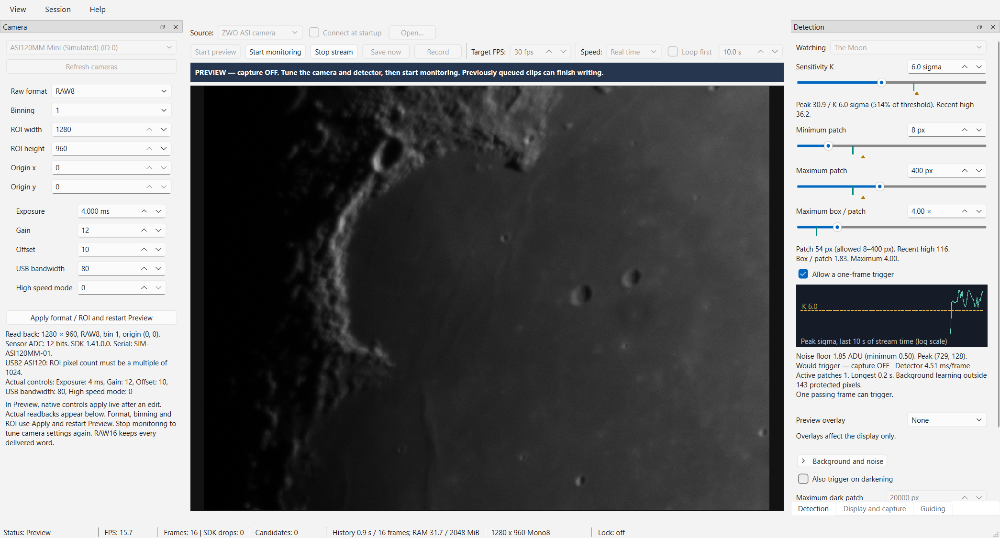

### 1.6 Seeing the image: stretch and histogram

What you set in the **Display** window (**Tools → Display** or **View → Display**) and in the histogram changes **only what you see**. The detector and the saved clips always use the camera's samples as they arrived.

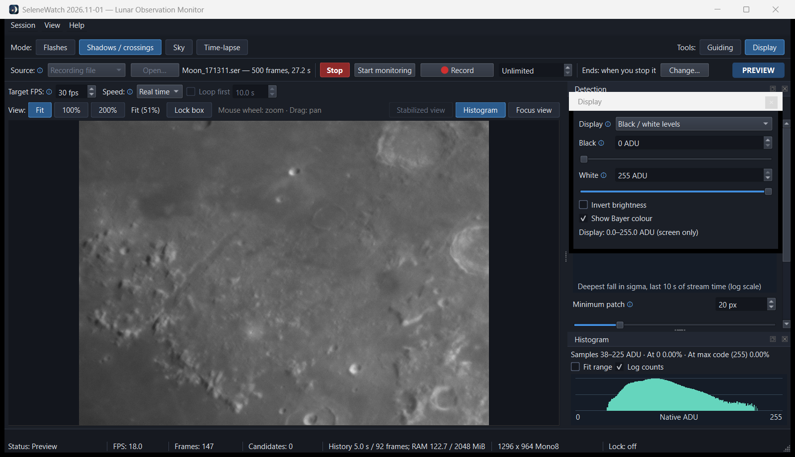

*The floating Display tool (**Tools → Display**) stretching a faint image on screen with Black / white levels while the histogram shows the camera's real values.*

- **Display:** **Linear** shows the full range; **Black / white levels** stretches between two values you set; **Auto-stretch** chooses them from the image. **Invert brightness** and **Show Bayer colour** are for viewing only.
- **The histogram** (**Histogram** on the preview bar, or **View → Histogram**) shows the camera's values before any stretch, with the share of pixels at zero and at the top of the range, where detail is lost.
- **Capture & storage** (**Session → Capture & storage…**) sets clip timing (**Pre-event history**, **Quiet tail**, **Maximum after trigger**), **RAM ceiling**, and **Disk reserve**, which take effect at the next Start.

The [camera settings guide](CAMERA_SETTINGS_GUIDE.md) suggests exposure, gain and histogram levels for each kind of observing.

### 1.7 Auto-tune

**Tune camera & detection…**, at the top of the Detection panel, opens a window that measures the Preview and suggests settings for what you are watching. It works only in Preview, and nothing changes until you apply a suggestion.

| Watching | What it measures | Aim |
| --- | --- | --- |
| Impact flashes (the earthlit side) | The earthshine | 3 to 10% of the camera's range, with the exposure between 10 and 40 ms |
| Shadows (the sunlit side) | The brightest sunlit areas | 60 to 80%, nothing saturated, exposure up to 10 ms, gain as low as possible |
| The sky (both watches) | The sky outside the mask | 8 to 30% |

1. **The earthshine (impact flashes only).** **Draw earthshine box** and drag a box on the earthshine. Auto-tune grows it to the whole earthshine and outlines it in purple. If that outline is wrong, **Measure only my box**.
2. **Step 1, the camera.** **Tune camera** sets the exposure and gain itself, in rounds of a few seconds: it measures, changes one setting, waits for the camera to report it back, and measures again, until the brightness is in the aim. For impact flashes and the sky, it then compares two gains by their measured noise, and keeps the one that shows fainter light. The panel lists every round. **Restore previous settings** undoes it; changing a setting yourself, or **Cancel**, stops it.
3. **Step 2, the sensitivity (K).** **Watch** runs several complete detectors on the same frames, at your K and the values around it, and counts what each would have saved. It suggests the lowest K that saved nothing. If something real passed (a meteor, a plane), tick it in the list so it is not counted against that K. **Apply K** sets the suggestion.
4. **Step 3, the minimum patch (impact flashes only).** From your seeing and the image scale, auto-tune works out how wide a flash is, adds one marked test flash just bright enough to pass K, and counts the pixels it covers. It then watches the noise at a few smaller minimum patches and suggests the smallest that stays quiet, no larger than that flash.
5. **Check with a test flash** (with testing tools on): adds one marked test flash and tells you whether it was caught.

**Why a test flash.** Watching quiet frames only measures false triggers, and on its own always argues for a less sensitive detector: a flash that is missed leaves no trace. A marked test flash of known brightness and size, added to the real frames, measures the other side: whether a flash is caught, and how faint a flash can be. Test flashes are marked as test data and never reach a recording.

**When to run it.** For the sky, in full darkness, not at dusk. For the Moon, when you start, and again once twilight has ended. Every applied change is recorded in the session's journal.

### 1.8 Ending a session by itself

The **Ends** row above the image says when Monitoring or a time-lapse will end by itself, for example *Ends: 04:55 local (02:55 UTC), the Moon below 10° · then the mount stops tracking*. While a session runs it counts down. **Change…** sets it:

- **When it ends:** at a local time; after a duration; **at dawn**, when the Sun rises above an altitude (−10° unless you change it); or, for the Moon, **when the Moon is below** an altitude (10°). Tick any of them: the first one met ends the session. Dawn and the Moon need the site's position ([1.4](#14-your-site-and-instrument)).
- **What the mount does then** (with a mount connected): **Stops tracking** or **Keeps tracking**. SeleneWatch asks the first time. On a German equatorial mount, hours of tracking unattended can turn the telescope into the pier, so if it keeps tracking, set the limits in the mount's driver. SeleneWatch never slews or parks the mount.

A session also ends by itself when the camera fails, when the disk reaches its reserve, or when guiding is lost ([chapter 6](#6-feature-lock-and-guiding)). The clip in hand, any recording and the report are finished first, the camera is closed, and the mount does what you chose. The reason is recorded with the session. **When you press Stop yourself**, the mount is left as it is: you are there.

### 1.9 Checking on SeleneWatch from your phone

While a session runs unattended, you can follow it from your phone's browser, for example from inside the house: whether it still monitors, whether the lock holds, and how many events it has caught. The page only shows; nothing on it changes SeleneWatch.

**Turning it on (once):**
1. Choose **Session → Status on your phone…** and tick **Show the status page on this network**. It is off until you do, and SeleneWatch remembers your choice.
2. The first time, Windows may ask whether SeleneWatch may use the network. Allow it on **private networks**.
3. Point your phone's camera at the QR code and open the link. Keep it as a bookmark: it stays the same from night to night.

The phone must be on the same network as the computer, normally your home Wi-Fi.

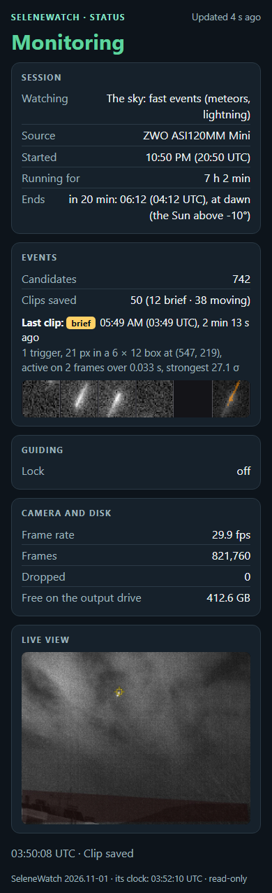

*The status page on a phone, here with sample data.*

**Finding the page.**
- **The address:** the QR code holds the computer's address, the port (8080 unless you change it) and an access key. **Copy address** copies it, to send to your phone another way.
- **More than one network:** if the computer has several, choose the one your phone is on under **Address**. Wi-Fi is listed first.
- **By name:** the dialog also shows the address by the computer's name (`http://<name>.local:8080/…`). It works on many phones, and keeps working if the router gives the computer a new address.
- **A new address:** if the router gives the computer a new address, scan the code again, or reserve the address in the router's settings.

**What it shows**, refreshed every 5 seconds:
- **The mode:** **Monitoring**, **Time-lapse**, **Preview**, **Stopped**, or a failure in red. The top corner says when SeleneWatch last answered, and turns red after 20 seconds without an answer.
- **The session:** the watch, the camera, when it started and when it ends; for a time-lapse, its stacks and the latest one.
- **This session's events:** the candidates, the clips by group ([chapter 8](#8-the-report-and-the-saved-files)), any clip not saved, and the last clip with its picture.
- **The camera and the disk:** the lock and guiding, the frame rate and dropped frames, and the free disk space.
- **The live view and the last message:** the image as the screen shows it, every 15 seconds, and the status bar's last message.

**Safety.** The page answers only devices on your local network, and only with the access key that is in the QR code. **New key…** makes a new key, so addresses saved with the old one stop working. The page shows nothing about where your site is.

**Away from home.** The page works only on the same network. Rather than opening a port on your router, install a private network app such as [Tailscale](https://tailscale.com) on the computer and the phone; its address then appears under **Address** too.

---

## 2. Watching the sky

Point a camera with a wide lens at the sky, start Monitoring, and SeleneWatch saves everything that appears where the camera points: meteors, lightning, aircraft, satellites, and things you did not expect. The next morning, a report lists them.

### How it works

SeleneWatch learns, pixel by pixel, how bright the sky normally is and how much it flickers. A pixel that suddenly rises well above its own flicker (by **K** times its noise) is marked, and a group of neighbouring marked pixels is a candidate. In Monitoring, each candidate is saved as a clip, with the frames from a few seconds before it to a few seconds after.

There are two sky watches, chosen under **Watching** at the top of the Detection panel. Each keeps its own settings:

| Watch | For | Exposures | Why |
| --- | --- | --- | --- |
| **The sky: fast events (meteors, lightning)** | Meteors, fireballs, lightning, aircraft and satellites, with their path frame by frame | Up to 40 ms (25 frames a second, as meteor networks use) | A meteor crosses a pixel in a few thousandths of a second. A longer exposure adds no more of its light, only more sky background and more noise. |
| **The sky: slow and faint (long exposures)** | Faint light that lasts: aurora, airglow, slow satellites, and a time-lapse of the night | Up to 2 s | Light that stays in place keeps adding up, so longer exposures show fainter light. |

What both share:
- **Long trails and lightning.** Patches may be large and long (up to 3000 pixels and 30 times longer than wide). A clip keeps 3 seconds before a trigger and up to 20 after, and a long event, such as an aircraft crossing for minutes, continues into the next clip.
- **The whole sky at once.** When a large share of the sky brightens at once (2% unless you change it), as with lightning or a bright fireball, that triggers too.
- **Stars that drift.** With a fixed camera the stars move slowly across the pixels. A patch that keeps firing for 20 seconds is learned into the background, so a drifting star or planet stops triggering, while anything fast still does.
- **A mask.** **Draw mask** and click around trees, roofs and streetlights; nothing is tested there. The saved frames keep those pixels as they were.
- **Following the sky's brightness.** **Follow the sky's brightness** adjusts the exposure, and then the gain, within limits you set, to keep the sky between 8 and 30% of the camera's range from dusk to dawn. It changes at most once every two minutes.
- **Ending at dawn.** **Ends → At dawn** stops Monitoring when the Sun rises ([1.8](#18-ending-a-session-by-itself)).

### Step by step

1. Enter your site's position under **Session → Site and instrument…** ([1.4](#14-your-site-and-instrument)), and choose your camera under **Source**.
2. Under **Watching**, choose **Fast sky events (meteors, lightning)** or **Slow & faint sky (long exposures)**.
3. Start Preview at night and draw a mask over the horizon:
   - **Draw mask**, click the corners of each area and double-click to close it (or drag for a rectangle). Turn **Draw mask** off when done.
   - **Save…** on the **Profile** row keeps these settings under a name; tick **Include horizon mask** to keep the mask with them, for a site of its own.
4. Set up the night:
   - **Change…** beside **Ends**: tick **At dawn**.
   - Tick **Follow the sky's brightness** and set its exposure and gain limits, or let auto-tune set them.
   - **Auto-tune**, in full darkness ([1.7](#17-auto-tune)), suggests the exposure, gain and K.
   - **Time-lapse while monitoring** (slow and faint watch only): keeps one frame every 30 seconds (or what you choose) as a lossless image, and builds a video of the night as it goes, ready when Monitoring stops.
5. Press **Start monitoring**. It runs until dawn, then stops by itself.
6. In the morning, choose **Session → Open last nightly report** ([chapter 8](#8-the-report-and-the-saved-files)). Start with the **brief** events: meteors are among them.

### What it looks like

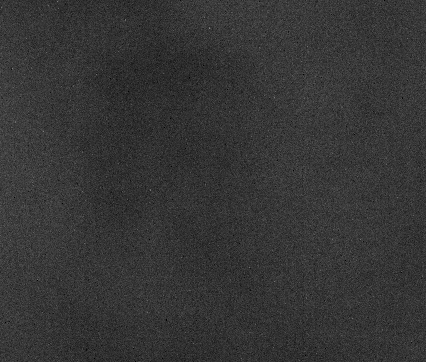

*A meteor caught by a fixed ZWO ASI120MM Mini on 21 November 2026 at 03:49:57 UTC, played at its real speed.*

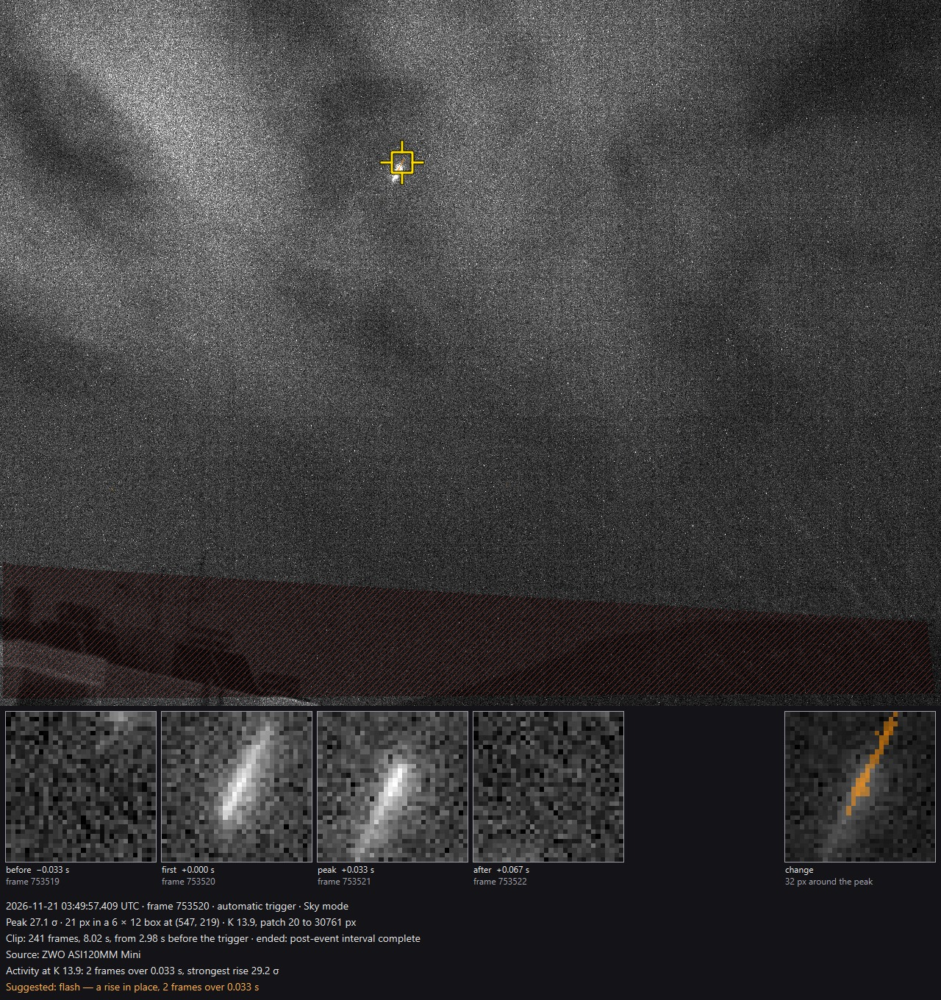

*The overview saved with each clip: the frame with what changed (orange) and the trigger marked, the frames before, during and after around it, and a line saying what was measured. The hatched area is the mask over the rooftops.*

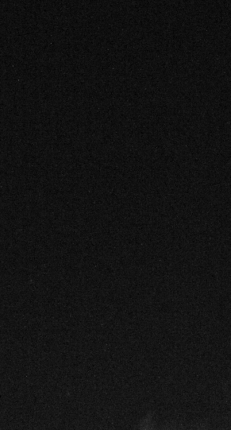

*A longer meteor caught by the same fixed ZWO ASI120MM Mini on 25 November 2026 at 22:05:24 UTC (30 ms exposures, 30 fps), cropped around its track and played at its real speed.*

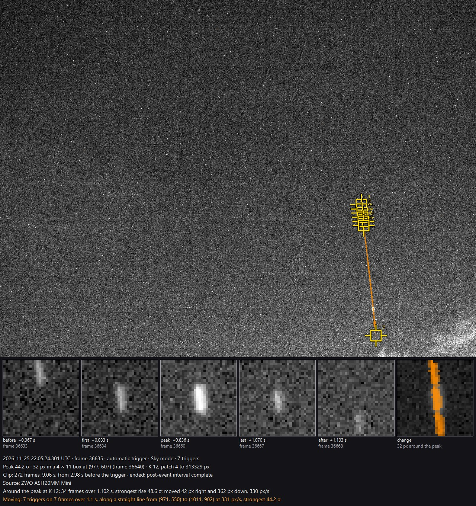

*Its saved overview: 34 active frames over 1.10 s, moving 42 px right and 362 px down (~330 px/s) with a 48.6 σ peak rise.*


*The report of that night: 55 clips became 25 events, grouped by what was measured. The brief events come first; their pictures are crops around each event, so a streak shows as a streak.*

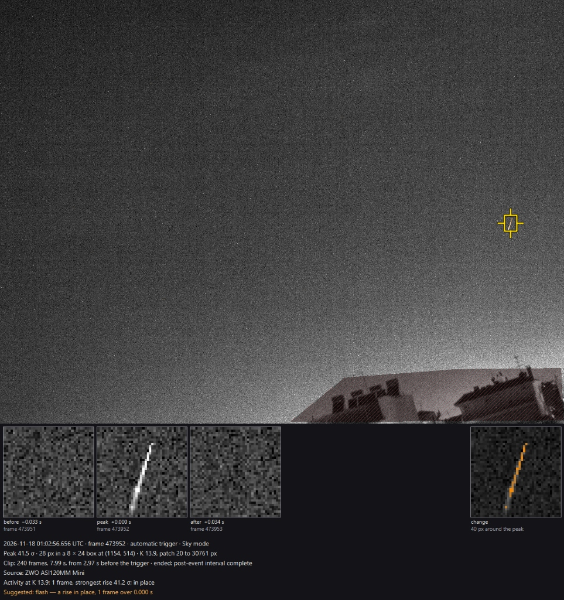

*Another real event from a night with the same camera: a streak on a single frame (18 November 2026, 01:02:56 UTC).*


*A mask drawn over the roofline. (The **Ends** setting has since moved above the image.)*

### Sky controls

| Control | What it does | Starting value |
| --- | --- | --- |
| **Watching** | The fast or the slow sky watch | — |
| **Sensitivity K** | How far above its own noise a pixel must rise | 6 |
| **Minimum / Maximum patch**, **Maximum box / patch** | How large a group of pixels may be, and how long and thin | 8 to 3000 pixels, 30 times |
| **Large brightening** | The share of the sky that, brightening at once, triggers | 2% |
| **Learn a patch after** | How long a patch may keep firing before it is learned | 20 s |
| **Mask** | Areas left out | None |
| **Follow the sky's brightness** | Keeps the sky between 8 and 30%, within your limits | Off |
| **Time-lapse while monitoring** | Slow watch: a frame every interval, and a video | Off, 30 s |
| **Pre-event history / Quiet tail / Maximum after trigger** (Session → Capture & storage…) | How much of the clip is kept before and after | 3 s, 5 s, 20 s |

---

## 3. Time-lapses of the Moon and the planets

Shadows lengthen across craters near the terminator, Jupiter turns in ten hours, its moons move from night to night. A time-lapse shows changes too slow to see at the eyepiece.

### How it works

- **Bursts at a fixed interval.** Every **Interval** (for example 60 seconds), SeleneWatch collects frames for the **Capture window** (for example 15 seconds), scores the sharpness of each, and keeps the sharpest (**Keep best**, at most **Max frames/period**).
- **Aligned and stacked.** The frames of a burst are aligned on each other and stacked; then each stack is aligned on the first:
  - **The Moon** is aligned by shift and rotation, inside the **lunar anchor** you choose: a steady, sunlit area. Without an anchor the whole frame is used, sky included, and a passing cloud can turn a stack wrongly. The panel warns in amber until you set one.
  - **A planet** is never rotated: each stack is shifted so the planet's disk stays where it was. Bright moons beside Jupiter count towards its centre, so the disk may wander by a pixel or two as they move.
- **Kept safely.** Each stack is saved at once as a 32-bit FITS file, as it is and sharpened, so a crash loses nothing finished. If processing ever falls behind, SeleneWatch skips a burst rather than fall further behind, and records it.
- **The output** (any combination of MP4, GIF and lossless SER) is built when the time-lapse ends, with the brightness of the stacks matched, so haze and thin cloud do not make it flicker. `timelapse.ser` keeps one frame per stack (linear 16-bit mono or RGB by default, with real UTC timestamps for SER Player; tick **Stretch SER (match MP4)** to bake in the MP4's stretch and gamma).
- **The field is kept in place.** The feature lock follows a crater or the planet's disk, and guiding corrects the mount ([chapter 6](#6-feature-lock-and-guiding)).

### Step by step

1. In Preview, frame the Moon or the planet. Use short exposures for sharp frames, and check with the histogram that the brightest parts are not saturated.
2. Lock on a crater, or on the planet with the lock box around the whole disk and some dark sky around it, and start guiding if you have a mount ([chapter 6](#6-feature-lock-and-guiding)).
3. Open **View → Time-lapse**:
   - **Target preset:** **Moon** or **Planet**.
   - **Interval** and **Capture window**. For a planet, keep the capture window short (a minute or so) so its rotation does not blur a burst.
   - **Moon: Lunar anchor → Select…** and drag a box around a sunlit area that will stay lit, with steady shadows, for the whole session.
   - **Sharpening**, **Stops** (when the session ends, or after a number of stacks; [1.8](#18-ending-a-session-by-itself)), and **Output**: MP4, GIF, SER (plus **Stretch SER (match MP4)** when SER is ticked), and frames per second.
   - **Also save raw SER bursts** keeps every stacked frame. It can fill a drive in one night, so it asks first and is off again the next time SeleneWatch starts.
   - **Also watch for transits** (Moon or Planet): watches for shadows between the bursts, with the shadows watch's settings ([chapter 4](#4-shadows-crossing-the-moon)).
4. Press **Start time-lapse** (on the command bar or in the right sidebar). Above the main preview, **Time-lapse view** switches between **Live camera**, **Latest stack**, and **Sequence loop** so you can inspect stacks or watch the sequence play back at full zoom and pan while capture continues. Below the preview, the collapsible **Latest stacks** thumbnail strip shows each completed stack—click any thumbnail to inspect it full-size in the main viewport. The sidebar shows each stack's progress, sharpness, shift, rotation, and any warnings.
5. When it ends, the panel shows the video being built. If you close SeleneWatch during a time-lapse, it asks first and finishes the video; **Close without video** leaves the stacks, and the video can be made later.

### Improving it afterwards

**Session → Re-sharpen time-lapse…** opens a finished time-lapse and works on its stacks without changing them:
- **Re-align stacks (optional):** re-align every saved stack onto a chosen reference stack before sharpening and exporting (never modifies the original `stacks/`):
  - **Feature box:** pick a reference stack, click **Draw feature box**, and drag a square around a crisp crater or steady region on the **Before** preview.
  - **Auto multi-point (rigid, Moon):** automatically selects crisp lunar features across the reference stack, tracks each point across the session, ignores moving shadows or passing clouds, and fits a rigid alignment.
  - **Correct rotation** (on by default for Moon sessions, off for planets) fits both shift and field rotation; untick it for shift-only alignment.
  - Switch **Preview stack** to any other stack to inspect its re-aligned result and measured shift/rotation live in **After** before rebuilding.
  - **Save re-aligned FITS stacks** (off by default) also saves the unsharpened re-aligned FITS stacks into the new run folder's `stacks/` subfolder so you can re-open it later to adjust sharpening without re-aligning again.
- **Sharpening:** sliders for the strength and width of the sharpening and for noise, with the stack before and after side by side, at any zoom.
- **Brightness:** match the brightness of the stacks, overall or also under patchy clouds (Moon).
- **Video tones:** **Auto stretch black/white** (on) picks the video's darkest and brightest levels from the sharpest clear stack; untick it to set **Black level** and **White level** yourself. **Gamma** brightens or darkens the middle tones.
- **Neutralize colour background** (colour stacks only, on by default): takes away each colour's own background level, so a blue daytime sky or light pollution does not tint the Moon, while a planet keeps its colour. It works with the automatic and the manual levels. Untick it to keep the colours as recorded. The video made at the end of a time-lapse uses it too.
- **Quality filter:** drop blurred or cloudy stacks. **Local rolling median** compares each stack's sharpness with the stacks around it, which suits a long session where the Moon's height and the shadows change slowly; **Session median** compares with the whole session; **Keep sharpest %** keeps the best share. The panel says how many stacks are kept and dropped. **◀ Dropped / Dropped ▶** steps through the dropped stacks, and the full-height **Frames / stacks** list on the left (toggled with **Inspect stacks**) lets you click or arrow through every stack and keep or drop any frame by hand.
- **Rebuild video only** makes the video again quickly from the sharpened stacks; **Re-generate time-lapse** sharpens (and re-aligns, if chosen) every kept stack into a new folder, beside the original ones. Settings can be saved as profiles.


*One sharpened stack of a Moon time-lapse, from 57 stacks a minute apart.*

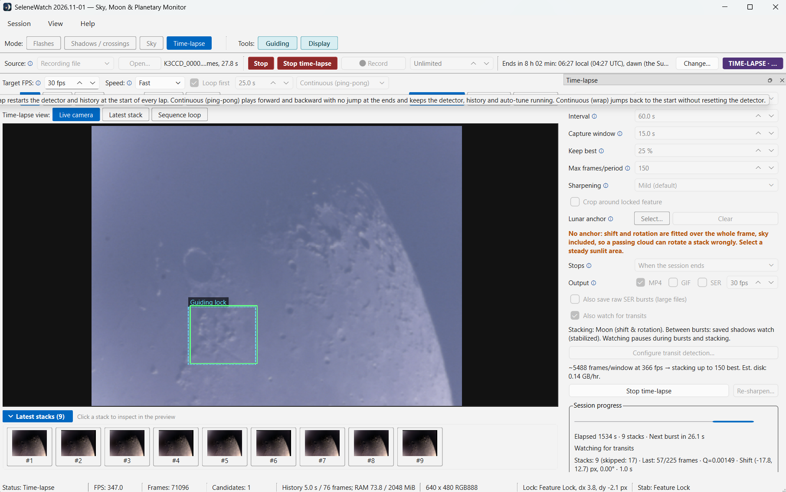

*Test run on a recorded lunar video (not a live time-lapse): Time-lapse mode with the **Time-lapse view** bar (**Live camera**, **Latest stack**, **Sequence loop**) above the preview, the **Guiding lock** box tracking the Moon, the **Latest stacks** thumbnail strip below, and the Time-lapse controls and session progress on the right.*

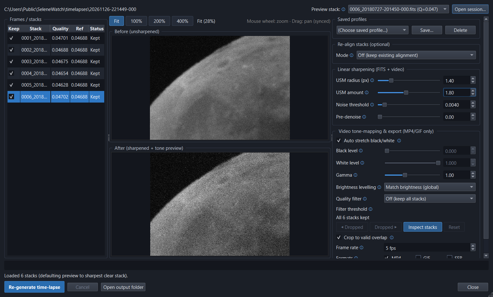

*Re-sharpening (recorded-video test run on the Alpine Valley region): the **Frames / stacks** list on the left, synchronized **Before (unsharpened)** and **After (sharpened + tone preview)** views at 146% zoom in the centre, and the sharpening, colour background neutralization, brightness levelling, and export settings on the right.*

### Watching for transits during a Moon time-lapse

With **Also watch for transits**, the shadows watch runs between the bursts and while a stack is made. The Time-lapse panel and the top of the Detection panel show whether it is watching, saving, or paused for a burst. A crossing during a pause can be missed. If a crossing clip is still being saved when a burst is due, the burst waits up to five seconds, or is skipped and recorded. **Open transit clips** opens the crossings saved during the time-lapse.

### Time-lapse controls

| Control | What it does |
| --- | --- |
| **Target preset** | Moon (aligned by shift and rotation) or Planet (centred on its disk, never rotated) |
| **Interval**, **Capture window** | How often a burst starts, and how long it collects frames |
| **Keep best**, **Max frames/period** | The share of frames kept, and the most kept (up to 200) |
| **Lunar anchor** | Moon: the area each stack is aligned on. Strongly recommended |
| **Crop around locked feature** | Crops each stack around the lock. Does not replace the lunar anchor |
| **Sharpening** | Off, Mild, Medium, or a saved profile |
| **Stops** | When the session ends, or after a number of stacks |
| **Output** | MP4, GIF and lossless SER (linear by default, or stretched to match MP4), frames per second |
| **Also save raw SER bursts** | Keeps every stacked frame (very large) |
| **Also watch for transits** | Moon or Planet: the shadows watch between bursts |

---

## 4. Shadows crossing the Moon

Aircraft, the International Space Station and satellites pass in front of the sunlit Moon as dark silhouettes. SeleneWatch can catch them in two ways: a watch that saves any crossing as it happens, and a recording at a time set in advance, for a crossing you know is coming.

### How the shadows watch works

**Shadows / crossings (Moon, Sun, planets)**, under **Watching**, looks only for pixels that get darker. Nothing that brightens triggers it: the bright surface shimmers with the seeing, and that would otherwise trigger all night (planetary shadow/crossing watching is experimental). Its starting settings are chosen to stay quiet on the sunlit Moon:
- **K 12**: a pixel must fall twelve times its own noise. On five recordings of the sunlit Moon, nothing triggered at this K.
- **A shadow of at least 20 pixels**, and up to 20 000 pixels, enough for a close aircraft.
- **One frame is enough**, so that the ISS and satellites are caught.

**Why one frame.** The ISS covers its own length, 109 metres, in about 14 ms, at any distance, and a satellite in less. So it shows on a few frames as it crosses the field, but each time hundreds of pixels further on: its shadow never appears twice in the same place. A watch that waited for the same shadow on two frames in a row would never catch it. On two recordings of the sunlit Moon, test ISS crossings at their real size and speed were caught 23 times out of 24 with one frame, and never with two; with either, nothing else triggered at K 12. Aircraft are slower (one takes about a quarter of a second to move its own length) and are caught either way. If seeing makes one-frame shadows on your nights, untick **Allow a one-frame trigger**: aircraft are still caught, the ISS and satellites no longer.

### Automatic: catching crossings as they happen

1. In Preview, frame the sunlit Moon, and lock and guide if you have a mount ([chapter 6](#6-feature-lock-and-guiding)).
2. Under **Watching**, choose **Shadows / crossings (Moon, Sun, planets)**.
3. **Auto-tune** ([1.7](#17-auto-tune)) measures the brightest sunlit areas, sets the exposure (up to 10 ms) and the gain, and suggests K. Keep K at 12 or higher on the sunlit Moon.
4. Set when the session ends ([1.8](#18-ending-a-session-by-itself)), for example when the Moon sinks below 10°.
5. Press **Start monitoring**. The readouts under K show the deepest fall and the largest shadow, and the graph plots the deepest fall against K. Each crossing is saved as a clip, with its path drawn in blue on its overview.

**Large darkening**, off at first, triggers when a large share of the frame darkens at once, such as a very close aircraft or a bird filling the frame.

### Planned: recording a predicted crossing

For an ISS transit or an occultation you know the time of, record every frame around it ([chapter 7](#7-recording-every-frame)): press **Record** shortly before, or set **Session → Schedule a recording…** with the predicted time and start Monitoring. Tick **Compare the PC clock with an NTP server** under **Session → Site and instrument** when the timing matters.

### What it looks like


*Sample data: a public-domain NASA lunar ISS transit sequence (16 March 2019, credit: NASA / Joel Kowsky, `NHQ201903160004`), replayed through the shadows watch at K 12 with a one-frame trigger. SeleneWatch detected all five crossing frames in a straight line (grouped as **Moving**, 220 σ deepest fall) and centred the crop strip on the ISS silhouette.*

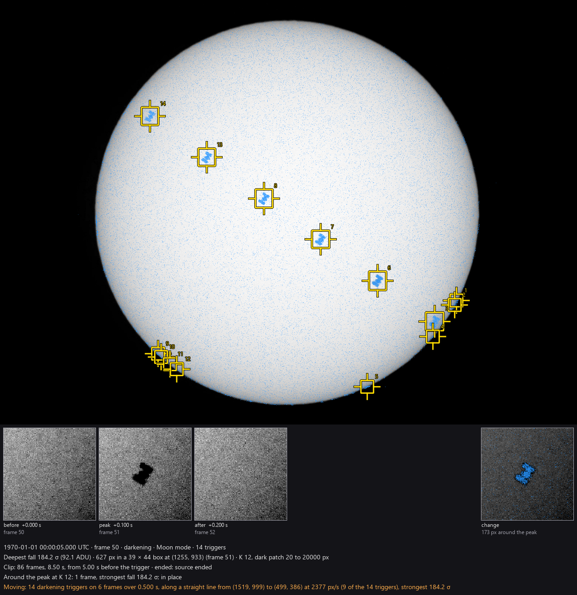

*Sample data: a public-domain NASA solar ISS transit sequence (24 June 2020, credit: NASA / Joel Kowsky, `NHQ202006240004`), replayed through the same shadows watch at K 12. All six crossing frames are marked in blue along a straight line (grouped as **Moving**, 184 σ deepest fall), with the ISS silhouette centred in the peak crop.*


*Test data: an ISS silhouette at its real size and speed for a 9.25-inch telescope (0.33″ per pixel, the ISS about 45° up), added to a real recording of the sunlit Moon, and saved by the shadows watch. It shows on three frames, far apart. No real transit was recorded here.*

### Shadows controls

| Control | What it does | Starting value |
| --- | --- | --- |
| **Watching** | **Shadows / crossings (Moon, Sun, planets)** *(experimental on planets)* | — |
| **Sensitivity K** | How far below its own noise a pixel must fall | 12 |
| **Minimum / Maximum patch** | The size of a shadow, in darkened pixels | 20 to 20 000 |
| **Maximum box / patch** | How long and thin a shadow may be | 10 times |
| **Allow a one-frame trigger** | On: one frame is enough, as the ISS and satellites need. Off: the same shadow must be seen on two frames in a row, which only aircraft and slower objects do | On |
| **Stabilize detection against drift/shake** | Aligns each frame to sub-pixel precision inside the detector before checking for shadows (raw saved SER frames stay untouched). Uses your active Feature Lock box if set, otherwise tracks the disk centroid or an automatic crater patch. Holds briefly through passing shadows and falls back cleanly to unstabilized detection if lock is lost. Adds ~1.5–2 ms/frame at 1280×960 (~7 ms/frame at 2128×2128) | Off |
| **Large darkening** | The share of the frame that, darkening at once, triggers | Off |

---

## 5. Impact flashes on the Moon's dark side

Small meteoroids hit the Moon all the time. On the night side, lit only faintly by sunlight reflected from the Earth (earthshine), a large enough impact shows as a brief flash, from a few hundredths of a second to a second. Watching for these **lunar impact flashes** is one of the ways amateurs contribute to the study of lunar transient phenomena. A flash seen by one observer is a candidate; it is confirmed when another observer recorded it at the same moment.

### How it works

SeleneWatch learns, pixel by pixel, the earthshine's brightness and its noise, over the last two seconds. A pixel that rises K times its own noise is marked, so the same K works on the quiet earthshine and on noisier areas. Marked pixels that touch form a patch; a patch of the right size and shape is a candidate. Because a flash can last a single frame, one frame is enough by default.

The sunlit side and its glare are left out (**Ignore brighter than**, 30% of the camera's range): no flash can be seen there, and its shimmer would only trigger falsely. The excluded area follows the Moon as it drifts. Tick **Show mask** right beside **Ignore brighter than** (or choose **Preview overlay → Excluded mask**) to shade the ignored pixels in red hatch on screen so you can verify that the earthshine is clear and the sunlit glare is covered.

### Step by step

1. In Preview, frame the earthshine. Keep most of the bright sunlit crescent outside the frame, so its glare does not spread, and keep enough lunar detail nearby to lock on ([chapter 6](#6-feature-lock-and-guiding)).
2. Check the brightness: with **Auto-stretch** to see the earthshine, and with the histogram, the earthshine should sit at about 3 to 10% of the camera's range, with no pixels at zero. The [camera settings guide](CAMERA_SETTINGS_GUIDE.md) explains why.
3. Under **Watching**, choose **Flashes (Moon, earthlit side)**.
4. **Auto-tune** ([1.7](#17-auto-tune)): draw a box on the earthshine, tune the camera, watch K, and measure the minimum patch. Auto-tune adds marked test flashes to work out how faint a flash can be caught.
5. Lock, and start guiding if you have a mount. Set when the session ends ([1.8](#18-ending-a-session-by-itself)), for example when the Moon sinks below 10°.
6. Press **Start monitoring**. If you see a flash by eye that was not caught, press **Save now** to keep the frames from just before.
7. When it ends, open the report ([chapter 8](#8-the-report-and-the-saved-files)).

To check your settings by hand, turn on **View → Testing tools**, click on the earthshine, and add a **Bright flash** test signal ([chapter 9](#9-test-signals)). The readout says whether it would trigger.

### What it looks like


*Sample data: the 17 March 2013 Mare Imbrium lunar impact flash recorded by NASA's Marshall Space Flight Center (Meteoroid Environment Office) and published by NASA's Goddard Space Flight Center (`SVS 11806`, public domain), replayed through the flashes watch. The crop strip shows the quiet surface before, the flash onset, the peak frame, the cooling tail across 12 frames (0.37 s, strongest rise 81.3 σ), and the change overlay.*

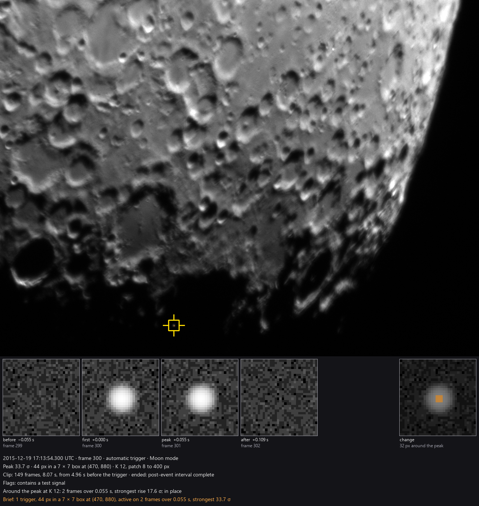

*Test data: a marked test flash added to the unlit part of the Moon, beyond the terminator, in a real recording, and the clip SeleneWatch saved, grouped as brief (K 12). No real impact was recorded here.*


*Adding a test flash on the dark limb in Preview: the graph of the strongest rise passes K, and the readout says it would trigger.*

### Flash controls

| Control | What it does | Starting value |
| --- | --- | --- |
| **Watching** | **Flashes (Moon, earthlit side)** | — |
| **Ignore brighter than** | Leaves out the sunlit side and its glare | 30% |
| **Sensitivity K** | How far above its own noise a pixel must rise | 6 |
| **Minimum / Maximum patch** | The size of a flash, in pixels | 8 to 400 |
| **Maximum box / patch** | How long and thin a patch may be | 4 times |
| **Allow a one-frame trigger** | A flash on a single frame triggers | On |
| **Stabilize detection against drift/shake** | Aligns each frame to sub-pixel precision inside the detector before checking for flashes (raw saved SER frames stay untouched). Uses your active Feature Lock box if set, otherwise tracks the disk centroid or an automatic crater patch. Falls back cleanly to unstabilized detection if lock is lost | Off |
| **Reference time**, **Minimum noise** | How quickly the background is learned, and the smallest noise assumed | 2 s, 0.5 |
| **Preview overlay** | Shows on screen the pixels above K (**Sigma map**), each pixel's noise (**Noise map**), or the pixels ignored by **Ignore brighter than**, a horizon mask, or the stabilized border (**Excluded mask**) | None |
| **Profile** | Saves and loads named detection settings | — |
| **Pre-event history / Quiet tail / Maximum after trigger** (Session → Capture & storage…) | How much of the clip is kept before and after | 5 s, 3 s, 10 s |
| **RAM ceiling / Disk reserve** (Session → Capture & storage…) | Memory for frames, and free disk space always left | 2048 MiB, 10 GiB |

---

## 6. Feature lock and guiding

For the Moon and the planets. Even with the mount tracking, the Moon drifts slowly across the sensor, and a mount's small errors add up over hours. The **feature lock** follows a crater or a planet's disk on the image, with or without a mount. **Guiding** sends the mount small corrections to keep it in place. Neither is used for the sky.


*Feature lock on a lunar crater with the floating **Guiding** tool (**Tools → Guiding**): the dashed cyan box marks where it was locked, the solid green box tracks the crater, and the instrument panel shows match score, drift speed, and the live 2D drift bullseye plot inside the tolerance circle.*

### Step by step

1. **Lock on a feature.** In Preview, open **View → Guiding**. **Draw lock box** and drag a box around a crater or other detail with contrast in both directions (not a straight limb or a flat sea), or click a point and **Lock at selection**. A planet (or a full-disk Moon or Sun): put the box around the whole disk with some dark sky; SeleneWatch automatically tracks it by **Disk centroid** rather than a fixed crater template ([section 6.1](#61-how-selenewatch-tracks-the-moon-sun-and-planets)). The box turns amber when the lock is briefly lost (clouds, a bump), and searches for it for **Lock lost after** (2 minutes unless you change it).
2. **Connect the mount.** Under **Mount**, choose **ASCOM telescope**, **Choose…** your driver, and **Connect**. Make sure tracking is on in the mount's driver: SeleneWatch never turns it on.
3. **Calibrate.** With the lock held, press **Calibrate** (about a minute). SeleneWatch measures how the field drifts on its own, then moves the mount a little west, east, north and south, and learns which way each axis moves the image. Calibrate again after a meridian flip.
4. **Start guiding.** **Tolerance** (3% of the frame's shorter side) is how far the feature may drift before a correction. Above the lock buttons, the live telemetry header (**Match score**, **Drift speed**, **Mount**) and the 2D **drift bullseye plot** show recent `(ΔX, ΔY)` offsets inside the tolerance circle so you can judge tracking stability at a glance. Secondary limits—**Give up at** (15%), **Aggressiveness**, **Max pulse**, and **Lock lost after**—sit inside the collapsible **Advanced guiding** section.

**What guiding never does.** It sends only guide pulses: no slews, syncs or parks. It stops by itself if the lock is lost, tracking stops, the mount flips, corrections stop working, or it would pulse too much. While guiding, a stop like this ends the session too ([1.8](#18-ending-a-session-by-itself)); stopping guiding yourself ends nothing. Every correction is recorded, and a candidate that happens during a correction is marked as such.

### Guiding controls

| Control | What it does |
| --- | --- |
| **Lock at selection**, **Draw lock box**, **Unlock** | Lock on a feature; the readouts show the drift and its speed |
| **ASCOM telescope** / **Simulated mount**, **Connect** | The mount to guide (the simulated one for practice with the synthetic Moon) |
| **Calibrate**, **Start guiding** | Learn the mount's directions; start correcting |
| **Tolerance**, **Give up at** | When corrections start (3%), and when guiding gives up (15%) |
| **Aggressiveness**, **Max pulse** | The share of the drift removed each time (85%), and the longest correction (3 s) |
| **Lock lost after** | How long a lost feature is searched for (2 min) |

### 6.1 How SeleneWatch tracks the Moon, Sun and planets

SeleneWatch aligns images in three places: **Guiding**, **Live detection stabilization** (**Stabilize detection against drift/shake** in the Detection panel), and **Time-lapse stacking**. Guiding and live detection stabilization share the same tracking engine and automatically pick between two methods based on what is inside the frame:

- **Disk centroid** — used when an isolated bright disk sits inside dark sky borders (planets such as Jupiter, Mars or Saturn, or a wide-field full Moon or full Sun). It tracks the geometric edge of the disk using a clipped-limb brightness weight, so planetary rotation (such as Jupiter turning over several hours), cloud-band changes, interior impact flashes and small shadow transits do not pull the centre away.
- **Feature Lock** — used when lunar terrain or craters fill the frame or the lock box. It matches the 2D crater pattern inside the lock box to sub-pixel precision.

| Task | How it tracks | Automatic or chosen by you? |
| --- | --- | --- |
| **Guiding** (mount corrections) | **Disk centroid** if your lock box encloses an isolated bright disk with dark sky borders; **Feature Lock** if your lock box lies on lunar terrain | Automatic from the box you draw |
| **Live detection stabilization** (optional, off by default) | **Disk centroid** on an isolated bright disk (even if you drew a guiding box around the planet); **Feature Lock** using your guiding box if it sits on lunar terrain, or an auto-picked crater patch if no lock box is set | Automatic from the frame and guiding box |
| **Time-lapse stacking** (burst alignment and video) | **Moon** aligns stacks by shift and rotation (with your lunar anchor); **Planet** centres each stack on the planet's disk without rotating | Chosen by you (**Target preset** in Time-lapse) |

**Drawing a guiding box on a planet vs. the Moon.** When guiding on Jupiter, Mars or Saturn, draw the lock box around the whole planet with dark sky around all four sides of the box. Both Guiding and Live detection stabilization recognize the isolated disk and track it by **Disk centroid**, while Time-lapse follows your **Planet** preset. When watching lunar craters or earthshine, draw the box on craters inside the lunar surface: both Guiding and Live detection stabilization use **Feature Lock** on your chosen crater.

**Multi-hour slow field rotation and changing lunar shadows.**
- **Disk centroid** is inherently unaffected by field rotation or planetary rotation over any session length.
- **Live detection stabilization** refreshes its **Feature Lock** reference periodically (while keeping the exact sub-pixel offset) so slow polar-alignment rotation and changing shadows over hours never break lock.
- **Guiding** with **Feature Lock** leaves its template untouched while correlation stays strong (85% or higher). If slow field rotation or changing shadows gently lower correlation into the 72–85% band for at least 5 seconds while locked, Guiding automatically refreshes the template (at most once every 5 minutes) while preserving the exact sub-pixel offset, preventing lock decay without introducing random-walk drift.

**Safety when lock is lost.**
- **Guiding** rejects a **Disk centroid** frame if bright disk pixels touch the edge of the search window or frame (preventing a clipped planet from sending a wrong guide pulse) or if passing clouds change the visible disk area sharply, handing over to the normal **Searching** / **Lock lost** safety rules.
- **Live detection stabilization** holds the last valid shift for up to 0.5 s during brief dips (such as a dark shadow crossing the lock region). If lock stays lost longer (clouds or a slew), it cleanly resets only the detector reference—keeping the pre-event buffer and any open clip intact—logs `registration_lost` in `session.txt`, and continues running normal unstabilized detection until 3 consistent matches re-lock cleanly. Raw frames in `event.ser` are always saved untouched.

**Where to see the active mode.**
- **Guiding panel:** shows **Locked (Disk centroid)** or **Locked (Feature Lock)**.
- **Detection panel** (below **Stabilize detection against drift/shake**): shows what stabilization chose and why—`Disk centroid (isolated disk)`, `Feature Lock (using guiding box)`, `Feature Lock (auto crater patch)`, `holding last shift`, or `lost — running unstabilized`—along with the live shift in pixels.
- **Time-lapse panel** (below **Also watch for transits**): summarizes both the stacking preset (**Moon** shift & rotation or **Planet** disk-centred) and whether between-burst shadow watching is stabilized or unstabilized.
- **Main window status bar:** shows the active lock method beside `Lock:` (e.g. `Lock: Disk centroid, dx …`) and, whenever detection stabilization is ticked, a compact `Stab: Disk centroid` / `Stab: Feature Lock` / `Stab: lost (unstabilized)` readout so you can check both even when docks are collapsed.
- **Stabilized view button** (in the **View:** bar above the preview, beside **Histogram**): when **Stabilize detection against drift/shake** is ticked, toggle **Stabilized view** on to shift the live preview (and any **Sigma map**, **Noise map**, or **Excluded mask** overlay) in lockstep with detector stabilization. This is display-only—raw recordings and `event.ser` clips are never altered—and mouse clicks or drawn boxes map automatically back to raw frame coordinates.

---

## 7. Recording every frame

**Record** writes every frame, as the camera delivers it, to a SER video with each frame's time. It works in Preview and in Monitoring:
- **Unlimited**, or a number of frames after which it stops by itself. While recording, the button turns into a red **Stop** that shows how long the recording is.
- **Session → Schedule a recording…** records from a time you set, for a number of seconds, by the frames' own times. It starts and stops on the exact frames, while Monitoring runs. Start a little before the predicted time.

Recordings made while monitoring are kept with that session; those made in Preview, under `recordings` in the output folder. If the disk gets too slow or too full, the recording stops cleanly and says why.

---

## 8. The report and the saved files

### The nightly report

Every Moon or sky monitoring session gets a folder of its own as soon as Monitoring starts, through midnight and through the exposure follower's restarts. When the session ends and its clips are written, choose **Open nightly report**, or later **Session → Open last nightly report**. The report is a page that opens in your browser, from the session's folder, without an internet connection.


**Events and groups.** A long crossing is saved as several clips of at most 20 seconds; the report shows clips that belong together as one event. Each event is in one of four groups, decided only by what was measured, never by what it might have been:

| Group | What was measured | Usually |
| --- | --- | --- |
| **Brief** | Everything in one place, within a fifth of a second | A meteor, a glint, a cosmic-ray hit, a flash, one blink of a strobe |
| **Moving** | Three or more triggers along one straight line, advancing in time (the speed may change), or one patch followed as it moved | An aircraft or a satellite; on the Moon, anything crossing it |
| **Wide** | A large share of the frame changed at once | Lightning, headlights or a torch, a cloud, a fireball's flare |
| **Other** | Anything else, described: in one place for longer, or spread out and not along a line | Seeing, cloud, a flickering light |

At the top, the report says how many events of each group the session has. Each event says what was measured, with frame counts, for example *1 trigger, 21 px in a 6 × 12 box, active on 2 frames over 0.033 s*. Its picture is the row of crops around it (before, during, after, and the change), so its shape shows; click it for the whole overview. **▶ Play GIF** plays its animation on the card (**Play all GIFs** plays every one; brief events play by themselves when there are few). An event made of several clips lists them, each with its own files.

**Opening the files.** **Open SER** opens the clip in the program Windows uses for SER files, such as SER Player, and **Show in folder** opens Explorer with the file selected. A browser cannot hand a file on your disk to another program itself, so these two links go through SeleneWatch: the browser asks once whether to open SeleneWatch, which opens the file and closes without a window. For safety they open only video, image and text files inside a monitoring session's folder.

**Coverage, setup and guiding.** The report also shows the camera, optics, detector, timing and stream health configuration, when monitoring was running, the night's timeline, any guiding summary and drift plot, any watch time-lapse, and any candidate that could not be saved. Clicking a preview image or file link opens it in a new browser tab. A star marks an event for follow-up; **Save marks** keeps the marks beside the report.

### What is in the output folder

```text
<output folder>/
    events/moon/ and events/sky/
        session-<UTC start>/
            report.html              the nightly report
            session.txt              monitoring intervals, detector settings and stream health
            candidates.txt           every candidate, saved or not, and every setting change
            guiding.txt              the lock and every guide correction (when used)
            autotune.txt             Preview auto-tune adjustments before the watch (when used)
            clips/<UTC>/             one clip: see below
            recordings/<UTC>/        recordings made while monitoring
            timelapse/               the slow sky watch's time-lapse
    recordings/<UTC>/                recordings made in Preview
    timelapses/<UTC start>/
        stacks/                      each stack, as 32-bit FITS
        sharpened/                   each stack sharpened
        timelapse.mp4, timelapse.gif, timelapse.ser  the video / SER sequence
        timelapse.txt                the settings, every stack, and why it ended
        transits/                    crossings saved during a Moon time-lapse
```

**Each clip** holds:

| File | What it is |
| --- | --- |
| `event.ser` | The frames as the camera delivered them, untouched, each with its time. This is the evidence. |
| `event.txt` | Everything known about the clip: the camera and its settings, the site and instrument, the clock check, each trigger and its measurements, the mask, guiding, each frame's time and any gap, whether it holds a test signal, and its group. |
| `00_overview.png` | The overview picture: what changed and where, the frames around it, and what was measured. For viewing only. |
| `01_baseline.png`, `02_event_peak.png`, `03_diff_annotated.png` | The frame before, the strongest frame, and the difference. For viewing only. |
| `04_event_preview.gif` | A short animation from just before to just after, at most 10 frames. For viewing only. |

**If SeleneWatch closes unexpectedly**, finished clips, the journal's lines, finished stacks and recordings up to their last second are kept. A clip that was still being written is listed as pending.

---

## 9. Test signals

With **View → Testing tools** on, the **Test flash** bar adds a known signal to the live or recorded frames, so you can see what your settings catch. Click on the image, choose a kind and press **Inject blip**:

| Kind | What it imitates |
| --- | --- |
| **Bright flash** | An impact flash: a small, round flash in one place |
| **Dark transit** | A soft round shadow moving slowly |
| **ISS silhouette (transit)** | The ISS crossing the sunlit Moon, at its real speed for the stream's frame rate: its outline of truss, solar arrays and modules, opaque, smeared by its motion and softened by the seeing. Its length defaults to the ISS about 45° up at your image scale (41″) |
| **Moving streak (meteor)** | A fast bright streak |
| **Blinking mover (aircraft)** | A slow light with a strobe |
| **Lightning** | The whole frame brightening |

Every frame a test signal touches is marked as test data, and so is every clip that contains it. Nothing is added while a recording runs. Turn testing tools off before observing for real.

---

## 10. Troubleshooting

| Problem | What to try |
| --- | --- |
| The camera is not listed under **Source** | Check the cable and the maker's driver, press **Refresh cameras**, and look at **Session → Camera support…**. For QHY, Player One and ToupTek, choose the maker's 64-bit library there. |
| **Start monitoring** is greyed out | The stream is stopped or finished, or a change of mode is under way. |
| A recording is refused | Compressed AVI files cannot be read. Convert to SER or uncompressed AVI. |
| *Reading the recording's index* | A large AVI without an index is being read through once; Preview starts when it is done. |
| The output folder is refused at Start | The drive is missing or cannot be written. Reconnect it or choose another folder under **Session → Output folder…**. |
| A recording stops: *disk too slow* or *disk reserve* | Use a faster local disk, a smaller region of interest or a lower frame rate, or free some space. |
| *RAM ceiling* or *writer busy* messages | Shorten **Pre-event history** or **Maximum after trigger**, use a smaller region of interest, or raise the **RAM ceiling**. |
| The sky watch triggers all night on one star | Check that **Learn a patch after** is on (20 s). |
| Too many candidates on the Moon | Raise K (12 or more for shadows on the sunlit side), keep **Ignore brighter than** on for flashes, or adjust the patch limits. The **Sigma map** overlay shows what passes K. |
| The shadows watch misses the ISS or satellites | Check that **Allow a one-frame trigger** is ticked ([chapter 4](#4-shadows-crossing-the-moon)). |
| The lock is refused: *one direction only* | Lock on a crater, not a straight limb or a flat sea. |
| Calibration fails, or guiding stops | Check that tracking is on, that guide pulses move the image, and calibrate again after a meridian flip. |
| A time-lapse skips periods: *processing fell behind* | Lengthen the interval, shorten the capture window, keep fewer frames, or crop. |
| A time-lapse warns *possible cloud* | The stack is still kept; drop such stacks later with the quality filter in **Re-sharpen time-lapse…**. |
| The phone's status page does not open | Check the phone is on the same Wi-Fi and that the dialog says **On**. If Windows asked about the network and it was refused, allow SeleneWatch under **Windows Security → Firewall & network protection → Allow an app through firewall**. If the computer's network is set to *Public*, set it to *Private*. If the computer has a new address, scan the code again. |
| *Not running: port 8080* | Another program uses that port: choose another **Port** and scan the new code. |
| The page says *The key is wrong* | A new key was made: scan the code again. |

---

## 11. What has been tested

| Area | How far it has been tested |
| --- | --- |
| **Watching the sky** | Automated tests with a synthetic sky and test signals, and **all-night use outdoors with a ZWO ASI120MM Mini**: meteors, aircraft, satellites and short flashes caught, a horizon mask, the exposure follower, and the report of the night |
| **Time-lapses** | Automated tests of stacking, alignment, rotation, planets, FITS files, the video and re-sharpening, recordings of the Moon and planets from 2010 to 2019, and **Moon time-lapses at the telescope** |
| **Shadows crossing the Moon** | Automated tests; test shadows added to five recordings of the sunlit Moon (no false trigger at K 12); test ISS silhouettes at their real size and speed on two of them (caught 23 times out of 24 with one frame, the default since then; never with two); public-domain NASA lunar and solar ISS transit sequences replayed at K 12 (both saved as Moving crossings). **Waiting for a real crossing at the telescope** and a predicted transit recorded on schedule |
| **Impact flashes** | Automated tests, test flashes added to real lunar recordings to measure the faintest caught, and NASA MSFC's public-domain 17 March 2013 Mare Imbrium lunar impact flash recording replayed through the flashes watch (detected across 12 frames, 81.3 σ). **Waiting for a calibrated night on the earthshine** |
| **Guiding** | Automated tests with a simulated mount, drift followed on lunar recordings, and the ASCOM simulator. **Waiting for a whole night of guiding under the Moon** |
| **Cameras** | ZWO ASI120MM Mini on the bench (8 and 16 bit, half-hour runs) and outdoors; QHYCCD 5L-II colour camera tested on hardware. Player One and ToupTek with automated tests and their libraries found on Windows; **waiting for real cameras** |
| **Auto-tune** | Automated tests on a model camera and the synthetic scenes; **waiting for real nights** |
| **Reading recordings** | 352 AVI and SER files from 2010 to 2019 read, with FireCapture's times |
| **The window** | Automated tests of the window offscreen, and tests on the real Windows desktop |

The design, the measurements and the history of each feature are recorded in [implemented features.md](implemented%20features.md) and [docs/](docs/).
