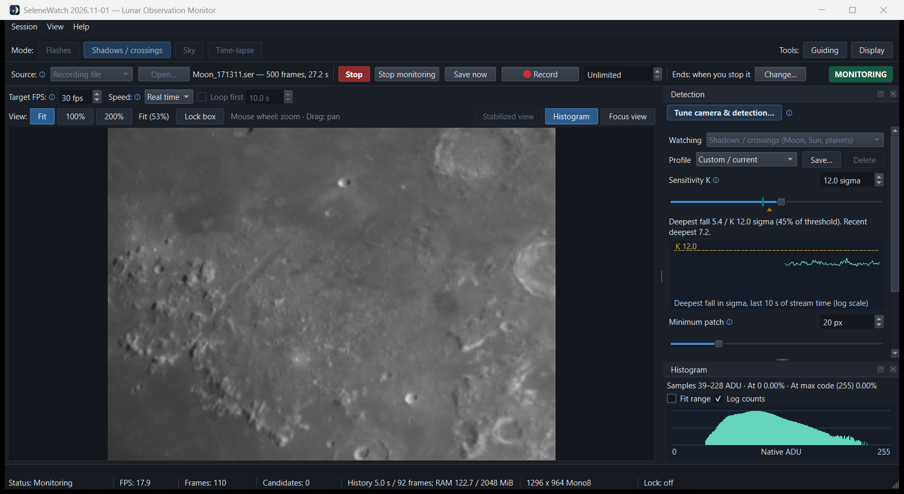
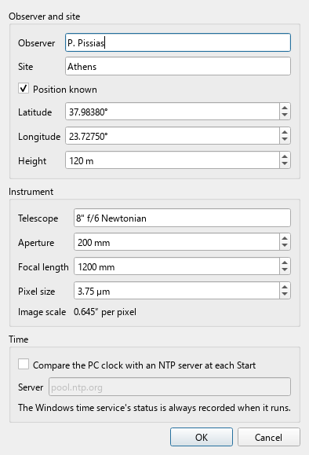
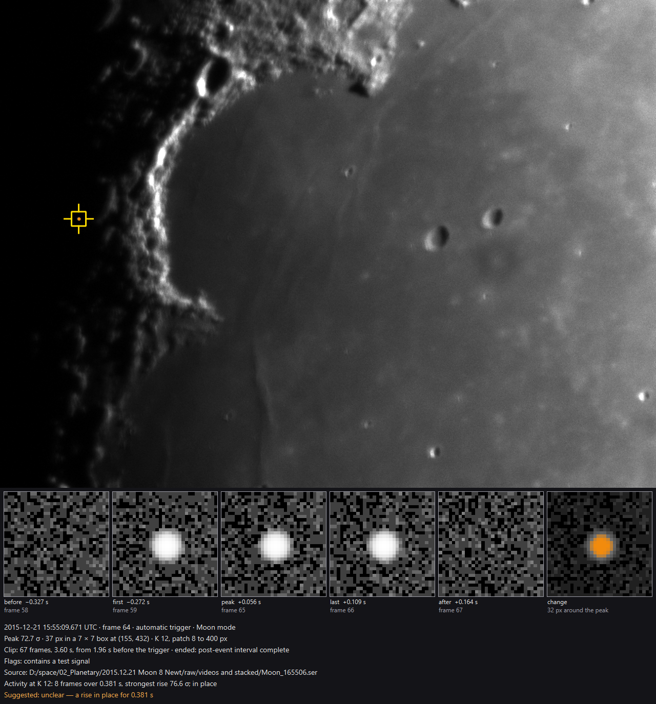
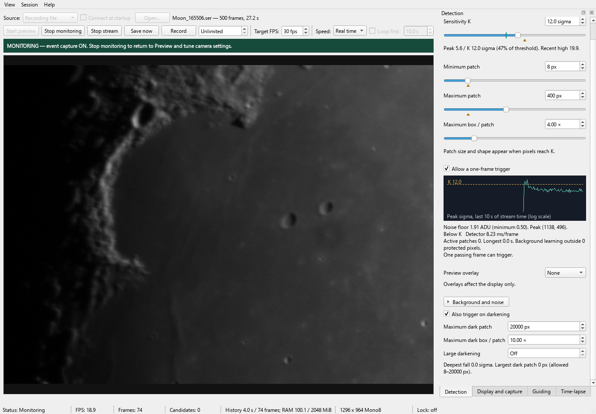
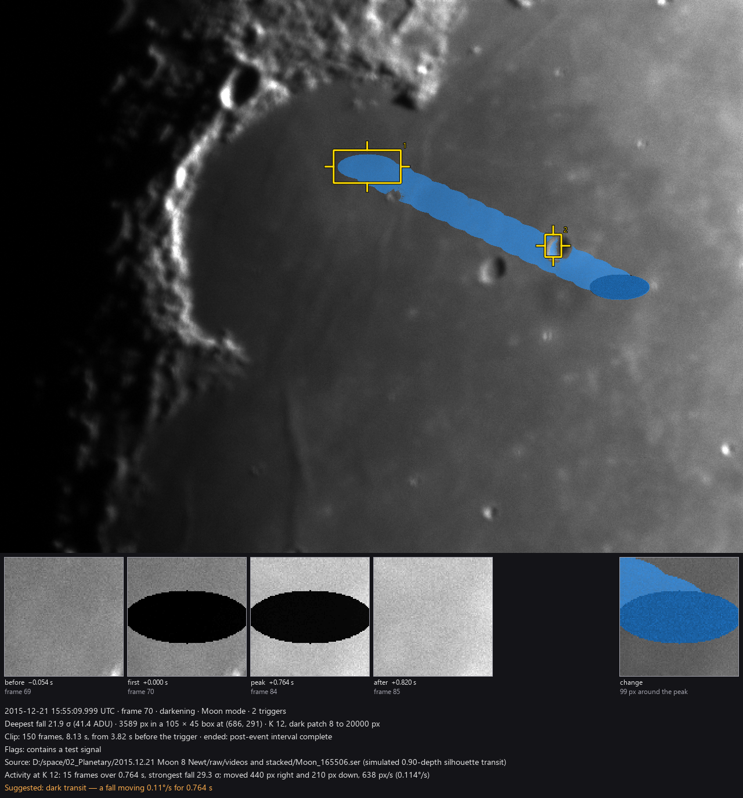

# SeleneWatch User Manual

SeleneWatch is a native Windows application for observing the Moon and the open sky with a telescope or wide-field camera (or replaying your own SER/AVI recordings). This manual walks from the main screen through common setup and into each of the four core observing workflows.

For building SeleneWatch from source, see [DEVELOPER.md](DEVELOPER.md). For architecture and evidence rules, see [PROJECT_DESCRIPTION.md](PROJECT_DESCRIPTION.md).

> **Candidates, not discoveries.** Automatic detections are *candidates* for human review, not confirmed discoveries. Confirming a lunar impact flash normally requires an independent simultaneous observation from another telescope or site. SeleneWatch keeps every candidate's raw frames, UTC timestamps, settings, and quick-look previews so comparison is straightforward.

---

## Contents

1. [The Main Screen at a Glance](#1-the-main-screen-at-a-glance)
2. [Common Setup & Connecting a Source](#2-common-setup--connecting-a-source)
   - [2.1 Computer, installation & camera drivers](#21-computer-installation--camera-drivers)
   - [2.2 Choosing your output folder](#22-choosing-your-output-folder)
   - [2.3 Site, instrument & clock accuracy](#23-site-instrument--clock-accuracy)
   - [2.4 Selecting a camera or recording & starting Preview](#24-selecting-a-camera-or-recording--starting-preview)
   - [2.5 Display stretch & the native-ADU histogram](#25-display-stretch--the-native-adu-histogram)
3. [Feature Lock & Mount Guiding (Shared for Lunar & Planetary Workflows)](#3-feature-lock--mount-guiding-shared-for-lunar--planetary-workflows)
4. [Workflow 1 — Lunar Flashes on the Earth-Illuminated Side](#4-workflow-1--lunar-flashes-on-the-earth-illuminated-side)
5. [Workflow 2 — Objects Passing in Front of the Moon (Shadows & Transits)](#5-workflow-2--objects-passing-in-front-of-the-moon-shadows--transits)
6. [Workflow 3 — Lunar and Planetary Time-Lapses](#6-workflow-3--lunar-and-planetary-time-lapses)
7. [Workflow 4 — Watching the Sky with a Fixed Camera](#7-workflow-4--watching-the-sky-with-a-fixed-camera)
8. [What SeleneWatch Saves (Folders, Clips & Logs)](#8-what-selenewatch-saves-folders-clips--logs)
9. [Troubleshooting](#9-troubleshooting)
10. [What Has Been Tested](#10-what-has-been-tested)

---

## 1. The Main Screen at a Glance



*The SeleneWatch main window running **Monitoring** on `Moon_181337.avi`, showing the top control bar, status banner, live preview, docked panels on the right, live histogram below, and the two-line status bar.*

From top to bottom, the main screen contains:

- **Menu bar:**
  - **View** — show/hide **Detection**, **Display and capture**, **Time-lapse**, **Guiding**, **Histogram**, camera docks, and toggle **View → Testing tools**.
  - **Session** — configure **Output folder…**, **Site and instrument…**, **Camera support…**, **Schedule a recording…**, **Re-sharpen time-lapse…**, or **Open the output folder**.
  - **Help** — **User Manual** (`F1`), **Tips**, **Acknowledgements**, **About SeleneWatch**, **About Qt**.
  - **New version … available** — appears at the top right only when the startup GitHub check finds a newer stable release. Click it to open [SeleneWatch releases](https://github.com/ppissias/SeleneWatch/releases) in your browser and choose a package. The check runs once per launch, has a four-second deadline, and stays silent when offline, when there are no releases, or when GitHub cannot be reached. It does not interrupt observing or install updates. Draft and prerelease builds are ignored.
- **Top bar:**
  - **Source** selector (`Choose a source…`, **Recording file**, camera families, and **Synthetic** when Testing tools are on), **Connect at startup**, **Open…**, and the amber **TESTING TOOLS ON** indicator when enabled.
  - Mode & capture buttons: **Start preview**, **Start monitoring** / **Stop monitoring**, **Stop stream**, **Save now**, **Record** paired with an optional frame limit (**Unlimited** = `0` or an explicit frame count), and (testing tools only) **Fixed flash**.
  - Timing/playback controls: **Target FPS**, **Speed** (`Real time` / `Fast` for files), and **Loop first … s**.
- **Mode banner:** a full-width colour strip immediately above the image showing which operating state SeleneWatch is in:

| Mode | Banner & what happens | Camera settings | Output written |
| --- | --- | --- | --- |
| **Preview** *(blue)* | Live analysis & ring buffer run; capture is OFF | Editable live | None unless **Record** is pressed (writes `recordings/<UTC>/` only) |
| **Monitoring** *(green)* | Automatic event detection & **Save now** active; optional **Record** / scheduled SER allowed | Locked for evidence integrity | `events/moon/` or `events/sky/`, `candidates.txt`, `guiding.txt`, plus optional `recordings/` |
| **Time-lapse** *(purple)* | Regular bursts of the sharpest frames stacked into 32-bit float FITS and MP4/GIF animations *(flash detection OFF)* | Locked | `timelapses/<UTC>/` (`stacks/`, `sharpened/`, `timelapse.mp4`/`.gif`, `timelapse.txt`, optional `raw/*.ser`) |

- **View bar & Preview canvas:**
  - **View bar (`Fit` | `100%` | `200%`):** immediately above the preview canvas. Switch between **Fit** (scales the full frame to the window), **100%** (actual sensor pixels `1:1`), and **200%** (`2×` actual pixels), or roll the **mouse wheel** over the image to zoom smoothly (`25%`–`800%`) around the cursor pixel. While zoomed in, **right-drag** or **middle-drag** pans across the frame.
  - **Preview canvas:** left-clicking selects a pixel (for local noise readout / **Test flash**), left-dragging locks on a crater (**Guiding**) or lunar anchor (**Time-lapse**), and clicking/dragging in Sky mode with **Draw mask** on defines horizon masks. Every click, drag, and overlay stays pixel-accurate at any zoom level.
- **Dock panels (right & bottom):** **Detection**, **Display and capture**, **Guiding**, **Time-lapse** share right-hand tabs (opening on **Detection** at startup); the active **Camera** dock opens on the left; **Histogram** opens below the preview.
  - *Help on every control:* hover a control for its explanation, or click the small **ⓘ** beside its name to show it. **Help → What's This?** (or `Shift+F1`) then a click on any control, including checkboxes and buttons, shows the same text.
  - *Small screens:* the source row and the buttons and playback controls above the preview wrap onto a second or third line when the window is narrow (for example on a 1366 × 768 laptop, or 1920 × 1200 at 125 % scaling), instead of shrinking until their text is cut off. The window can be made about 1100 pixels wide; to give the preview more room, close or float a dock.
  - *Mouse-wheel protection:* Spin boxes, sliders, and closed dropdowns across all panels and dialogs ignore mouse-wheel scrolls (forwarding them to the dock scrollbar instead) so you never accidentally alter **Sensitivity K**, exposure, or patch limits while scrolling a panel. When a control is focused, keyboard **Up / Down** arrow keys remain active for fine single-step adjustments.
- **Two-line status bar (bottom):**
  - Top line: latest status or action message across the full window width (hover if shortened).
  - Bottom line: **Status**, **FPS** & **Frames** (plus SDK dropped frames), **Candidates**, **History** & **RAM** usage (`used / ceiling MiB`), frame geometry/format (`1296 × 964 Mono8`), and **Lock** readout.

---

## 2. Common Setup & Connecting a Source

Complete these five setup steps before starting any of the four observing workflows. Detection, display, capture, histogram, guiding, and time-lapse preferences are saved automatically and restored on launch.

### 2.1 Computer, installation & camera drivers

- **Operating system:** Windows 10 or 11 (64-bit). SeleneWatch never blocks frame acquisition on disk writes, GUI drawing, or mount commands; a local SSD and adequate RAM (default 2048 MiB ceiling) support high frame rates.
- **Installing:** Releases ship in two forms (versioned e.g. `2026.11-01`):
  - `SeleneWatch-<version>-win64.msi` — installs per-user into `%LOCALAPPDATA%\SeleneWatch` with a Start Menu shortcut (no admin rights required). Uninstalling keeps all saved data in your output folder intact.
  - `SeleneWatch-<version>-win64.zip` — portable archive; extract into any writable folder and run `SeleneWatch.exe`.
  - Both ship Qt 6 (`LGPLv3`), OpenCV, CFITSIO, LGPL FFmpeg (`win64-lgpl-shared`), ZWO's ASI library, Visual C++ runtime DLLs, and licenses (`LICENSE.txt`, `THIRD_PARTY_LICENSES.md`, `licenses/`).
- **Camera drivers:** Install your camera vendor's Windows driver before connecting hardware:

| Camera family | What you need | Status |
| --- | --- | --- |
| **ZWO ASI** | ZWO's Windows driver. `ASICamera2.dll` ships with SeleneWatch. | Bench-tested (ASI120MM Mini) |
| **QHYCCD** | QHY's Windows *All-In-One* driver & SDK package. Discovered automatically when selected. | Built; hardware test pending |
| **Player One** | Player One driver + `PlayerOneCamera.dll` (x64). Discovered from N.I.N.A., 64-bit SharpCap, next to `SeleneWatch.exe`, or via **Choose Player One DLL…**. | Built; hardware test pending |
| **ToupTek & OEMs** *(Altair Astro, etc.)* | Camera driver + `toupcam.dll` (x64). Discovered from N.I.N.A., 64-bit SharpCap, ToupTek ASCOM x64, next to `SeleneWatch.exe`, or via **Choose ToupTek DLL…**. | Built; hardware test pending |

Use **Session → Camera support…** at any time while stopped to inspect all four camera families, discovered SDK paths/versions, and connected cameras, or to choose/reset a custom x64 DLL. **Mount (optional):** For Workflows 1–3, install the [ASCOM Platform](https://ascom-standards.org/) and your mount's ASCOM driver if you want automated pulse guiding.

### 2.2 Choosing your output folder

Open **Session → Output folder…** (while stopped) to set the single remembered root directory (default `%USERPROFILE%\SeleneWatch`) used across restarts and version upgrades (`settingsVersion = 1`). All SeleneWatch outputs organize cleanly beneath it:

```text
<output folder>/
    events/
        moon/<UTC>/      Lunar flash & darkening clips, candidates.txt, guiding.txt
        sky/<UTC>/       Sky watch clips, candidates.txt
    recordings/<UTC>/    Manual (Preview or Monitoring) and scheduled continuous SER files
    timelapses/<UTC>/    Lunar/planetary FITS stacks, sharpened FITS, MP4/GIF, timelapse.txt
```


***Session → Output folder…**: shows the unified output layout, checks live free space, and warns if a cloud-synced directory is selected.*

- **Use a fast local folder (SSD):** Avoid cloud-synced paths (`OneDrive`, `Dropbox`, `Google Drive`, `iCloud Drive`); SeleneWatch warns you if one is selected.
- **No silent fallbacks:** Before starting **Monitoring**, **Record**, or **Time-lapse**, SeleneWatch verifies the folder exists, is writable, and leaves at least your **Disk reserve** free. If the folder was deleted while **Preview** is already running, clicking **Recreate folder** in the prompt recreates it in place without stopping your preview stream. If an external drive is unplugged, it refuses with an error rather than silently writing elsewhere.
- **Session → Open the output folder** opens it in Windows Explorer. Read-only archive recordings you open are never modified.

### 2.3 Site, instrument & clock accuracy

Open **Session → Site and instrument…** once before serious observing:



***Session → Site and instrument…**: records observer metadata, computes image scale in arcseconds per pixel, and configures optional NTP clock checking.*

- **Observer and site:** Name, site label, and **Position known** (North latitude, East longitude, height in meters). Required for **Watch from dusk to dawn** in Workflow 4.
- **Instrument:** Telescope, aperture, focal length, and binned pixel size in microns. SeleneWatch calculates image scale (`″/px`) so clip overviews report moving object speeds in `°/s`. Telescope name also embeds in SER headers.
- **Time:** Windows Time service status is always logged at Start. Tick **Compare the PC clock with an NTP server at each Start** to measure PC clock offset via SNTP for multi-site lunar flash or occultation timing comparisons (off by default).

### 2.4 Selecting a camera or recording & starting Preview

1. With the stream stopped, pick your **Source**:
   - A camera family (**ZWO ASI**, **QHY**, **Player One**, **ToupTek**) — optionally tick **Connect at startup** so future launches pre-select it automatically. Press **Refresh cameras** in its dock and select your camera.
   - **Recording file** — click **Open…** and load an `.ser` file (8- or 16-bit mono with trailer timestamps) or uncompressed `.avi` file (`8-bit`, `Y800`, `24/32-bit RGB`, `YUY2`; compressed AVIs are refused). Matching FireCapture `.txt` logs automatically supply UTC start time, exposure, gain, and true mean duration/FPS. Use **Speed** (`Real time` / `Fast`) and **Loop first … s** for tuning and playback tests.
   - **Synthetic** *(via **View → Testing tools**)* — renders a built-in test scene without hardware: a cratered lunar disk with a moving pacing marker when **Watching** is **The Moon** (with configurable `Mono8` / `12-bit` / `16-bit` / `Bayer RGGB` format), or a starry night sky with realistic sensor noise and a dark tree/roofline horizon silhouette when **Watching** is **The sky**.
2. Press **Start preview**. Nothing is recorded to `events/` or `candidates.txt` while in Preview (unless you explicitly press **Record**).
3. In your **Camera** dock, adjust live controls (**Exposure**, **Gain**, **Offset**, **USB bandwidth**, high-speed mode) with the slider beside each one, or type an exact value in its box. The **Exposure** slider is logarithmic, so short exposures get as much of its length as long ones. Edits apply shortly in Preview (a drag reaches the camera once you pause), with **Settling** shown briefly as detection relearns. Changing **Raw format** (`RAW8`/`RAW16`), **Binning**, or **ROI** uses **Apply settings** and briefly restarts Preview.
   - **RAW16** preserves every bit delivered by the camera without truncation; sensor ADC bit depth is recorded separately in metadata.


*Connecting a camera: the **Camera** dock on the left lists requested vs. read-back geometry, **Refresh cameras**, and live controls during **Preview**.*

### 2.5 Display stretch & the native-ADU histogram

Everything in **Display and capture** (right dock tab) and **View → Histogram** affects **only what you see on screen**—raw SER pixels and the detector always receive unmodified linear samples.


*Adjusting **Black / white levels** (`18` to `115 ADU`) in **Display and capture** while **Histogram** displays the raw `0–141 ADU` distribution.*

- **Display modes:**
  - **Linear / high bits** — shows full dynamic range unstretched (shifted cleanly for high-bit sensors).
  - **Black / white levels** — adjust Black and White points in native ADU using sliders or spin boxes to reveal dim earthshine or deep shadows.
  - **Auto-stretch** — automatic percentile & midtones stretch computed from the frame.
- **Invert brightness** & **Show Bayer colour:** flip tones (helpful when inspecting faint features against bright skies) or live-debayer colour sensors on screen without debayering saved SER evidence.
- **Histogram (`View → Histogram`):** plots raw native ADU distribution before stretch/debayering (`Fit range`, `Log counts`) and displays the exact min/max range plus percentage of clipped pixels at `0` (`At 0`) and `max code` (`At max code`). For recommended exposure, gain, offset, and histogram targets across all four workflows (including the 3–10 % earthshine rule), see [CAMERA_SETTINGS_GUIDE.md](CAMERA_SETTINGS_GUIDE.md).

---

## 3. Feature Lock & Mount Guiding (Shared for Lunar & Planetary Workflows)

**Applicable workflows:** Workflow 1 (Lunar flashes), Workflow 2 (Transits/shadows), and Workflow 3 (Lunar/planetary time-lapses). *(Automatically disabled in Workflow 4: **The sky**).*

Even with lunar tracking enabled, the Moon moves continuously in declination (~0.25″/s) and polar/periodic mount errors push the disk across the sensor over minutes or hours. **Feature lock** tracks drift on screen even without a connected mount; **Guiding** sends gentle, bounded ASCOM pulse corrections to hold the target inside a configurable box.


***Guiding** dock locked onto a lunar crater (`State: Locked`): dashed rectangle marks the lock reference, solid green box tracks current position, and status bar shows live drift.*

### Step-by-step Feature Lock & Guiding

1. **Lock onto a feature:** In **Preview**, open **View → Guiding**. Either **drag a rectangle** around a crater or detailed region (contrast in two dimensions—avoid flat mare or straight limb edges) or click a point and press **Lock at selection** (`64 × 64 px` default box).
   - **Dashed box:** original locked position. **Solid green box:** current tracked feature (turns amber if temporarily missed; searches wider for 60 s during cloud/bumps before releasing).
   - **Unlock** releases by hand. A valid lock persists across Preview -> Monitoring transitions and stream restarts unless geometry changes.
2. **Connect a mount:** Under **Mount**, pick **ASCOM telescope** -> **Choose…** (select 64-bit out-of-process driver such as EQMOD, GS Sky, Device Hub, or ASCOM Simulator) -> **Connect**. Confirm **tracking is ON** in your mount's driver (SeleneWatch never turns mount tracking on/off). Use **Simulated mount** when practicing with the Synthetic source.
3. **Calibrate:** With a lock held and mount tracking, press **Calibrate** (~1 min). SeleneWatch pulses West/East, takes up Dec backlash, and pulses North/South to measure image axis orientation, drift, and pixels moved per ms of pulse. *Recalibrate if your mount performs a meridian flip.*
4. **Start guiding:** Set **Tolerance** (default `3.0 %` of shorter frame side—kept comfortably wider than ~1–2 px atmospheric seeing jitter) and press **Start guiding**.
   - **Gentle correction rule:** Corrections fire only when an axis leaves the tolerance box, removing 70% of error per pulse and settling before re-measuring. Dec pulses never reverse on small overshoots to avoid backlash oscillation.
   - **Safety bounds:** SeleneWatch sends **pulse-guide commands only** (no slew, sync, park, or rate changes), stops guiding automatically if the lock is lost, tracking turns off, pier side changes, 3 pulses fail to reduce error, per-minute pulse budget (`20 s/min`) is exceeded, or calibration moves `> 0.25 px/frame` (lower guide rate in your mount driver if refused).
   - **Evidence integrity:** Every pulse and once-per-second offset logs to `guiding.txt`. Any event candidate triggered during a pulse or settle interval stays saved and is marked `during_mount_correction=yes`. On real lunar data, guide corrections at `<= 0.25 px/frame` stayed quiet at `K ≥ 12`; check your guiding candidate rate on your first guided night before leaving unattended.

### Guiding Controls Reference

| Section | Control / Readout | Purpose |
| --- | --- | --- |
| **Feature lock** | **Lock at selection** / **Unlock** / drag box | Lock onto a 2D crater feature and inspect **State**, **Drift** (`dx`, `dy`), **Last match** score, and template quality |
| **Mount** | **ASCOM telescope** / **Simulated mount**, **Choose…**, **Connect** / **Disconnect** | Connects mount late-bound via ASCOM COM and displays tracking, slewing, park, pier side, and guide rates |
| **Guiding** | **Calibrate**, **Start guiding**, **Tolerance** (`% of field`) | Measures mount axes once per pier side and holds feature drift inside tolerance (`3 %` default) via bounded guide pulses |

---

## 4. Workflow 1 — Lunar Flashes on the Earth-Illuminated Side

### Functionality

SeleneWatch models every pixel's running mean brightness and noise variance over a sliding reference time constant (**Background and noise → Reference time**, default `2.0 s`), protected by a robust median-absolute-deviation frame noise floor (**Minimum noise**, default `0.5 ADU`). Because threshold **K** scales each pixel by its *own* local noise, one threshold handles quiet earthshine (where tiny faint flashes clear `K`) and turbulent sunlit rims simultaneously.

Passing pixels (`≥ K` above reference) are grouped into 8-connected patches, verified against **Minimum patch** (default `8 px`, rejecting single hot pixels), **Maximum patch** (`400 px`), and **Maximum box / patch** (`4.00 ×`, rejecting elongated seeing/edge artifacts), with configurable **Allow a one-frame trigger** (on by default so real 20–50 ms flashes are never lost). Triggered patches hold their reference box while the rest of the frame keeps learning continuously—meaning overlapping flashes at separate positions are still caught without going blind.

### Main Use Case

Continuous multi-hour patrolling of the Moon's dark earthshine limb to detect brief **meteoroid impact flashes** (20 ms–1 s duration) and save lossless SER video with pre-event baseline frames, exact UTC timing, visual overviews, and animated GIF previews ready for cross-observer confirmation.

### Step-by-Step Workflow

1. Connect your camera, set **Output folder** and **Site and instrument** ([Section 2](#2-common-setup--connecting-a-source)), and press **Start preview**.
2. Frame the dark earthshine side (keeping enough sunlit detail nearby if you plan to lock **Guiding** on a crater; [Section 3](#3-feature-lock--mount-guiding-shared-for-lunar--planetary-workflows)).
3. Under **View → Display and capture**, switch display to **Auto-stretch** or **Black / white levels** to inspect earthshine terrain while confirming in **Histogram** that the earthshine surface sits around **3–10 % of full scale** (`12–25 ADU` in `RAW8`, `2000–6500 ADU` in `RAW16`, with **`0.00 %` clipped at `0`**) and keeping most of the bright sunlit crescent outside the field to preserve headroom and minimize scattered glare (see [CAMERA_SETTINGS_GUIDE.md](CAMERA_SETTINGS_GUIDE.md) for detailed exposure, gain, and histogram recommendations). *(Adjust **Pre-event history** `5.0 s`, **Quiet tail** `3.0 s`, **Maximum after trigger** `10.0 s`, **RAM ceiling**, and **Disk reserve** while stopped if needed.)*
4. Open **View → Detection** with **Watching** set to **The Moon**.
   - **Saved detection profiles:** Use the **Profile** row right below **Watching** to load a saved lunar threshold configuration, or click **Save…** after tuning to store named presets (for example *"Earthshine quiet seeing"* vs. *"Terminator windy night"*).
   - **Optional sensitivity test:** Enable **View → Testing tools**, click on the earthshine area (zoom in to **100%** or **200%** if helpful), choose **Kind: Bright flash** in **Test flash** (`FWHM`, `Peak ADU`, `Duration frames`), and press **Inject blip** to verify the faintest flash your current **K** catches without false triggers. Remember to turn **View → Testing tools** OFF before a real observing run (`testing_tools="off"`).
   - Alternatively watch **Peak sigma** and the 10-second trace for ~1 minute in Preview: set **K** comfortably above normal quiet seeing peaks (often `8–16 sigma` depending on seeing and limb proximity; `6.0 sigma` is the starting value).
5. Turn on **Guiding** if using a mount, then press **Start monitoring**. If using a camera, SeleneWatch briefly reopens the camera with verified locked settings and relearns the reference (re-arm **Start guiding** after the reopen).
6. Leave Monitoring running. If you spot a flash or anomaly by eye that fell under threshold, press **Save now** to force a manual clip of the pre-event ring + post-event tail.
7. Press **Stop monitoring** then **Stop stream** when done, and review saved clips in `<output folder>/events/moon/<UTC>/` starting with `00_overview.png` and `04_event_preview.gif`.

### Screenshots


*Tuning **The Moon** flash detection in **Preview** (`Moon_165506.ser`): injecting a calibrated **Test flash** (`FWHM 4.0 px`, `Peak 140.0 ADU`, `8 frames`) at `(155, 432)` on the dark limb spikes the 10 s sigma graph past `K 12.0` (`Would trigger — capture OFF`).*



*Saved `00_overview.png` summary (`Moon_165506.ser` with injected flash): yellow trigger ticks on the dark limb, 6-panel strip (`before` -> `first` -> `peak` -> `last` -> `after` -> `change`), diagnostic caption, and `04_event_preview.gif` saved beside it in the same clip folder.*

### Detection & Capture Controls Reference

| Panel | Control | Purpose & Default |
| --- | --- | --- |
| **Detection** | **Watching** | Set to **The Moon** (editable while stopped; keeps Moon & Sky settings separate) |
| | **Profile** (`Save…` / `Delete`) | Save, load, or delete named detection profiles for the active target (`The Moon` or `The sky`) |
| | **Sensitivity K** | Rise threshold in noise units (`sigma`). Sliders show live teal mark (`now`) + amber recent 10 s peak (`6.0 sigma` default) |
| | **Minimum / Maximum patch** | Allowed connected bright-pixel count (`8 px` / `400 px`) |
| | **Maximum box / patch** | Bounding-box area ÷ pixel count compactness limit (`4.00 ×`) |
| | **Allow a one-frame trigger** | On = single-frame flashes trigger immediately; Off = requires 2 consecutive frames |
| | **Preview overlay** | Screen-only `None`, `Sigma map` (pixels `≥ K` red), or `Noise map` (ADU) |
| | **Background and noise** | **Reference time** (`2.0 s` exponential learning) & **Minimum noise** (`0.5 ADU` floor) |
| | **Peak sigma plot & readouts** | 10-second log trace, clicked-pixel noise, patch rejection reason, `Candidate — capture ON` |
| **Display & capture** | **Pre-event history** / **Quiet tail** / **Max after** | Source seconds kept before trigger (`5.0 s`), after activity (`3.0 s`), cap per clip (`10.0 s`) |
| | **RAM ceiling** / **Disk reserve** | Shared live frame ceiling (`2048 MiB`) and minimum free disk guard (`10 GiB`) |

---

## 5. Workflow 2 — Objects Passing in Front of the Moon (Shadows & Transits)

### Functionality

Objects silhouetted against the sunlit Moon (**ISS**, satellites, commercial aircraft, birds, bats) make pixels *darker* rather than brighter, while predicted events (**ISS transits**, **stellar/planetary occultations**, **grazes**) require every single frame captured continuously across a known UTC window. SeleneWatch supports **both**:

1. **Automated Darkening Detection (`Also trigger on darkening`):** Analyzes negative pixel excursions (`fall ≥ K × noise`) through an independent patch pass that **never merges rising and falling pixels**. Dark patches use separate silhouette-sized limits (**Maximum dark patch** `20000 px`, **Maximum dark box / patch** `10.00 ×`) plus an optional **Large darkening** full-field trigger (`Off` by default) for close aircraft or birds filling the frame. Overviews draw darkened trails in **blue** and suggest `dark transit`, while `04_event_preview.gif` loops up to 10 frames showing the crossing motion.
2. **Continuous & Scheduled Lossless SER Capture (`Record` / `Schedule a recording…`):** Streams every frame straight to `<output folder>/recordings/<UTC>/recording.ser` with per-frame `frames.txt` and `recording.txt` on a dedicated writer thread. Works manually in **Preview** or **Monitoring** with an **Unlimited** (`0`) or explicit **frame count limit** (`N frames`), or automatically at a predicted UTC start time and duration during **Monitoring** while flash/darkening detection continues uninterrupted.

### Main Use Case

- **Unplanned transits:** Leaving the camera watching sunlit or crescent lunar terrain to automatically catch surprise aircraft, bird, or satellite silhouettes crossing the disk (**Also trigger on darkening**).
- **Predicted ISS transits & occultations:** Capturing guaranteed, zero-skipped-frame continuous SER files around ephemeris predictions (either manually via **Record** in Preview/Monitoring or unattended via **Schedule a recording…**).

### Step-by-Step Workflow

#### Path A — Automated transit / shadow hunting (**Monitoring**)

1. Frame the sunlit Moon or limb in **Preview** (optionally enable **Guiding**, [Section 3](#3-feature-lock--mount-guiding-shared-for-lunar--planetary-workflows)).
2. Under **View → Detection**, ensure **Watching** is **The Moon**, then tick **Also trigger on darkening**.
3. Set **Sensitivity K** to **`12.0 sigma` or higher** for sunlit lunar terrain. Archive measurements show `K = 6` triggers heavily on sunlit crater-rim seeing, whereas `K ≥ 12` stays completely quiet on normal seeing while catching ~90%-darkness ISS and plane silhouettes.
4. Keep **Maximum dark patch** at `20000 px` and **Maximum dark box / patch** at `10.00 ×` (or enable **Large darkening** `~5%` only if hunting wide low-altitude aircraft/birds). *(With **View → Testing tools** on, you can rehearse this directly by choosing **Kind: Dark transit** in the **Test flash** bar, clicking the sunlit lunar disk, and pressing **Inject blip**).*
5. Press **Start monitoring**. Check the **Deepest fall / Largest dark patch** readout at the bottom of the Detection panel. Triggered events save into `events/moon/<UTC>/` (`kind=darkening`, blue track in `00_overview.png`, and `04_event_preview.gif`).

#### Path B — Predicted ISS transit or occultation (Manual or Scheduled SER Recording)

1. Verify **Session → Output folder…** points to a fast local SSD, and enable **NTP clock check** in **Session → Site and instrument…** if micro/millisecond timing comparison is needed.
2. Focus, set ROI/exposure/gain in **Preview**:
   - **Quick manual capture (Preview or Monitoring):** Leave frame limit at **Unlimited** (`0`)—or enter an exact frame count (`N frames`) to stop automatically—and press **Record** ~10 s before the transit/occultation. Press **Stop recording** afterwards (or let the frame count finish).
   - **Scheduled UTC capture (Monitoring):** Open **Session → Schedule a recording…**, enter the predicted **From** UTC time (start slightly early, e.g., −15 s) and **For** duration in seconds, press **OK**, and start **Monitoring**. SeleneWatch starts and stops the SER file on the exact frame timestamps and logs `recording_start`/`recording_stop` lines in `candidates.txt`.

### Screenshots



*Workflow 2 Detection configuration (`Moon_165506.ser`): **Sensitivity K** at `12.0 sigma` (zero false triggers on sunlit terrain), **Also trigger on darkening** enabled with `20000 px` / `10.00 ×` dark silhouette limits, plus **Record** / `Unlimited` in the top toolbar.*



*Example `00_overview.png` of a silhouette transit (`Moon_165506.ser` with an injected 0.90-depth crossing ellipse): blue trail across the sunlit Moon, `before / first / peak / after / change` crops, `Suggested: dark transit`, and `04_event_preview.gif` (`10 frames`, `286 × 212`, `282 KB`, `4 fps`).*

### Transit & Continuous Recording Controls Reference

| Panel / Bar | Control | Purpose & Starting Value |
| --- | --- | --- |
| **Detection** *(Darkening, Moon only)* | **Also trigger on darkening** | Enables negative-excursion patch detection (`Off` by default; `ChangeKind::Fall`). Hidden and off when **Watching** is **The sky**: against a night sky an object has nothing to darken |
| | **Maximum dark patch** | Largest dark silhouette allowed (`20000 px` default) |
| | **Maximum dark box / patch** | Silhouette bounding-box ratio limit (`10.00 ×` default) |
| | **Large darkening** | Triggers when this % of unmasked pixels falls by `K` at once (`Off` default) |
| | **Dark readout** | Live `Deepest fall ... sigma. Largest dark patch ... px` |
| **Top Bar & Session** | **Record** + Frame limit (`Unlimited` / `N frames`) | Lossless continuous SER writer in both **Preview** and **Monitoring** (`recordings/<UTC>/`); auto-stops cleanly on limit, Stop, or disk guard |
| | **Session → Schedule a recording…** | Arms a UTC `From` / `For` continuous recording triggered by frame timestamps during **Monitoring** |

---

## 6. Workflow 3 — Lunar and Planetary Time-Lapses

### Functionality

Watch planets turn and lunar shadows unfold. Time-lapse animations bring the slow changes of an observing session into view, from Jupiter's rotation to shadows moving across lunar craters.

Lunar and planetary time-lapses use short exposures at high frame rates, with the sharpest frames selected and stacked for each point in the sequence. SeleneWatch provides **Time-lapse mode** as an independent running state (**flash detection OFF**):

- **Fixed-cadence frame selection and stacking:** Every **Interval** (e.g. `60 s`), SeleneWatch collects incoming frames over your **Capture window** (e.g. `15 s`), scores sharpness on the target ROI in real time, and retains only the sharpest **Keep best %** capped at **Max frames/period (`100–200` frames max, hard cap 200)** so burst RAM stays bounded.
- **Overload skip protection:** Heavy two-pass subpixel phase correlation, Lanczos/bicubic resampling, sigma-clipped stacking, session alignment (**Moon** rigid translation + Alt-Az field rotation with optional **Lunar anchor**, or **Planet** limb-centroid centering), linear sharpening, and 32-bit FITS I/O run asynchronously on a dedicated worker thread. If processing ever falls behind the cadence or `MemoryBudget`, the pre-capture gate skips that period cleanly without dropping or queueing unbounded frames in RAM and logs it in `timelapse.txt`.
- **Linear FITS archive & Re-sharpen & Rebuild:** Every completed period writes unsharpened `stacks/*.fits` (`BITPIX = -32`) and linearly unsharp-masked `sharpened/*.fits` immediately so crashes never lose finished stacks. At stop (or stop condition / `Disk reserve`), FFmpeg builds `timelapse.mp4` (`libopenh264`, target-masked brightness levelling, valid-overlap cropping, stretch/gamma) and optional `timelapse.gif`. Afterwards, **Re-sharpen time-lapse…** lets you tune USM sharpening sliders and tone-mapping live on any session without overwriting `stacks/`.

### Main Use Case

Recording hours-long sequences of **lunar terminator crater shadows creeping across the Moon**, **Jupiter/Saturn rotation movies** (with Great Red Spot / cloud belts moving cleanly while the disk stays centered), or **lunar/solar eclipse sequences**.

### Step-by-Step Workflow

1. In **Preview**, frame the Moon or planet cleanly, tune exposure/gain for short, sharp frames (use **Histogram** so sunlit crater rims or bright cloud belts stay unclipped), and optionally lock & start **Guiding** on a Moon crater ([Section 3](#3-feature-lock--mount-guiding-shared-for-lunar--planetary-workflows)).
2. Open **View → Time-lapse**:
   - Select **Target preset**: **Moon** (default `25 %` best, `150` max frames/period, rigid translation + rotation alignment) or **Planet** (`15 %` best, `200` max frames/period, limb-centroid centering tolerant of surface rotation).
   - Set **Interval** (`≥ Capture window`), **Capture window** (for planets keep ≤ 60–90 s to avoid planetary rotation blur during one burst), **Keep best %**, and **Max frames/period** (`100–200`).
   - *(Moon optional)* Press **Select lunar anchor** and drag a box on the preview around a sunlit crater that will stay illuminated throughout your session, or tick **Crop around locked feature**.
   - Pick initial **Sharpening** (`Mild (default)`, `Off`, `Medium`, or saved custom profile), **Stop condition** (**Until I press Stop**, **Fixed duration**, **UTC end time**, or **Number of stacks**), and **Animation** outputs (**MP4**, optional **GIF**, FPS, optional raw SER burst archival).
   - **Also save raw SER bursts** writes every stacked frame of every burst to `raw/*.ser` and can fill a drive in one night (the dock's **Est. disk** line shows the rate). Ticking it asks for confirmation, and it is off again each time SeleneWatch starts. The time-lapse stops only when free space falls below the **Disk reserve** in **Display and capture** (10 GiB unless you change it; your value is remembered for each target); with the reserve at **None** it runs until the drive is full. A burst keeps a raw frame only while the RAM ceiling has room, so a full burst never stalls the camera.
3. Press **Start time-lapse**. Monitor **Latest stack**, **Filmstrip loop**, per-stack stats (`Q` quality, shift, rotation), and any overload/cloud/disk-reserve warnings.
4. After **Stop time-lapse** (or the stop condition), the dock shows **Building the video: n / N frames** while the MP4/GIF is assembled. Closing SeleneWatch during a time-lapse asks to stop it first, then keeps the window open with a progress dialog until the video is built; **Close without video** abandons only the video (the FITS stacks stay, and **Rebuild video only** makes it later). If stacking fails unexpectedly, the time-lapse stops on its own (not the program), records `error` and `stop_reason: internal error: …` in `timelapse.txt`, and still builds the video from the stacks already saved.
5. When finished, inspect `timelapses/<UTC>/timelapse.mp4` / `.gif`. Open **Session → Re-sharpen time-lapse…** (or **Re-sharpen…**) anytime to fine-tune sliders live (`Before` vs `After`), save reusable profiles, choose **Rebuild video only** for fast FPS/gamma/GIF adjustments, or **Apply to all** non-destructively into `<session>/sharpened_<profile>_<UTC>/`.

### Screenshots


*Live **Time-lapse** (`Moon_165104.ser`): pink **Lunar anchor** `(710, 380) 260 × 220 px` tracks `31.6 px` of drift while updating **Latest stack** and **Filmstrip loop** (`3 / 4`).*


***Re-sharpen time-lapse…** (`Moon_165104.ser`): defaults to the highest-quality FITS stack (`Q=0.00291`), featuring synced live sliders (`25 ms` coalesced updates + cached `Before` image) for non-destructive tuning and export.*

### Time-Lapse & Re-Sharpen Controls Reference

| Window | Control | Purpose |
| --- | --- | --- |
| **Time-lapse dock** | **Target preset** (`Moon` / `Planet`) | Switches inter-stack alignment strategy and fills keep-% / cap defaults |
| | **Interval** & **Capture window** | Fixed cadence `t_k = t_0 + k × interval` and burst sampling duration (`window ≤ interval`) |
| | **Keep best** & **Max frames/period** | Percentage retained per burst capped at `100–200` frames max (hard cap `200`) |
| | **Sharpening** | Linear profile (`Off`, `Mild`, `Medium`, or saved `Profile: ...`) |
| | **Lunar anchor** / **Crop around locked feature** | Moon sunlit anchor box for hours-long shadow shifts, or crop output around guiding lock |
| | **Stop condition** | **Until I press Stop**, **Fixed duration**, **UTC end time**, or **Number of stacks** |
| | **Animation** (`MP4` / `GIF`, `fps`) & **Save raw SER bursts** | End-of-session video formats and frame rate. Raw SER bursts (very large) ask for confirmation and are never remembered between runs |
| | **Session progress & preview** | Live bar, elapsed/countdown, stack telemetry, warnings, **Latest stack**, & **Filmstrip loop** |
| **Re-sharpen dialog** | **Linear sharpening sliders** | `USM radius (px)` (`0.30–15.0 px`), `USM amount` (`0.00–6.00`), `Noise threshold`, `Pre-denoise` |
| | **Video tone-mapping & export** | `Auto stretch`, `Black/White level` sliders, `Gamma`, `Brightness levelling`, `Drop below quality`, `Crop to valid overlap`, `MP4` / `GIF` / `fps` |
| | **Saved profiles** & **Rebuild video only** | Save/load reusable profiles; **Rebuild video only** re-encodes MP4/GIF fast from existing `sharpened/` FITS; **Apply to all** writes non-destructive `sharpened_<profile>_<UTC>/` |

---

## 7. Workflow 4 — Watching the Sky with a Fixed Camera

### Functionality

Switching **Watching** (at the top of **Detection**) from **The Moon** to **The sky** activates an independent wide-field detector profile engineered for unattended multi-hour sky patrols without affecting Moon settings:

- **Streak-friendly limits:** Starting thresholds allow larger patches (**Maximum patch** `3000 px`) and elongated diagonal tracks (**Maximum box / patch** `30.00 ×`) with `3 s` pre-event history, `5 s` quiet tail, and `20 s` post-trigger clip cap. Long events (aircraft crossing for minutes) chain into contiguous linked clips without repeating pre-event history.
- **Large brightening:** Triggers automatically as `kind=brightening` whenever at least **2 %** (editable) of *unmasked* pixels rise by `K` at once—catching lightning strokes and bright fireball flares while keeping noise statistics intact. Slow dusk/dawn brightness ramps adapt harmlessly.
- **Slow-drifter release (`Learn a patch after`):** Fixed cameras watch stars drift slowly across pixels. A patch firing continuously beyond `20 s` is released to learn into the background so drifting stars/planets fade cleanly, while fast meteors, aircraft, and satellites continue firing cleanly on fresh pixels.
- **Horizon polygon & rectangle masks (`Draw mask`):** Excludes trees, rooftops, streetlights, and passing headlights from both detection and noise estimation while saving the masked SER pixels completely unmodified for evidence.
- **Dusk-to-dawn automation & sky-following exposure:** Computes NOAA solar altitude every 30 s to start Monitoring automatically below **Sun below** (`−10°` default) and stop at dawn, and can step camera exposure/gain smoothly between user limits to keep sky background median inside `8–30 %` of full scale (logged as `exposure_change` in `candidates.txt`).
- **Triage & compact animated previews:** Every clip generates `00_overview.png` showing the full trajectory, `suggested_kind` classification (`meteor`, `lightning`, `aircraft`, `satellite`, `flash`, `seeing`, `unclear`), and `04_event_preview.gif` (`≤ 10` frames, `≤ 512 px`, `≤ 512 KiB`) for rapid morning scanning.

### Main Use Case

Leaving a fixed camera with a wide-angle or all-sky lens unattended overnight to automatically patrol from dusk to dawn for **meteors, fireballs, lightning, satellites, and aircraft**, ready to inspect the next morning via overviews and GIF loops.

### Step-by-Step Workflow

1. Confirm **Position known** with accurate latitude/longitude under **Session → Site and instrument…** ([Section 2.3](#23-site-instrument--clock-accuracy)) and select your camera under **Source** (optionally tick **Connect at startup**).
2. Under **View → Detection**, while stopped, switch **Watching** to **The sky** (Notice **Guiding** automatically shows `(Moon only)` and disables).
3. Press **Start preview** briefly at twilight or night, tune initial exposure/gain, and exclude horizon clutter:
   - Toggle **Draw mask** ON: click corners around trees, roofs, or streetlights and **double-click** to close a polygon (or **drag** for a rectangle; up to `16` shapes of up to `32` corners). Turn **Draw mask** OFF when finished.
   - **Saving Sky detection profiles:** When you click **Save…** on the **Profile** row in Sky mode, the dialog offers an optional **Include horizon mask** checkbox (unchecked by default). Leave it unchecked for sensitivity-only profiles that preserve whatever horizon mask you currently have drawn, or check it (`(+mask)`) to save a site-specific profile that restores its own horizon mask when selected.
   - **Testing indoors:** With **View → Testing tools** enabled and **Watching** set to **The sky**, the **Synthetic** source generates a realistic starry sky and horizon silhouette, and **Test flash → Kind** lets you inject **Moving streak (meteor)**, **Blinking mover (aircraft)**, **Lightning** (whole frame), or **Bright flash** inside or outside your mask.
4. Configure unattended options in **The sky** group:
   - Tick **Watch from dusk to dawn** and set **Sun below** (`−10.0°`). Below it the panel shows the Sun's altitude and when Monitoring next starts or stops, in the computer's local time with UTC in brackets (for example `Dawn stop at 2026-11-22 06:41 local time (05:41 UTC).`).
   - Optionally tick **Follow the sky's brightness** and enter safe **Exposure** (`from ... to ... ms`) and **Gain up to ... in steps of ...** bounds for twilight-to-midnight adaptation. Only these limits are yours to set. The rest is fixed, and the tooltip and the ⓘ beside **Exposure** repeat it:
     - The sky's median outside the mask is kept between **8 % and 30 %** of full scale.
     - Once it has been outside that band for **60 s**, one change is made. The exposure moves toward **15 %**, multiplied or divided by at most **2** per change. When the exposure is at your limit, gain moves by one step instead. A brighter sky lowers gain first, then shortens the exposure.
     - Changes are at least **120 s** apart.
     - With **Gain fixed** (the default), only the exposure changes.
     - While Monitoring, each change saves the clip in hand and restarts Monitoring with the new settings, a gap of a few seconds.
5. Either press **Start monitoring** immediately—or stop/leave Preview ready and let the **Watch from dusk to dawn** schedule arm Monitoring automatically once dusk arrives.
6. The next morning, open `events/sky/<UTC>/`: browse `04_event_preview.gif` and `00_overview.png` thumbnails plus `candidates.txt` (`suggested_kind=`) to review events quickly before opening full `event.ser` clips.

### Screenshots


***The sky** target in **Detection**: hatched red polygon **Mask** excludes the roofline/horizon, while **Watch from dusk to dawn** (`Sun below -10.0°`), **Follow the sky's brightness**, and streak limits (`3000 px`, `30.00 ×`) prepare an unattended night run.*


*Real overnight **Sky** capture with a fixed **ZWO ASI120MM Mini** (`2026-11-18 01:02:56.656 UTC`, frame `473952`): the hatched polygon mask at bottom right excludes rooftops and chimneys while a single-frame streak (`Peak 41.5 σ`, `28 px` in `8 × 24` at `1154, 514`, `K 13.9`) triggers a clean `240`-frame (`7.99 s`) clip.*


*Another real event from the same all-night **Sky** run (`2026-11-17 23:56:58.445 UTC`, frame `355544`): a compact flash/flare (`Peak 41.0 σ`, `27 px` in `6 × 8` at `234, 768`, `K 13.9`) captured cleanly across adjacent `before` -> `peak` -> `after` crop frames while masked buildings remain ignored.*

### Sky Watch Controls Reference

| Control | Purpose | Sky Starting Value |
| --- | --- | --- |
| **Watching** | Must be **The sky** (changes while stopped; isolated from Moon settings) | `The Moon` initially |
| **Large brightening** | Share of unmasked pixels rising by `K` in one frame (lightning / fireball flare) | `2.0 % of frame` |
| **Learn a patch after** | Releases persistent patches (e.g. slowly drifting stars/planets) back to background learning | `20 s` |
| **Mask** (`Draw mask` / `Clear`) | Polygon (click corners + double-click) or rectangle (drag) exclusion zones, up to 16 × 32 corners | None |
| **Watch from dusk to dawn** & **Sun below** | NOAA solar altitude scheduler starting/stopping capture automatically once per night | `Off`, `−10.0°` |
| **Follow the sky's brightness** | Auto-adjusts Exposure (within `ms` bounds, max 2× step) then Gain (up to `maxGain` by step) when median sky leaves `8–30 %` for 60 s (`≥ 2 min` cooldown) | `Off` (`1.00–2000.00 ms`, `Gain fixed`) |
| **Sensitivity K** / **Min & Max patch** / **Box / patch** | Tuned wider for meteor streaks across the field | `6.0 sigma`, `8–3000 px`, `30.00 ×` |
| **Capture history / tail / max** | Short pre-event history + longer tail to keep multi-stroke lightning & bright trails whole | `3.0 s` / `5.0 s` / `20.0 s` |

---

## 8. What SeleneWatch Saves (Folders, Clips & Logs)

All outputs reside inside your single chosen **Output folder** (**Session → Output folder…**, default `%USERPROFILE%\SeleneWatch`):

```text
<output folder>/
    events/
        moon/
            candidates.txt
            guiding.txt
            <UTC stamp>/          e.g. 20261115-143156-930/
                event.ser
                event.txt
                00_overview.png
                01_baseline.png
                02_event_peak.png
                03_diff_annotated.png
                04_event_preview.gif
        sky/
            candidates.txt
            <UTC stamp>/
                (same files as above)
    recordings/
        <UTC stamp>/
            recording.ser
            frames.txt
            recording.txt
    timelapses/
        <UTC start>/
            stacks/               0001_<UTC>.fits ... (unsharpened linear 32-bit float)
            sharpened/            0001_<UTC>.fits ... (linear sharpened; or sharpened_<profile>_<UTC>/)
            sharpening_profile.json
            timelapse.mp4
            timelapse.gif         (optional)
            timelapse.txt         (settings, stop_reason, one stack: line per stack, and skip / error /
                                   raw_ser_error / discarded lines for periods without a stack or SER)
            raw/*.ser             (optional raw burst archival)
```

### Inside each event clip (`events/moon/<UTC>/` & `events/sky/<UTC>/`)

| File | Purpose & Rule |
| --- | --- |
| **`event.ser`** | Primary lossless evidence at native 8-bit or 16-bit depth, untouched by stretches/masks/overlays, with per-frame UTC trailer timestamps. |
| **`event.txt`** | Complete self-describing sidecar: mode (`moon`/`sky`), source, camera geometry/exposure/gain, site/instrument, clock check, trigger measurements, mask, guiding state & overlapping pulses, per-frame index/UTC/gaps, test marks, overview/GIF status, ending with `complete: yes`. |
| **`00_overview.png`** | **Display only:** auto-stretched peak frame with cumulative changes (rises in orange, falls in blue), numbered yellow trigger marks, hatched mask (Sky), 6-panel tracking crop strip (`before` -> `first` -> `peak` -> `last` -> `after` -> `change`), speed in `px/s` and `°/s`, and `Suggested:` kind. |
| **`01_baseline.png`**, **`02_event_peak.png`**, **`03_diff_annotated.png`** | **Display only:** quick-look PNGs of the pre-onset frame, strongest peak frame, and pre-update positive reference difference. |
| **`04_event_preview.gif`** | **Display only:** compact looping animation (`4 fps`) covering `2` frames before onset through peak to `2` frames after end, capped at **10 frames maximum**, anchored to steady auto-stretch levels, and downscaled (`≤ 512 px` long edge, `≤ 512 KiB`) for rapid inspection of both lunar and sky clips. FFmpeg gets `30 s`; past that it is stopped and `event.txt` records `preview_gif: not written: FFmpeg did not finish within 30 s`, without delaying later clips further. |

- **`candidates.txt`:** Session log inside `events/moon/` and `events/sky/` recording every `session_start`, `candidate_pending`, final `clip=<folder>` or `not_saved=<reason>` outcome, `manual`, `contains_test_signal=yes`, `during_mount_correction=yes`, `recording_start`/`stop`, and `exposure_change`. Even if a clip is refused for RAM or disk reserve, its trigger remains logged.
- **`guiding.txt`:** Lock initialization, 1-second offsets, calibration vectors, and every guide pulse issued during Monitoring.
- **If SeleneWatch closes unexpectedly:** Completed clips (`complete: yes`), written `candidates.txt` lines, finished FITS stacks, and flushed continuous `recording.ser` headers up to the last second are preserved. Unfinished clips leave a `candidate_pending` record without `complete: yes`.

---

## 9. Troubleshooting

| Problem | What to try |
| --- | --- |
| Camera missing under **Source** | Check USB cable and vendor driver, click **Refresh cameras**, and inspect **Session → Camera support…** (or pick x64 vendor DLL for QHY / Player One / ToupTek; 32-bit DLLs cannot be loaded). |
| **Start monitoring** is greyed out | Source is stopped, finished, or currently transitioning modes (or check **Record** / **Time-lapse** state). |
| Recording file refused | Compressed AVIs are unsupported; convert to `.ser` or uncompressed `.avi`. |
| *"Reading the recording's index"* | Unindexed large AVI is being walked safely on a background worker thread; Preview starts once complete. |
| Output folder refused at Start | Configured drive is missing/unplugged or read-only. Reconnect or select a valid local SSD folder in **Session → Output folder…** (never writes to cloud-blocked or fallback folders behind your back). |
| Recording stops: *"disk too slow"* / *"disk reserve"* | Record to a faster local SSD, crop ROI, lower frame rate, or free space above **Disk reserve**. |
| *"RAM ceiling …"* / *"writer busy"* messages | Lower **Pre-event history**, **Max after trigger**, or ROI, or increase **RAM ceiling**. |
| Sky watch triggers all night on one star | Confirm **Learn a patch after** is enabled (e.g. `20 s`), or mount on a tracking equatorial mount. |
| Too many false candidates on Moon | Raise **Sensitivity K** (especially `K ≥ 12` when **Also trigger on darkening** is used on sunlit terrain), adjust **Minimum/Maximum patch**, or disable 1-frame triggers. Use **Sigma map** overlay to diagnose. |
| Lock refused: *"one direction only"* | Drag over a 2D crater feature rather than a straight lunar limb or flat mare. |
| Calibration fails / Guiding stops | Check ASCOM tracking is ON, verify guide pulses move the image, keep guide speed `≤ 0.25 px/frame`, and recalibrate after a meridian flip. |
| Time-lapse *"Processing fell behind interval"* | Overload gate cleanly skipped a period instead of stalling acquisition/RAM; increase **Interval**, shorten **Capture window**, reduce **Max frames/period**, or tighten ROI. |
| Time-lapse *"Sharpness dropped sharply (possible cloud)"* | Stack still saved to `stacks/`; raise **Drop below quality** in **Re-sharpen time-lapse…** when building final MP4/GIF. |

---

## 10. What Has Been Tested

| Area | Verification status |
| --- | --- |
| **Synthetic source, SER/AVI readers, detector, clip writing** | Automated CTest suites; verified across 352 archive AVI and SER files (FireCapture timestamps & unindexed walks) |
| **Event animated GIF previews (`04_event_preview.gif`)** | Automated `overview`, `sky`, and `darkening` tests verifying `≤ 10` peak-centred frames (`2 before .. 2 after`), `≤ 512 px` downscale, and `≤ 512 KiB` cap across Moon/Sky/Darkening clips; verified on `Moon_165506.ser` transit test |
| **ZWO ASI120MM Mini** | Bench-tested in `RAW8` & `RAW16`, live readbacks, byte integrity, two 30-minute soak runs, and all-night outdoor fixed-camera Sky Watch sessions |
| **QHYCCD, Player One & ToupTek adapters** | Automated tests with deterministic fakes + x64 DLL runtime probes on Windows; **physical camera hardware runs pending** |
| **Feature lock, calibration & ASCOM guiding** | Automated unit/simulation tests, archive drift tracking (`Moon_180548.avi`, `Moon_165104.ser`), `0.25 px/frame` pulse-detector study, and ASCOM OmniSim check; **live equatorial mount under the Moon pending** |
| **Workflow 1 — Lunar flashes** | Automated core/detection/window suites; archive sunlit-terrain measurements & test-injection brackets; **calibrated earthshine field run pending** |
| **Workflow 2 — Objects passing in front of the Moon & Continuous recording** | Automated `darkening` & `session_record` suites; archive darkening probe across 5 Moon recordings (`K ≥ 12`); **unplanned real lunar transit & scheduled ephemeris run pending** |
| **Workflow 3 — Lunar/planetary Time-lapse & Re-sharpen** | Automated 26-test `timelapse` suite (CFITSIO 2D/3D linear float FITS with strict `BITPIX` validation, OpenCV stacking/rotation/centroid, off-acquisition Bayer `RGGB`/`GRBG`/`GBRG` demosaicing, 12-bit high-aligned Mono16, parallel overload skip gate, `diskReserveBytes`, streaming FFmpeg MP4/GIF, preview-vs-MP4 parity, raw SER within the RAM ceiling, stacking errors that skip a period or stop only the time-lapse, cancelled video build, and `FakeZwoApi` camera time-lapse) & `ui` slider/rebuild, raw SER confirmation and close-while-finishing tests; checked on real lunar & planetary archive recordings |
| **Workflow 4 — Watching the sky (fixed camera)** | Automated `sky` & `sky_extras` suites (including synthetic Sky scene and meteor/lightning/dark-transit injections) **plus all-night outdoor fixed-camera runs on a ZWO ASI120MM Mini** (`K 13.9`, `patch 20–30761 px`, polygon horizon mask), capturing meteors/streaks, planes, cosmic rays, and brief flashes cleanly |
| **Unified Output folder, Profiles, Zoom & Windows GUI E2E** | Automated `core`, `session_record`, `display_capture`, `manual_capture`, `zwo`, `preview` (zoom/pan pixel accuracy), and 31-test `ui` suite (named detection profiles with optional Sky mask, `WheelGuard`, in-place output folder recreation during Preview), plus real Windows UI Automation E2E verification (`tests/gui_e2e_test.ps1`) |

Full design specs, validation reports, and feature histories are recorded in [implemented features.md](implemented%20features.md), [features.md](features.md), and [docs/](docs/).
