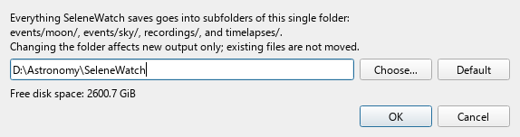
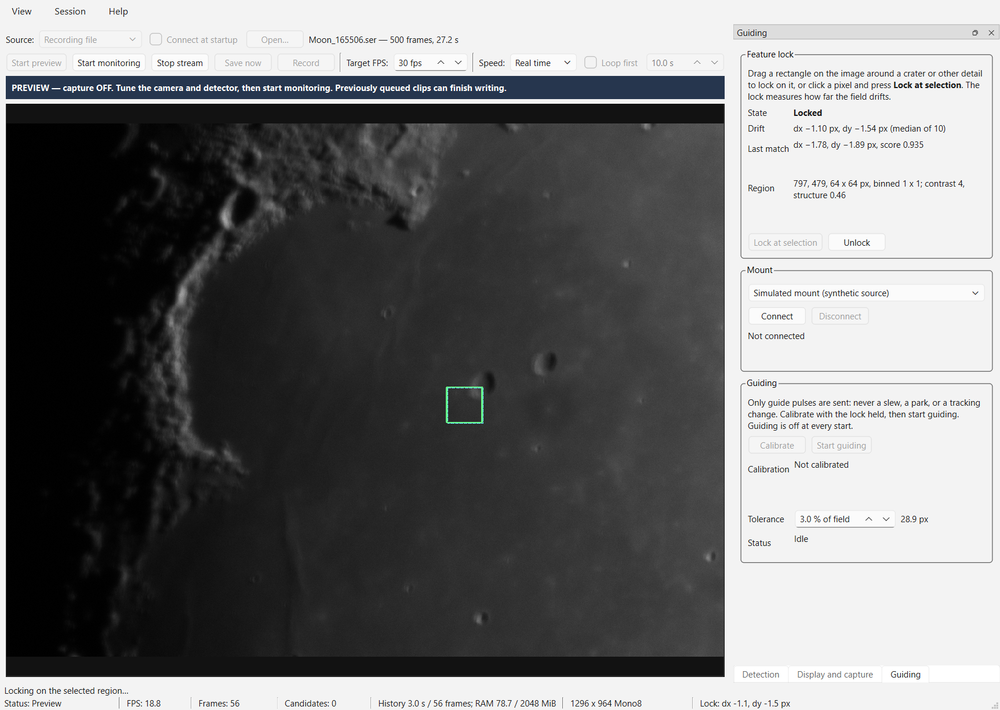
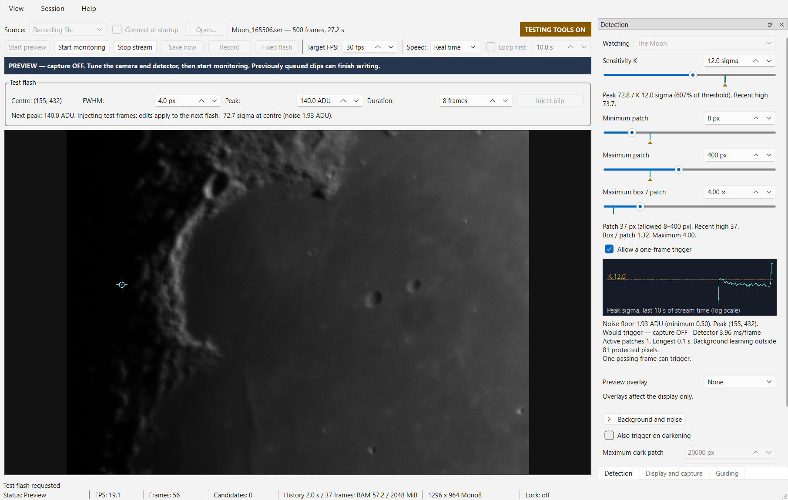
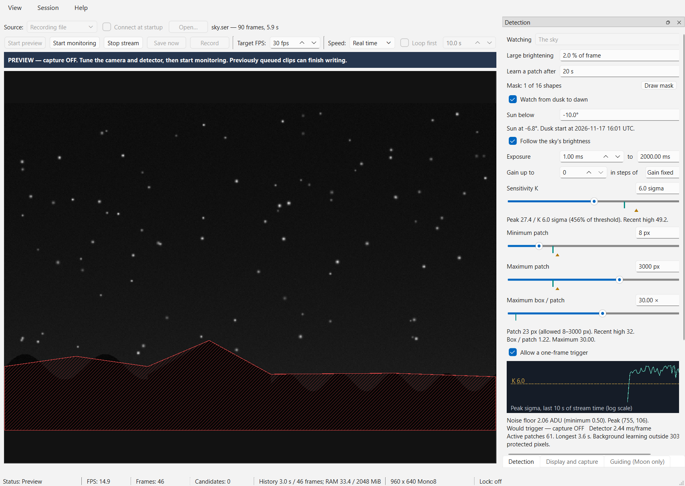
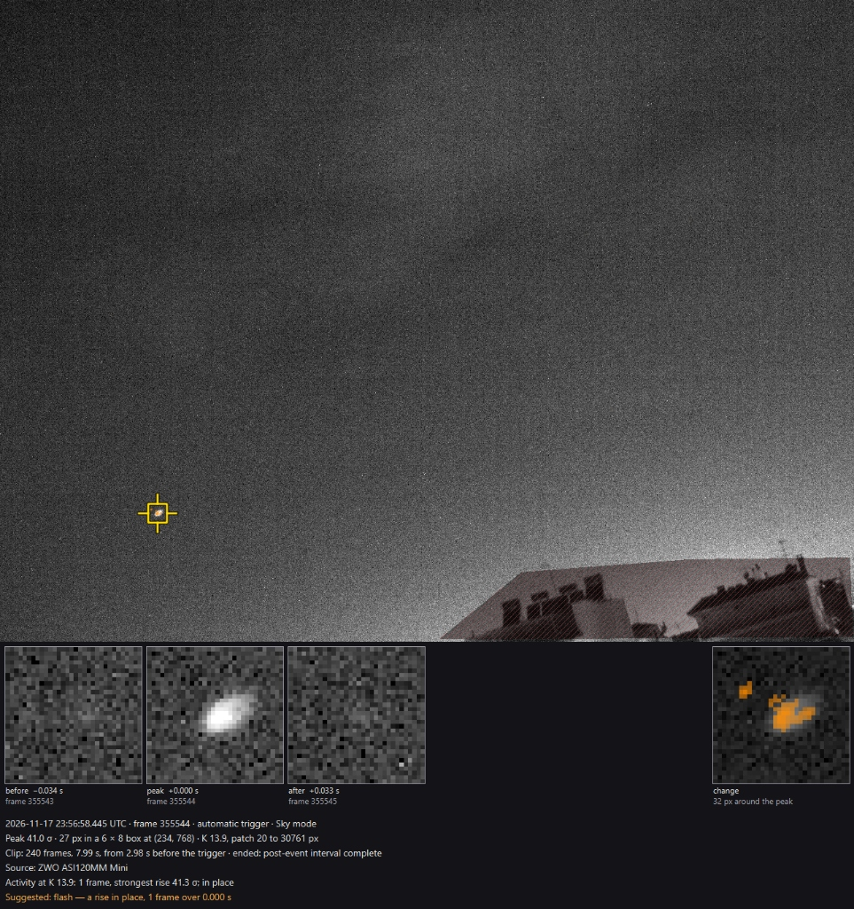

# SeleneWatch User Manual

SeleneWatch is a native Windows application for observing the Moon and the open sky with a telescope or wide-field camera (or replaying your own SER/AVI recordings). This manual walks from the main screen through common setup and into each of the four core observing workflows.

For building SeleneWatch from source, see [DEVELOPER.md](DEVELOPER.md). For architecture and evidence rules, see [PROJECT_DESCRIPTION.md](PROJECT_DESCRIPTION.md).

> **Candidates, not discoveries.** Automatic detections are *candidates* for human review, not confirmed discoveries. Confirming a lunar impact flash normally requires an independent simultaneous observation from another telescope or site. SeleneWatch keeps every candidate's raw frames, UTC timestamps, settings, and quick-look previews so comparison is straightforward.

---

## Contents

1. [The Main Screen at a Glance](#1-the-main-screen-at-a-glance)
2. [Common Setup & Connecting a Source](#2-common-setup--connecting-a-source)
   - [2.1 Computer, installation & camera drivers](#21-computer-installation--camera-drivers)
   - [2.2 Choosing your output folder](#22-choosing-your-output-folder)
   - [2.3 Site, instrument & clock accuracy](#23-site-instrument--clock-accuracy)
   - [2.4 Selecting a camera or recording & starting Preview](#24-selecting-a-camera-or-recording--starting-preview)
   - [2.5 Display stretch & the native-ADU histogram](#25-display-stretch--the-native-adu-histogram)
   - [2.6 Auto-tune: suggested camera settings and K](#26-auto-tune-suggested-camera-settings-and-k)
   - [2.7 Ending a session unattended](#27-ending-a-session-unattended)
3. [Feature Lock & Mount Guiding (Shared for Lunar & Planetary Workflows)](#3-feature-lock--mount-guiding-shared-for-lunar--planetary-workflows)
4. [Workflow 1 — Lunar Flashes on the Earth-Illuminated Side](#4-workflow-1--lunar-flashes-on-the-earth-illuminated-side)
5. [Workflow 2 — Objects Passing in Front of the Moon (Shadows & Transits)](#5-workflow-2--objects-passing-in-front-of-the-moon-shadows--transits)
6. [Workflow 3 — Lunar and Planetary Time-Lapses](#6-workflow-3--lunar-and-planetary-time-lapses)
7. [Workflow 4 — Watching the Sky with a Fixed Camera](#7-workflow-4--watching-the-sky-with-a-fixed-camera)
8. [What SeleneWatch Saves (Folders, Clips & Logs)](#8-what-selenewatch-saves-folders-clips--logs)
9. [Troubleshooting](#9-troubleshooting)
10. [What Has Been Tested](#10-what-has-been-tested)

---

## 1. The Main Screen at a Glance


*The SeleneWatch main window running **Monitoring** on `Moon_181337.avi`, showing the top control bar, status banner, live preview, docked panels on the right, live histogram below, and the two-line status bar.*

From top to bottom, the main screen contains:

- **Menu bar:**
  - **View** — show/hide **Detection**, **Display and capture**, **Time-lapse**, **Guiding**, **Histogram**, and the active **Camera** dock; toggle **Focus view (hide panels)** (`F11`); switch **View → Theme** (**Dark**, **Red night vision**, or **System (light)**); **Reset window layout**; and toggle **View → Testing tools**.
  - **Session** — configure **Output folder…**, **Site and instrument…**, **Camera support…**, **Schedule a recording…**, **Re-sharpen time-lapse…**, or **Open the output folder**.
  - **Help** — **User Manual** (`F1`), **Tips**, **Acknowledgements**, **About SeleneWatch**, **About Qt**.
  - **New version … available** — appears at the top right only when the startup GitHub check finds a newer stable release. Click it to open [SeleneWatch releases](https://github.com/ppissias/SeleneWatch/releases) in your browser and choose a package. The check runs once per launch, has a four-second deadline, and stays silent when offline, when there are no releases, or when GitHub cannot be reached. It does not interrupt observing or install updates. Draft and prerelease builds are ignored.
- **Top command bar:** spans the full window width on one slim row and shows only controls relevant to the active source and stream state:
  - **Source** selector (`Choose a source…`, **Recording file**, camera families, and **Synthetic** when Testing tools are on), **Connect at startup** *(cameras only)*, **Open…** *(recordings only)*, and the **TESTING TOOLS ON** indicator when enabled.
  - Stream & capture controls: **Start preview** (replaced by **Stop** while running), **Start monitoring** / **Stop monitoring** *(while running)*, **Save now** *(during Monitoring)*, **Record** paired with an optional frame limit (**Unlimited** = `0` or an explicit frame count; while recording, **Record** turns into a red **Stop** button showing the recording's length), and (testing tools + synthetic only) **Fixed flash**.
  - **Ends** and **Change…**: when Monitoring or a time-lapse ends by itself, and what the mount does then ([Section 2.7](#27-ending-a-session-unattended)).
  - **Mode badge:** a compact colour-coded pill on the right of the top bar showing the operating state (**STOPPED**, **PREVIEW**, **MONITORING**, or **TIME-LAPSE**).
  - Recording/synthetic playback options (**Target FPS**, **Speed**, **Loop first … s**) appear on a slim bar only when a recording or synthetic source is selected, and hide completely for live cameras.

| Mode | Banner & what happens | Camera settings | Output written |
| --- | --- | --- | --- |
| **Preview** *(blue)* | Live analysis & ring buffer run; capture is OFF | Editable live | None unless **Record** is pressed (writes `recordings/<UTC>/` only) |
| **Monitoring** *(green)* | Automatic event detection & **Save now** active; optional **Record** / scheduled SER allowed | Locked for evidence integrity | `events/moon/` or `events/sky/`, `candidates.txt`, `guiding.txt`, plus optional `recordings/` |
| **Time-lapse** *(purple)* | Regular bursts of the sharpest frames stacked into 32-bit float FITS and MP4/GIF animations *(flash detection OFF)* | Locked | `timelapses/<UTC>/` (`stacks/`, `sharpened/`, `timelapse.mp4`/`.gif`, `timelapse.txt`, optional `raw/*.ser`) |

- **View bar & Preview canvas:**
  - **View bar (`Fit` | `100%` | `200%` … `Histogram` | `Focus view`):** immediately above the preview canvas. Switch between **Fit**, **100%** (`1:1` sensor pixels), and **200%**, or roll the **mouse wheel** over the image to zoom smoothly (`25%`–`800%`) around the cursor pixel. While zoomed in, **left-drag** pans across the frame by default (right- or middle-drag also pans while a draw tool is active). Click **Histogram** to toggle the compact right-sidebar histogram, or **Focus view** (`F11`) to hide all side panels for a full-window live view and click again to restore them.
  - **Preview canvas:** a short left-click selects a pixel (for local noise readout / **Test flash** / **Lock at selection**). A left-drag draws a rectangle only while you have turned on an explicit draw tool (**Draw ROI** in the Camera dock, **Draw lock box** in Guiding, **Draw earthshine box** in Auto-tune, **Select lunar anchor** in Time-lapse, or **Draw mask** in Sky mode), returning to pan mode afterwards. Every click, drag, and overlay stays pixel-accurate at any zoom level.
- **Single right-hand sidebar:** all docks live on the right edge so the live camera view owns the entire left ~75% of the window from top to bottom. When a camera is selected, the scrollable **Camera** dock sits above the tabbed **Detection**, **Display and capture**, **Guiding**, and **Time-lapse** panels, with the optional **Histogram** compact below them on the same right sidebar. Your window size, dock layout, and chosen theme (**Dark**, **Red night vision**, or **System**) are remembered across launches; use **View → Reset window layout** anytime to restore defaults.
  - *Help on every control:* hover a control for its explanation, or click the small **ⓘ** beside its name to show it. **Help → What's This?** (or `Shift+F1`) then a click on any control, including checkboxes and buttons, shows the same text.
  - *Small screens:* the source row and the buttons and playback controls above the preview wrap onto a second or third line when the window is narrow (for example on a 1366 × 768 laptop, or 1920 × 1200 at 125 % scaling), instead of shrinking until their text is cut off. The window can be made about 1100 pixels wide; to give the preview more room, close or float a dock.
  - *Mouse-wheel protection:* Spin boxes, sliders, and closed dropdowns across all panels and dialogs ignore mouse-wheel scrolls (forwarding them to the dock scrollbar instead) so you never accidentally alter **Sensitivity K**, exposure, or patch limits while scrolling a panel. When a control is focused, keyboard **Up / Down** arrow keys remain active for fine single-step adjustments.
- **Two-line status bar (bottom):**
  - Top line: latest status or action message across the full window width (hover if shortened).
  - Bottom line: **Status**, **FPS** & **Frames** (plus SDK dropped frames), **Candidates**, **History** & **RAM** usage (`used / ceiling MiB`), frame geometry/format (`1296 × 964 Mono8`), and **Lock** readout.

---

## 2. Common Setup & Connecting a Source

Complete these five setup steps before starting any of the four observing workflows. Detection, display, capture, histogram, guiding, and time-lapse preferences are saved automatically and restored on launch.

### 2.1 Computer, installation & camera drivers

- **Operating system:** Windows 10 or 11 (64-bit). SeleneWatch never blocks frame acquisition on disk writes, GUI drawing, or mount commands; a local SSD and adequate RAM (default 2048 MiB ceiling) support high frame rates.
- **Installing:** Releases ship in two forms (versioned e.g. `2026.11-01`):
  - `SeleneWatch-<version>-win64.msi` — installs per-user into `%LOCALAPPDATA%\SeleneWatch` with a Start Menu shortcut (no admin rights required). Uninstalling keeps all saved data in your output folder intact.
  - `SeleneWatch-<version>-win64.zip` — portable archive; extract into any writable folder and run `SeleneWatch.exe`.
  - Both ship Qt 6 (`LGPLv3`), OpenCV, CFITSIO, LGPL FFmpeg (`win64-lgpl-shared`), ZWO's ASI library, Visual C++ runtime DLLs, and licenses (`LICENSE.txt`, `THIRD_PARTY_LICENSES.md`, `licenses/`).
- **Camera drivers:** Install your camera vendor's Windows driver before connecting hardware:

| Camera family | What you need | Status |
| --- | --- | --- |
| **ZWO ASI** | ZWO's Windows driver. `ASICamera2.dll` ships with SeleneWatch. | Bench-tested (ASI120MM Mini) |
| **QHYCCD** | QHY's Windows *All-In-One* driver & SDK package. Discovered automatically when selected. | Built; hardware test pending |
| **Player One** | Player One driver + `PlayerOneCamera.dll` (x64). Discovered from N.I.N.A., 64-bit SharpCap, next to `SeleneWatch.exe`, or via **Choose Player One DLL…**. | Built; hardware test pending |
| **ToupTek & OEMs** *(Altair Astro, etc.)* | Camera driver + `toupcam.dll` (x64). Discovered from N.I.N.A., 64-bit SharpCap, ToupTek ASCOM x64, next to `SeleneWatch.exe`, or via **Choose ToupTek DLL…**. | Built; hardware test pending |

Use **Session → Camera support…** at any time while stopped to inspect all four camera families, discovered SDK paths/versions, and connected cameras, or to choose/reset a custom x64 DLL. **Mount (optional):** For Workflows 1–3, install the [ASCOM Platform](https://ascom-standards.org/) and your mount's ASCOM driver if you want automated pulse guiding.

### 2.2 Choosing your output folder

Open **Session → Output folder…** (while stopped) to set the single remembered root directory (default `%USERPROFILE%\SeleneWatch`) used across restarts and version upgrades (`settingsVersion = 1`). All SeleneWatch outputs organize cleanly beneath it:

```text
<output folder>/
    events/
        moon/session-<UTC start>/    One lunar monitoring watch, including report.html
        sky/session-<UTC start>/     One sky monitoring watch, including report.html
    recordings/<UTC>/    Standalone continuous SER started in Preview
    timelapses/<UTC>/    Lunar/planetary FITS stacks, sharpened FITS, MP4/GIF, timelapse.txt
```



***Session → Output folder…**: shows the unified output layout, checks live free space, and warns if a cloud-synced directory is selected.*

- **Use a fast local folder (SSD):** Avoid cloud-synced paths (`OneDrive`, `Dropbox`, `Google Drive`, `iCloud Drive`); SeleneWatch warns you if one is selected.
- **No silent fallbacks:** Before starting **Monitoring**, **Record**, or **Time-lapse**, SeleneWatch verifies the folder exists, is writable, and leaves at least your **Disk reserve** free. If the folder was deleted while **Preview** is already running, clicking **Recreate folder** in the prompt recreates it in place without stopping your preview stream. If an external drive is unplugged, it refuses with an error rather than silently writing elsewhere.
- **Session → Open the output folder** opens it in Windows Explorer. Read-only archive recordings you open are never modified.

### 2.3 Site, instrument & clock accuracy

Open **Session → Site and instrument…** once before serious observing:


***Session → Site and instrument…**: records observer metadata, computes image scale in arcseconds per pixel, and configures optional NTP clock checking.*

- **Presets:** save the observer, site, position and instrument under a name (**Save as preset**), and fill them back in by choosing the preset from the list, for example *Home, 8-inch* and *Club field, refractor*. **Delete** removes the chosen preset. The clock check is the computer's, not part of a preset. Nothing is used until you press **OK**.
- **Observer and site:** Name, site label, and **Position known** (North latitude, East longitude, height in meters). Needed to end a session **At dawn** or **When the Moon is below** an altitude ([Section 2.7](#27-ending-a-session-unattended)). Without a position those conditions are not met, and **Ends** says why.
- **Instrument:** Telescope, aperture, focal length, and binned pixel size in microns. SeleneWatch calculates image scale (`″/px`) so clip overviews report moving object speeds in `°/s`. Telescope name also embeds in SER headers.
- **Time:** Windows Time service status is always logged at Start. Tick **Compare the PC clock with an NTP server at each Start** to measure PC clock offset via SNTP for multi-site lunar flash or occultation timing comparisons (off by default).

### 2.4 Selecting a camera or recording & starting Preview

1. With the stream stopped, pick your **Source**:
   - A camera family (**ZWO ASI**, **QHY**, **Player One**, **ToupTek**) — optionally tick **Connect at startup** so future launches pre-select it automatically. Press **Refresh cameras** in its dock and select your camera.
   - **Recording file** — click **Open…** and load an `.ser` file (8- or 16-bit mono with trailer timestamps) or uncompressed `.avi` file (`8-bit`, `Y800`, `24/32-bit RGB`, `YUY2`; compressed AVIs are refused). Matching FireCapture `.txt` logs automatically supply UTC start time, exposure, gain, and true mean duration/FPS. Use **Speed** (`Real time` / `Fast`) and **Loop first … s** for tuning and playback tests.
   - **Synthetic** *(via **View → Testing tools**)* — renders a built-in test scene without hardware: a cratered lunar disk with a moving pacing marker when **Watching** is **The Moon** (with configurable `Mono8` / `12-bit` / `16-bit` / `Bayer RGGB` format), or a starry night sky with realistic sensor noise and a dark tree/roofline horizon silhouette when **Watching** is **The sky**.
2. Press **Start preview**. Nothing is recorded to `events/` or `candidates.txt` while in Preview (unless you explicitly press **Record**).
3. In your **Camera** dock, adjust live controls (**Exposure**, **Gain**, **Offset**, **USB bandwidth**, high-speed mode) with the slider beside each one, or fine-tune with the spin box's up/down arrows or by typing an exact value. **Exposure range** selects preset slider stops and arrow step for your target (**Planetary (≤ 20 ms)**, **Fast (5–100 ms)**, or **Sky (50 ms–5 s)**) and switches automatically when you change **Watching**; the box still accepts any exposure the camera supports. Edits apply shortly in Preview (a drag reaches the camera once you pause), with **Settling** shown briefly as detection relearns. Changing **Raw format** (`RAW8`/`RAW16`), **Binning**, or typing manual **ROI** values uses **Apply settings** and briefly restarts Preview.
   - **Camera ROI tools (shared across all camera families):** click **Draw ROI** during Preview and drag a rectangle directly on the image (even inside an already-cropped sub-ROI) to zoom the sensor ROI onto your target immediately; pick a centered crop from **ROI preset** (`75%`, `50%`, `25%`, or standard sizes that fit the sensor); or click **Center** / **Full** to center the current ROI or return to the full sensor. During Preview, **Draw ROI**, **ROI preset**, **Center**, and **Full** apply immediately and restart Preview. All drawn, preset, and typed ROI values are automatically rounded to the connected camera's hardware alignment rules (such as ZWO's `8 × 2` steps and USB2 ASI120's `1024`-pixel count rule, Player One's `4 × 2` steps, and ToupTek's even origin and `≥ 8` even size).
   - **RAW16** preserves every bit delivered by the camera without truncation; sensor ADC bit depth is recorded separately in metadata.


*Connecting a camera: the **Camera** dock on the left lists requested vs. read-back geometry, **Refresh cameras**, and live controls during **Preview**.*

### 2.5 Display stretch & the native-ADU histogram

Everything in **Display and capture** (right dock tab) and **View → Histogram** affects **only what you see on screen**—raw SER pixels and the detector always receive unmodified linear samples.


*Adjusting **Black / white levels** (`18` to `115 ADU`) in **Display and capture** while **Histogram** displays the raw `0–141 ADU` distribution.*

- **Display modes:**
  - **Linear / high bits** — shows full dynamic range unstretched (shifted cleanly for high-bit sensors).
  - **Black / white levels** — adjust Black and White points in native ADU using sliders or spin boxes to reveal dim earthshine or deep shadows.
  - **Auto-stretch** — automatic percentile & midtones stretch computed from the frame.
- **Invert brightness** & **Show Bayer colour:** flip tones (helpful when inspecting faint features against bright skies) or live-debayer colour sensors on screen without debayering saved SER evidence.
- **Histogram (`View → Histogram`):** plots raw native ADU distribution before stretch/debayering (`Fit range`, `Log counts`) and displays the exact min/max range plus percentage of clipped pixels at `0` (`At 0`) and `max code` (`At max code`). For recommended exposure, gain, offset, and histogram targets across all four workflows (including the 3–10 % earthshine rule), see [CAMERA_SETTINGS_GUIDE.md](CAMERA_SETTINGS_GUIDE.md).

### 2.6 Auto-tune: suggested camera settings and K

The **Tune camera & detection…** button (with its **ⓘ** help icon) at the top of the **Detection** dock opens the **Tune camera & detection** window beside the main one (the Detection settings stay where they are). It measures the Preview and suggests settings. Its size and place are remembered. Nothing changes until you tick a suggestion and apply it, and auto-tune works only in **Preview**: its buttons are off while Monitoring, and Monitoring starting (also by **Watch from dusk to dawn**) cancels a measurement.

The aims follow what you are watching ([CAMERA_SETTINGS_GUIDE.md](CAMERA_SETTINGS_GUIDE.md)):

| Watching | Measured | Aim | Correction |
| --- | --- | --- | --- |
| **The Moon: flashes on the earthlit side** | The earthshine area | 3–10 % of full scale | Gain; the exposure stays between 10 and 40 ms |
| **The Moon: shadows on the sunlit side** | The brightest sunlit areas | 60–80 %, nothing saturated | Exposure up to 10 ms, gain as low as possible |
| **The sky** (both sky watches) | The sky outside the mask | 8–30 %, the exposure follower's band | A longer exposure first (up to **Longest exposure**: 40 ms for fast events, 2000 ms for slow and faint, each remembered for its watch), then gain; a brighter sky lowers gain first |

1. **The earthshine (Moon flashes only).** Press **Draw earthshine box** and drag a box on the earthshine. Auto-tune grows it to the whole earthshine area and outlines that on the preview in purple, with the share of the frame it covers. The box is labelled *Earthshine*, so it is never confused with the guiding lock box (cyan, *Guiding lock*). Drawing the earthshine box turns off **Draw lock box**, and the other way round; closing the window ends a box being drawn. Glare near the terminator, the sunlit side and the sky beyond the Moon's edge are left out. If no darker sky is in view (a tight crop), or the outline is wrong, only your box is measured; **Measure only my box** forces that. The box is remembered.
2. **Step 1 — Camera.** Press **Tune camera**. Auto-tune sets the camera itself, live, in rounds. Each round measures the brightness for two seconds, changes one setting, and waits until the camera reports it back and Preview has settled. A round takes a few seconds, and most cameras reach the aim in two to six rounds.
   - **What moves first** follows the table above. For flashes it is gain; the exposure moves within 10–40 ms only when the gain is at its limit. Otherwise a darker scene lengthens the exposure first, and a brighter one lowers gain first.
   - **How far each move goes** is learned from the measurements, not fixed. Gain units differ between cameras, so the first gain move is a guess; each later move uses how the brightness actually answered the last ones. Two measurements at different exposures give the camera's black level, so the moves aim at the signal above it. A move never goes past a setting already measured on the other side of the aim. A saturated measurement only says "too bright", so the next move is a quarter down.
   - **The panel lists each round**: the level measured and the setting changed, from and to. Each change is logged in `candidates.txt` as an `autotune_camera` line with its round, and the camera's readback as an `autotune_readback` line.
   - **Stage 2: the gain with the faintest threshold** (the Moon's flashes and the sky). What decides the faintest flash or meteor that can be caught is the threshold in photons, not in ADU. At a fixed exposure, the background brings the same number of photons at any gain, so the gain whose background has the highest signal-to-noise has the lowest threshold. Once in the aim, auto-tune compares two gains at the tuned exposure: the one it reached, and one near the top of the aim. For each it measures the temporal noise and, with a short **dark** round at a hundredth of the exposure, the black level. It keeps the higher gain only when its signal-to-noise is more than 5 % better, and otherwise keeps the headroom. This usually adds three or four rounds. On most cameras the reached gain stays. It changes on cameras whose read noise drops inside the aim, such as those with a high-conversion-gain mode, and on 8-bit streams. The choice is logged as an `autotune_gain_choice` line with what was compared. Stopping during stage 2 returns the camera to the settings it reached in the aim.
   - **It stops** when the brightness is in the aim, when the camera cannot get closer (the exposure at its limit for this watch and the gain at its end; the panel says so), or after 12 rounds (the brightness may be changing: clouds or twilight).
   - **You stay in control.** Changing a camera setting yourself, the measured area or a detection setting stops it, and so does **Cancel**. **Restore previous settings** sets back the exposure and gain from before **Tune camera** changed them. It never runs in Monitoring or during a recording.
   - **What is left to you:** the Offset, when pixels sit at 0, and with **Follow the sky's brightness** on, the follower's limits are offered as rows: exposure from the camera's shortest to the longest for meteors, and **Gain up to** the tuned gain plus a quarter of the camera's gain range, in steps of a twentieth. Untick them to keep your own limits. **Apply** sets the ticked rows; a new Offset shifts the black level, so the camera is then tuned again.
3. **Step 2 — Sensitivity (K).** Choose **Quick (15 s)** or **Thorough (60 s)** and press **Watch**. Several complete detectors run on the same frames, at your current K and the values around it (never below 5.0), all starting from the background the detector has learned. The table shows, for each K, the events Monitoring would have recorded, the time measured, and the per-pixel threshold: how far a pixel in the measured area must rise at that K. A flash must also cover the minimum patch size to be caught. The suggestion is the lowest K with no events left. An event that was real (a meteor, a plane) can be ticked in the list to exclude it; a fast plane can appear as several. A K whose patch search was skipped on some frames (too many pixels at K) is never suggested. When the computer has no room for several detectors at once, only the current K is measured, and **Try K** sets another K (visibly, in the Detection panel) and watches it. **Apply K** sets the suggestion; it is refused when a camera or detection setting changed after the watch.
4. **Step 3 — Minimum patch (flashes only).** After applying K, set your **Typical seeing** (2.5″ by default) and press **Measure (about 70 s)**.
   - **The flash width:** a flash is a point source, as wide as a star: the seeing divided by the image scale. The scale comes from **Session → Site and instrument**; when only the focal length is entered, from the pixel size the connected camera reports (times the binning). Without a focal length, the **Test flash** FWHM is used, and the panel says it is an assumption.
   - **The footprint:** auto-tune injects one marked flash of that width, peaking at 1.5 × K × the noise at its pixel, and counts the pixels it covers at K. A minimum patch larger than that would drop flashes that faint.
   - **The noise watch:** it then watches for 60 s at the current K, with your minimum patch and about ⅔, ½ and ⅓ of it (never below 3 px).
   - **The suggestion:** the smallest value with no events, no larger than the footprint. When noise needs a larger patch than the footprint, the panel says that flashes that faint cannot be told from noise at this K. **Apply minimum patch** sets it, and `autotune_min_patch` in `candidates.txt` records the values tested, the footprint and the flash width with its source.
5. **Check with a test flash** (with **View → Testing tools**): injects one marked test flash, of the size set under **Test flash**, into the measured area, or where you clicked, and reports whether the detector at the current K found it at its place and time ("Caught" or "Missed"). It is never available during a recording, so no test flash can reach a SER file, nor in the shadows watch, which looks only for darkening (rehearse a shadow with **Kind: Dark transit** in the **Test flash** bar instead).

**Why a test flash is injected into real frames.** Detection always trades two errors: false triggers on noise, and real flashes missed. Watching the real data measures only the first: what triggers when nothing is there. On its own it always argues for a higher K and a larger minimum patch, which makes the detector ever more deaf without anyone noticing, since a missed flash leaves no trace. Real impact flashes are too rare to wait for during a one-minute watch, and nobody knows in advance where, how bright or how wide one will be.

A marked test flash is a flash whose place, time, brightness and width are known. It is added to the real frames, with their real earthshine, noise, glare and background learning, and the detector runs on it exactly as on the night. That measures the other side, the signal side:
- **Is it caught** at this place with the current K, minimum patch and confirmation?
- **How many pixels does it cover** when it is just bright enough to pass K? That is the largest minimum patch that does not throw faint flashes away.
- **What is the faintest flash caught?** That is tonight's sensitivity in ADU, to compare between nights and settings.

Astronomers do the same in survey photometry ("artificial star tests"). Injecting, rather than calculating, tests the real detector end to end: noise that differs pixel by pixel, a faint patch broken up by noise, background learning, the brightness ceiling, the mask and the two-frame confirmation all take part. Two limits apply:
- **The test flash is idealised:** a smooth Gaussian of the width assumed from your seeing and image scale (or the Test flash FWHM). In worse seeing, real flashes are wider and fainter at their core.
- **It never reaches your evidence:** injected frames are marked as test data, and nothing is injected while a recording runs.

**When to run it.** For the sky, run auto-tune in full darkness (Sun below −18°), not at dusk or dawn: the sky keeps getting darker after dusk. With **Follow the sky's brightness** on, the follower then keeps the sky in its band through the night. For the Moon, an earthshine crescent is often watched in twilight. Run auto-tune again once the sky is dark. With the site's position set, the panel shows the Sun's altitude and this advice.

While auto-tune measures, the exposure follower waits, and its one-minute hold starts again afterwards. Every applied change is written to `candidates.txt`. `autotune_camera` lines list the applied rows and the measured level, and `autotune_readback` lines give the values the camera reported back. `autotune_k` lines give the old and new K, each tested K with its remaining and found events, the time measured, the frames with a skipped search, and the measured noise.

### 2.7 Ending a session unattended

The **Ends** row, above the preview, beside the stream buttons, says when Monitoring or a time-lapse ends by itself, for example *Ends: 04:55 local (02:55 UTC), the Moon below 10° · then the mount stops tracking*. While a session runs it counts down: *Ends in 3 h 12 min: …*. **Change…** sets it:

- **When it ends.** Tick any of these; the session ends at the first one met. With none ticked it runs until you stop it.
  - **At a local time**, on this computer's clock (the UTC time is shown beside it).
  - **After** a duration from the start.
  - **At dawn**: the Sun rising above an altitude (−10° by default).
  - **When the Moon is below** an altitude (10° by default), for the Moon and a Moon time-lapse: the natural end of an evening crescent.

  Each row shows when it would be met tonight. Dawn and the Moon need the site's position ([Section 2.3](#23-site-instrument--clock-accuracy)).
- **Then the mount** (shown with a mount connected, for the Moon): **Stops tracking** or **Keeps tracking**. The first time you start Monitoring or a time-lapse with a mount connected, SeleneWatch asks. **Keeps tracking** shows a warning on the row: on a German equatorial mount, hours of tracking unattended can drive the telescope into the pier, so set the meridian limits in the mount's driver. SeleneWatch never slews or parks the mount.

**What ends a session by itself:** an **Ends** condition, the camera or source failing, a clip refused for the **Disk reserve** (Monitoring can save nothing more), and lost guiding ([Section 3](#3-feature-lock--mount-guiding-shared-for-lunar--planetary-workflows)). Then the clip in hand, any continuous recording and the nightly report are finished, or the time-lapse's video is built; the camera is closed; and the mount is kept tracking or stopped, as chosen. The status line says when and why. `session.txt` records the reason on its `monitoring_stop` line (`reason=session end: …`) and what the mount did on a `mount_at_end` line, which the nightly report shows too. A time-lapse records them as `stop_reason:` and `mount_at_end:` in `timelapse.txt`.

**Your own Stop** leaves the mount as it is: you are there.

---

## 3. Feature Lock & Mount Guiding (Shared for Lunar & Planetary Workflows)

**Applicable workflows:** Workflow 1 (Lunar flashes), Workflow 2 (Transits/shadows), and Workflow 3 (Lunar/planetary time-lapses). *(Automatically disabled in Workflow 4: **The sky**).*

Even with lunar tracking enabled, the Moon moves continuously in declination (~0.25″/s) and polar/periodic mount errors push the disk across the sensor over minutes or hours. **Feature lock** tracks drift on screen even without a connected mount; **Guiding** sends gentle, bounded ASCOM pulse corrections to hold the target inside a configurable box.



***Guiding** dock locked onto a lunar crater (`State: Locked`): dashed rectangle marks the lock reference, solid green box tracks current position, and status bar shows live drift.*

### Step-by-step Feature Lock & Guiding

1. **Lock onto a feature:** In **Preview**, open **View → Guiding**. Either press **Draw lock box** and **drag a rectangle** around a crater or detailed region (contrast in two dimensions—avoid flat mare or straight limb edges), or click a point and press **Lock at selection** (`64 × 64 px` default box). A drag on the preview draws a rectangle only while you have chosen a draw tool: **Draw lock box** here, **Draw ROI** in the Camera dock, **Draw earthshine box** in Auto-tune, **Select lunar anchor** in Time-lapse, or **Draw mask** for the sky; otherwise left-drag pans the zoomed view. The lock box is drawn in cyan and labelled *Guiding lock*.
   - **Dashed box:** original locked position. **Solid green box:** current tracked feature (turns amber if temporarily missed; searches wider during cloud or bumps for **Lock lost after** (`2 min` by default, `30 s` to `10 min`) before giving up).
   - **Unlock** releases by hand. A valid lock persists across Preview -> Monitoring transitions and stream restarts unless geometry changes.
2. **Connect a mount:** Under **Mount**, pick **ASCOM telescope** -> **Choose…** (select 64-bit out-of-process driver such as EQMOD, GS Sky, Device Hub, or ASCOM Simulator) -> **Connect**. Confirm **tracking is ON** in your mount's driver. SeleneWatch never turns tracking on. It stops it only when a session ends by itself and you chose **Stops tracking** ([Section 2.7](#27-ending-a-session-unattended)). Use **Simulated mount** when practicing with the Synthetic source.
3. **Calibrate:** With a lock held and mount tracking, press **Calibrate** (~1 min). SeleneWatch first measures the unpulsed field drift (reusing the live **Drift speed** if already locked for ≥ 10 s, otherwise watching unpulsed for 10 s), then pulses West/East, takes up Dec backlash, and pulses North/South—subtracting that drift from every leg so rough polar alignment cannot cut the West leg short or skew the axes. *Recalibrate if your mount performs a meridian flip.*
4. **Start guiding:** Set **Tolerance** (default `3.0 %` of shorter frame side—when corrections start), **Give up at** (default `15.0 %`—higher safety limit before giving up when strong drift is being held or slowed), and optionally tune **Aggressiveness** (`85 %` default, `30–100 %`) and **Max pulse** (`3000 ms` default, `500–5000 ms`), then press **Start guiding**.
   - **Drift-aware correction rule:** Corrections fire when an axis leaves **Tolerance**, removing the chosen aggressiveness share plus expected steady drift during the pulse/settle cycle (measured during calibration and refined from live **Drift speed**), then settling (`0.6 s`) before re-measuring. Measured Dec backlash is automatically taken up on a first North move or Dec reversal, and Dec pulses never reverse on small overshoots (`≤ 2 × tolerance`) to avoid backlash oscillation.
   - **Safety bounds:** SeleneWatch sends **pulse-guide commands only** (no slew, sync, park, or rate changes; a tracking stop only at a session's end, if you chose it), stops guiding automatically if the lock is lost, tracking turns off, pier side changes, 5 corrections in a row run away (reversed axis) or fail to reduce error past **Give up at**, per-minute pulse budget (`50 s/min`) is exceeded, or calibration moves `> 0.25 px/frame` (lower guide rate in your mount driver if refused).
   - **Lost guiding ends the session:** while guiding, a guiding stop for one of these reasons ends Monitoring or the time-lapse at once, and a lock not found again within **Lock lost after** ends it then; the mount is left as chosen under **Ends** ([Section 2.7](#27-ending-a-session-unattended)). Stopping guiding yourself ends nothing. A lock used only for the drift readout ends nothing either.
   - **Evidence integrity:** Every pulse and once-per-second offset logs to `guiding.txt`. Any event candidate triggered during a pulse or settle interval stays saved and is marked `during_mount_correction=yes`. On real lunar data, guide corrections at `<= 0.25 px/frame` stayed quiet at `K ≥ 12`; check your guiding candidate rate on your first guided night before leaving unattended.

### Guiding Controls Reference

| Section | Control / Readout | Purpose |
| --- | --- | --- |
| **Feature lock** | **Lock at selection** / **Unlock** / drag box | Lock onto a 2D crater feature and inspect **State**, **Drift** (`dx`, `dy`), **Drift speed** (`px/s`, and RA/Dec `″/s` once calibrated for live polar-alignment tuning), **Last match** score, and template quality |
| **Mount** | **ASCOM telescope** / **Simulated mount**, **Choose…**, **Connect** / **Disconnect** | Connects mount late-bound via ASCOM COM and displays tracking, slewing, park, pier side, and guide rates |
| **Guiding** | **Calibrate**, **Start guiding**, **Tolerance** (`% of field`), **Give up at** (`% of field`) | Measures mount axes once per pier side; corrects drift past **Tolerance** (`3 %` default) and keeps trying until **Give up at** (`15 %` default) unless an axis runs away |
| | **Aggressiveness** (`%`), **Max pulse** (`ms`) | Share of drift removed per correction (`85 %` default, `30–100 %`) and longest single pulse (`3000 ms` default, `500–5000 ms`), applied live and remembered |
| | **Lock lost after** | How long a lost lock is searched for before guiding, and so the session, ends (`2 min` default) |

---

## 4. Workflow 1 — Lunar Flashes on the Earth-Illuminated Side

### Functionality

SeleneWatch models every pixel's running mean brightness and noise variance over a sliding reference time constant (**Background and noise → Reference time**, default `2.0 s`), protected by a robust median-absolute-deviation frame noise floor (**Minimum noise**, default `0.5 ADU`). Because threshold **K** scales each pixel by its *own* local noise, one threshold handles quiet earthshine (where tiny faint flashes clear `K`) and turbulent sunlit rims simultaneously.

Passing pixels (`≥ K` above reference) are grouped into 8-connected patches, verified against **Minimum patch** (default `8 px`, rejecting single hot pixels), **Maximum patch** (`400 px`), and **Maximum box / patch** (`4.00 ×`, rejecting elongated seeing/edge artifacts), with configurable **Allow a one-frame trigger** (on by default so real 20–50 ms flashes are never lost). Triggered patches hold their reference box while the rest of the frame keeps learning continuously—meaning overlapping flashes at separate positions are still caught without going blind.

### Main Use Case

Continuous multi-hour patrolling of the Moon's dark earthshine limb to detect brief **meteoroid impact flashes** (20 ms–1 s duration) and save lossless SER video with pre-event baseline frames, exact UTC timing, visual overviews, and animated GIF previews ready for cross-observer confirmation.

### Step-by-Step Workflow

1. Connect your camera, set **Output folder** and **Site and instrument** ([Section 2](#2-common-setup--connecting-a-source)), and press **Start preview**.
2. Frame the dark earthshine side (keeping enough sunlit detail nearby if you plan to lock **Guiding** on a crater; [Section 3](#3-feature-lock--mount-guiding-shared-for-lunar--planetary-workflows)).
3. Under **View → Display and capture**, switch display to **Auto-stretch** or **Black / white levels** to inspect earthshine terrain while confirming in **Histogram** that the earthshine surface sits around **3–10 % of full scale** (`12–25 ADU` in `RAW8`, `2000–6500 ADU` in `RAW16`, with **`0.00 %` clipped at `0`**) and keeping most of the bright sunlit crescent outside the field to preserve headroom and minimize scattered glare (see [CAMERA_SETTINGS_GUIDE.md](CAMERA_SETTINGS_GUIDE.md) for detailed exposure, gain, and histogram recommendations). *(Adjust **Pre-event history** `5.0 s`, **Quiet tail** `3.0 s`, **Maximum after trigger** `10.0 s`, **RAM ceiling**, and **Disk reserve** while stopped if needed.)*
4. Open **View → Detection** with **Watching** set to **The Moon: flashes on the earthlit side**. These settings are the flashes' own (the Moon's settings from before the two Moon watches existed). **Ignore brighter than** (`30 %` of full scale by default) leaves out the sunlit side and the glare by the terminator, where no flash can be seen and seeing only makes false triggers; it follows the Moon's drift. The **Test flash** readout says when a chosen pixel is above it (the **Synthetic** Moon is all sunlit: set it to **Off** to rehearse flashes on it).
   - **Saved detection profiles:** Use the **Profile** row right below **Watching** to load a saved lunar threshold configuration, or click **Save…** after tuning to store named presets (for example *"Earthshine quiet seeing"* vs. *"Terminator windy night"*).
   - **Optional sensitivity test:** Enable **View → Testing tools**, click on the earthshine area (zoom in to **100%** or **200%** if helpful), choose **Kind: Bright flash** in **Test flash** (`FWHM`, `Peak ADU`, `Duration frames`), and press **Inject blip** to verify the faintest flash your current **K** catches without false triggers. Remember to turn **View → Testing tools** OFF before a real observing run (`testing_tools="off"`).
   - **Auto-tune:** press **Tune camera & detection…** at the top of the dock, draw a box on the earthshine, then measure the camera and watch K ([Section 2.6](#26-auto-tune-suggested-camera-settings-and-k)).
   - Alternatively watch **Peak sigma** and the 10-second trace for ~1 minute in Preview: set **K** comfortably above normal quiet seeing peaks (often `8–16 sigma` depending on seeing and limb proximity; `6.0 sigma` is the starting value).
5. Turn on **Guiding** if using a mount, then press **Start monitoring**. If using a camera, SeleneWatch briefly reopens the camera with verified locked settings and relearns the reference (re-arm **Start guiding** after the reopen).
6. Leave Monitoring running. If you spot a flash or anomaly by eye that fell under threshold, press **Save now** to force a manual clip of the pre-event ring + post-event tail.
7. Press **Stop monitoring** then **Stop stream** when done, and choose **Open nightly report** to review the lunar clips and their previews.

### Screenshots



*Tuning **The Moon** flash detection in **Preview** (`Moon_165506.ser`): injecting a calibrated **Test flash** (`FWHM 4.0 px`, `Peak 140.0 ADU`, `8 frames`) at `(155, 432)` on the dark limb spikes the 10 s sigma graph past `K 12.0` (`Would trigger — capture OFF`).*


*Saved `00_overview.png` summary (`Moon_165506.ser` with injected flash): yellow trigger ticks on the dark limb, 6-panel strip (`before` -> `first` -> `peak` -> `last` -> `after` -> `change`), diagnostic caption, and `04_event_preview.gif` saved beside it in the same clip folder.*

### Detection & Capture Controls Reference

| Panel | Control | Purpose & Default |
| --- | --- | --- |
| **Detection** | **Watching** | **The Moon: flashes on the earthlit side** (editable while stopped or in Preview, with separate settings and profiles for each watch) |
| | **Ignore brighter than** | Flashes only: pixels whose learned brightness is above this share of full scale are not tested (`30 %`; `Off` tests every pixel) |
| | **Profile** (`Save…` / `Delete`) | Save, load, or delete named detection profiles for the active target (`The Moon` or `The sky`) |
| | **Sensitivity K** | Rise threshold in noise units (`sigma`). Sliders show live teal mark (`now`) + amber recent 10 s peak (`6.0 sigma` default). In the shadows watch it is the fall threshold, and the marks show the deepest fall |
| | **Minimum / Maximum patch** | Allowed connected bright-pixel count (`8 px` / `400 px`). In the shadows watch, the darkened-pixel count of a shadow (`20 px` / `20000 px`) |
| | **Maximum box / patch** | Bounding-box area ÷ pixel count compactness limit (`4.00 ×`; `10.00 ×` for a shadow in the shadows watch) |
| | **Allow a one-frame trigger** | On = single-frame flashes trigger immediately; Off = requires 2 consecutive frames |
| | **Preview overlay** | Screen-only `None`, `Sigma map` (pixels `≥ K` red), or `Noise map` (ADU) |
| | **Background and noise** | **Reference time** (`2.0 s` exponential learning) & **Minimum noise** (`0.5 ADU` floor) |
| | **Peak sigma plot & readouts** | 10-second log trace, clicked-pixel noise, patch rejection reason, `Candidate — capture ON` |
| **Display & capture** | **Pre-event history** / **Quiet tail** / **Max after** | Source seconds kept before trigger (`5.0 s`), after activity (`3.0 s`), cap per clip (`10.0 s`) |
| | **RAM ceiling** / **Disk reserve** | Shared live frame ceiling (`2048 MiB`) and minimum free disk guard (`10 GiB`) |

---

## 5. Workflow 2 — Objects Passing in Front of the Moon (Shadows & Transits)

### Functionality

Objects silhouetted against the sunlit Moon (**ISS**, satellites, commercial aircraft, birds, bats) make pixels *darker* rather than brighter, while predicted events (**ISS transits**, **stellar/planetary occultations**, **grazes**) require every single frame captured continuously across a known UTC window. SeleneWatch supports **both**:

1. **Automated Darkening Detection (**Watching: The Moon: shadows on the sunlit side**):** Looks only for negative pixel excursions (`fall ≥ K × noise`). Nothing that brightens triggers in this watch: no flash can be seen against the sunlit side, and brightenings there come from seeing. The controls at the top of the Detection panel are the shadow's: **Minimum patch** (`20 px`), **Maximum patch** (`20000 px`, room for a plane's whole silhouette) and **Maximum box / patch** (`10.00 ×`), and the readouts, the trace and the sigma map show falls. An optional **Large darkening** full-field trigger (`Off` by default) catches close aircraft or birds filling the frame. Overviews draw darkened trails in **blue** and suggest `dark transit`, while `04_event_preview.gif` loops up to 10 frames showing the crossing motion.
2. **Continuous & Scheduled Lossless SER Capture (`Record` / `Schedule a recording…`):** Streams every frame straight to `recordings/<UTC>/recording.ser` with per-frame `frames.txt` and `recording.txt` on a dedicated writer thread. Monitoring recordings belong to the active watch. Preview recordings belong to the output root. Works manually in **Preview** or **Monitoring** with an **Unlimited** (`0`) or explicit **frame count limit** (`N frames`), or automatically at a predicted UTC start time and duration during **Monitoring** while flash/darkening detection continues uninterrupted.

### Main Use Case

- **Unplanned transits:** Leaving the camera watching sunlit or crescent lunar terrain to automatically catch surprise aircraft, bird, or satellite silhouettes crossing the disk (**Watching: The Moon: shadows on the sunlit side**).
- **Predicted ISS transits & occultations:** Capturing guaranteed, zero-skipped-frame continuous SER files around ephemeris predictions (either manually via **Record** in Preview/Monitoring or unattended via **Schedule a recording…**).

### Step-by-Step Workflow

#### Path A — Automated transit / shadow hunting (**Monitoring**)

1. Frame the sunlit Moon or limb in **Preview** (optionally enable **Guiding**, [Section 3](#3-feature-lock--mount-guiding-shared-for-lunar--planetary-workflows)).
2. Under **View → Detection**, while stopped or in Preview, set **Watching** to **The Moon: shadows on the sunlit side**. This watch looks only for darkening, with defaults of `K 12`, a minimum shadow of `20 px` confirmed over two frames, and a maximum shadow of `20000 px` / `10 ×`. Large darkening starts off. Both Moon watches save under `events/moon/` during Monitoring and share the Moon's capture settings and guiding.
3. Set **Sensitivity K** to **`12.0 sigma` or higher** for sunlit lunar terrain. Archive measurements show `K = 6` triggers heavily on sunlit crater-rim seeing, whereas `K ≥ 12` stays completely quiet on normal seeing while catching ~90%-darkness ISS and plane silhouettes.
4. Keep **Maximum patch** at `20000 px` and **Maximum box / patch** at `10.00 ×` (or enable **Large darkening** `~5%` at the bottom of the panel only if hunting wide low-altitude aircraft/birds). *(With **View → Testing tools** on, you can rehearse this directly by choosing **Kind: Dark transit** in the **Test flash** bar, clicking the sunlit lunar disk, and pressing **Inject blip**).*
5. Press **Start monitoring**. The readouts under **Sensitivity K** and the patch sliders show the **Deepest fall** and the largest shadow, and the 10 s trace plots the deepest fall against K. Triggered events save into `events/moon/session-<UTC start>/clips/<UTC>/` (`kind=darkening`, blue track in `00_overview.png`, and `04_event_preview.gif`).

#### Path B — Predicted ISS transit or occultation (Manual or Scheduled SER Recording)

1. Verify **Session → Output folder…** points to a fast local SSD, and enable **NTP clock check** in **Session → Site and instrument…** if micro/millisecond timing comparison is needed.
2. Focus, set ROI/exposure/gain in **Preview**:
   - **Quick manual capture (Preview or Monitoring):** Leave frame limit at **Unlimited** (`0`)—or enter an exact frame count (`N frames`) to stop automatically—and press **Record** ~10 s before the transit/occultation. While it records, the button is a red **Stop** showing the recording's length (for example **Stop 0:42**); press it afterwards (or let the frame count finish).
   - **Scheduled UTC capture (Monitoring):** Open **Session → Schedule a recording…**, enter the predicted **From** UTC time (start slightly early, e.g., −15 s) and **For** duration in seconds, press **OK**, and start **Monitoring**. SeleneWatch starts and stops the SER file on the exact frame timestamps and logs `recording_start`/`recording_stop` lines in `candidates.txt`.

### Screenshots


*Workflow 2 Detection configuration (`Moon_165506.ser`): **Sensitivity K** at `12.0 sigma` (zero false triggers on sunlit terrain), darkening on (shown as the checkbox of an earlier version; now the shadows watch) with `20000 px` / `10.00 ×` dark silhouette limits (shown at the bottom in that version; now **Maximum patch** and **Maximum box / patch** at the top), plus **Record** / `Unlimited` in the top toolbar.*


*Example `00_overview.png` of a silhouette transit (`Moon_165506.ser` with an injected 0.90-depth crossing ellipse): blue trail across the sunlit Moon, `before / first / peak / after / change` crops, `Suggested: dark transit`, and `04_event_preview.gif` (`10 frames`, `286 × 212`, `282 KB`, `4 fps`).*

### Transit & Continuous Recording Controls Reference

| Panel / Bar | Control | Purpose & Starting Value |
| --- | --- | --- |
| **Detection** *(Darkening, shadows watch only)* | **Watching: The Moon: shadows on the sunlit side** | Negative-excursion patch detection (`ChangeKind::Fall`) is on in this watch and only in it, and nothing that brightens triggers here. Off when **Watching** is **The sky**: against a night sky an object has nothing to darken |
| | **Maximum patch** | Largest dark silhouette allowed (`20000 px` default); at the top of the panel, the same control as the flashes' maximum |
| | **Maximum box / patch** | Silhouette bounding-box ratio limit (`10.00 ×` default) |
| | **Large darkening** | Triggers when this % of unmasked pixels falls by `K` at once (`Off` default) |
| | **Readouts and trace** | Live `Deepest fall ... / K ... sigma`, the largest shadow in `Patch ... px`, and the 10 s trace of the deepest fall |
| **Top Bar & Session** | **Record** + Frame limit (`Unlimited` / `N frames`) | Lossless continuous SER writer in both **Preview** and **Monitoring** (`recordings/<UTC>/`); turns into a red **Stop** with the recording's length while recording; auto-stops cleanly on limit, Stop, or disk guard |
| | **Session → Schedule a recording…** | Arms a UTC `From` / `For` continuous recording triggered by frame timestamps during **Monitoring** |

---

## 6. Workflow 3 — Lunar and Planetary Time-Lapses

### Functionality

Watch planets turn and lunar shadows unfold. Time-lapse animations bring the slow changes of an observing session into view, from Jupiter's rotation to shadows moving across lunar craters.

Lunar and planetary time-lapses use short exposures at high frame rates, with the sharpest frames selected and stacked for each point in the sequence. A Moon time-lapse can also watch for transits between bursts.

- **Fixed-cadence frame selection and stacking:** Every **Interval** (e.g. `60 s`), SeleneWatch collects incoming frames over your **Capture window** (e.g. `15 s`), scores sharpness on the target ROI in real time, and retains only the sharpest **Keep best %** capped at **Max frames/period (`100–200` frames max, hard cap 200)** so burst RAM stays bounded.
- **Overload skip protection:** Heavy two-pass subpixel phase correlation, Lanczos/bicubic resampling, sigma-clipped stacking, session alignment (**Moon** rigid translation + Alt-Az field rotation, fitted inside the **Lunar anchor** when one is selected; or **Planet** translation only, onto the disk's brightness-weighted centre), linear sharpening, and 32-bit FITS I/O run asynchronously on a dedicated worker thread. If processing ever falls behind the cadence or `MemoryBudget`, the pre-capture gate skips that period cleanly without dropping or queueing unbounded frames in RAM and logs it in `timelapse.txt`.
- **Linear FITS archive & Re-sharpen & Rebuild:** Every completed period writes unsharpened `stacks/*.fits` (`BITPIX = -32`) and linearly unsharp-masked `sharpened/*.fits` immediately so crashes never lose finished stacks. At stop (or stop condition / `Disk reserve`), FFmpeg builds `timelapse.mp4` (`libopenh264`, clear-reference robust affine brightness levelling that handles cloud dimming and haze without burning clear highlights, valid-overlap cropping, stretch/gamma) and optional `timelapse.gif`. Afterwards, **Re-sharpen time-lapse…** lets you tune USM sharpening sliders, brightness levelling (**Off**, **Match brightness (global)**, or **Match brightness + patchy clouds (Moon)**), and tone-mapping live on any session without overwriting `stacks/`.

### Main Use Case

Recording hours-long sequences of **lunar terminator crater shadows creeping across the Moon**, **Jupiter/Saturn rotation movies** (with Great Red Spot / cloud belts moving cleanly while the disk stays centered), or **lunar/solar eclipse sequences**.

### Step-by-Step Workflow

1. In **Preview**, frame the Moon or planet cleanly, tune exposure/gain for short, sharp frames (use **Histogram** so sunlit crater rims or bright cloud belts stay unclipped), and optionally lock & start **Guiding** on a Moon crater, or on a planet with the lock box around the whole disk and a margin of dark sky ([Section 3](#3-feature-lock--mount-guiding-shared-for-lunar--planetary-workflows)).
2. Open **View → Time-lapse**:
   - Select **Target preset**: **Moon** (default `25 %` best, `150` max frames/period, rigid translation + rotation alignment) or **Planet** (`15 %` best, `200` max frames/period). A planet is never rotated: each stack is shifted so the disk's brightness-weighted centre stays where it was in the first stack, which tolerates the surface turning. Bright moons beside Jupiter count towards that centre, so as they move it can wander by a pixel or two.
   - Set **Interval** (`≥ Capture window`), **Capture window** (for planets keep ≤ 60–90 s to avoid planetary rotation blur during one burst), **Keep best %**, and **Max frames/period** (`100–200`).
   - *(Moon, strongly recommended)* Press **Select lunar anchor** and drag a box on the preview around a sunlit region that will stay illuminated, with steady shadows, throughout your session. Each stack's shift and rotation are then fitted inside the anchor only. **Without an anchor they are fitted over the whole frame, sky included, and a passing cloud can rotate a stack wrongly**: its glow changes the frame's brightness pattern, and a small rotation can then match it better even though the craters no longer line up. The dock shows this warning in amber while no anchor is set, and starting a Moon time-lapse without one repeats it. `timelapse.txt` records the anchor used (`lunar_anchor:`), or `none`. **Crop around locked feature** does not replace an anchor: the rotation is then fitted over the whole crop.
   - Pick initial **Sharpening** (`Mild (default)`, `Off`, `Medium`, or saved custom profile), **Stops** (**When the session ends**, or **After a number of stacks**; the time and duration are the **Ends** setting above the preview, [Section 2.7](#27-ending-a-session-unattended)), and **Animation** outputs (**MP4**, optional **GIF**, FPS, optional raw SER burst archival).
   - **Also save raw SER bursts** writes every stacked frame of every burst to `raw/*.ser` and can fill a drive in one night (the dock's **Est. disk** line shows the rate). Ticking it asks for confirmation, and it is off again each time SeleneWatch starts. The time-lapse stops only when free space falls below the **Disk reserve** in **Display and capture** (10 GiB unless you change it; your value is remembered for each target); with the reserve at **None** it runs until the drive is full. A burst keeps a raw frame only while the RAM ceiling has room, so a full burst never stalls the camera.
   - **Also watch for transits** is available with the **Moon** preset while a Moon watch is selected. It uses the saved **The Moon: shadows on the sunlit side** detection settings and the Moon's clip history and tail. **Configure transit detection…** opens that watch in **Detection**. The built-in defaults work on a new installation. Set exposure and gain for the sunlit Moon in Preview.
3. Press **Start time-lapse**. Monitor **Latest stack**, **Filmstrip loop**, per-stack stats (`Q` quality, shift, rotation), and any overload/cloud/disk-reserve warnings.
4. After **Stop time-lapse** (or **Ends**, or the number of stacks), the dock shows **Building the video: n / N frames** while the MP4/GIF is assembled. Closing SeleneWatch during a time-lapse asks to stop it first, then keeps the window open with a progress dialog until the video is built; **Close without video** abandons only the video (the FITS stacks stay, and **Rebuild video only** makes it later). If stacking fails unexpectedly, the time-lapse stops on its own (not the program), records `error` and `stop_reason: internal error: …` in `timelapse.txt`, and still builds the video from the stacks already saved.
5. When finished, inspect `timelapses/<UTC>/timelapse.mp4` / `.gif`. Open **Session → Re-sharpen time-lapse…** (or **Re-sharpen…**) anytime to inspect full-resolution `Before` vs `After` previews (with synchronized `Fit` / `100%` / `200%` / `400%` zoom, mouse-wheel zoom, and drag panning), fine-tune sliders live, save reusable profiles, choose **Rebuild video only** for fast FPS/gamma/GIF adjustments, or **Apply to all** non-destructively into `<session>/sharpened_<profile>_<UTC>/`.

### Screenshots


*Live **Time-lapse** (`Moon_165104.ser`): pink **Lunar anchor** `(710, 380) 260 × 220 px` tracks `31.6 px` of drift while updating **Latest stack** and **Filmstrip loop** (`3 / 4`).*


***Re-sharpen time-lapse…** (`Moon_165104.ser`): defaults to the highest-quality FITS stack (`Q=0.00291`), featuring synced live sliders (`25 ms` coalesced updates + cached `Before` image) for non-destructive tuning and export.*

### Transit coverage during a Moon time-lapse

The camera and guiding continue while the transit watch alternates with the time-lapse. Both the **Time-lapse** progress panel and a banner at the top of the **Detection** dock show that active shadow/transit monitoring is running (watching, saving, or paused for burst capture or stacking), while Detection controls and **Tune camera & detection…** stay locked until the time-lapse ends. A transit that happens during a pause can be missed.

If a clip is already collecting or saving when a burst is due, the burst can wait up to five seconds. A delayed burst needs room for its full capture window before the next scheduled one. If it runs out of room or grace, SeleneWatch skips that burst and keeps the original schedule. The `timelapse.txt` log records the skip.

After stopping, use **Open transit clips** to open `timelapses/<UTC>/transits/`. Within it, `clips/<UTC>/event.ser` contains the native frames, `candidates.txt` records saved and unsaved candidates, and `session.txt` records the UTC pauses and resumes.

### Time-Lapse & Re-Sharpen Controls Reference

| Window | Control | Purpose |
| --- | --- | --- |
| **Time-lapse dock** | **Target preset** (`Moon` / `Planet`) | Switches inter-stack alignment strategy and fills keep-% / cap defaults |
| | **Also watch for transits** | Moon only. Saves native crossing clips in the gaps between time-lapse bursts and stacks. Off by default. |
| | **Interval** & **Capture window** | Fixed cadence `t_k = t_0 + k × interval` and burst sampling duration (`window ≤ interval`) |
| | **Keep best** & **Max frames/period** | Percentage retained per burst capped at `100–200` frames max (hard cap `200`) |
| | **Sharpening** | Linear profile (`Off`, `Mild`, `Medium`, or saved `Profile: ...`) |
| | **Lunar anchor** | Moon, strongly recommended: a steady sunlit box inside which each stack's shift and rotation are fitted. Without it the fit uses the whole frame and a passing cloud can rotate a stack wrongly (amber warning in the dock). Not used for planets |
| | **Crop around locked feature** | Crops each stack around the guiding lock. Does not replace a lunar anchor |
| | **Stops** | **When the session ends** (**Ends** above the preview, or **Stop**) or **After a number of stacks** |
| | **Animation** (`MP4` / `GIF`, `fps`) & **Save raw SER bursts** | End-of-session video formats and frame rate. Raw SER bursts (very large) ask for confirmation and are never remembered between runs |
| | **Session progress & preview** | Live bar, elapsed/countdown, stack telemetry, warnings, **Latest stack**, & **Filmstrip loop** |
| **Re-sharpen dialog** | **Synchronized zoom & pan** | `Fit` / `100%` / `200%` / `400%`, mouse-wheel zoom, and drag panning synced across full-resolution `Before` and `After` views |
| | **Linear sharpening sliders** | `USM radius (px)` (`0.30–15.0 px`), `USM amount` (`0.00–6.00`), `Noise threshold`, `Pre-denoise` |
| | **Video tone-mapping & export** | `Auto stretch`, `Black/White level` sliders, `Gamma`, `Brightness levelling` (`Off` / `Match brightness (global)` / `Match brightness + patchy clouds (Moon)`), `Drop below quality`, `Crop to valid overlap`, `MP4` / `GIF` / `fps` |
| | **Saved profiles** & **Rebuild video only** | Save/load reusable profiles; **Rebuild video only** re-encodes MP4/GIF fast from existing `sharpened/` FITS; **Apply to all** writes non-destructive `sharpened_<profile>_<UTC>/` |

---

## 7. Workflow 4 — Watching the Sky with a Fixed Camera

### Functionality

Switching **Watching** (at the top of **Detection**) from **The Moon** to one of the two sky watches activates an independent wide-field detector profile engineered for unattended multi-hour sky patrols without affecting Moon settings.

**Two ways to watch the sky** (Feature-35). They are different jobs, so each keeps its own detection settings, profiles, capture settings, exposure follower limits and auto-tune **Longest exposure**. Both use the sky's folder and mask behaviour.

| Watch | For | Exposures | Why |
| --- | --- | --- | --- |
| **The sky: fast events (meteors, lightning)** | Meteors, fireballs, lightning, sprites, satellites and aircraft: timing and trajectory frame by frame | Up to **40 ms** by default (25 frames a second, as meteor networks use) | A meteor crosses a pixel in a few milliseconds on a wide-field lens. Exposed longer, it leaves no more light in each pixel; only the sky's background grows, and with it the noise each pixel is tested against. |
| **The sky: slow and faint (long exposures)** | Aurora, airglow waves, slow satellites, long-lasting glows, and a time-lapse of the night | Up to **2 s** by default | Light that stays in place keeps adding up, so longer exposures show fainter detail. The background is learned over about 10 s (five frames of 2 s), a patch that keeps firing for 60 s is learned, and clips keep 20 s before and up to 60 s after a trigger. These are first values, to be checked on the first nights. |

Faint *static* detail (the Milky Way, a comet's tail) is imaging rather than catching a change: the slow watch's time-lapse keeps it, and for stacking, **Time-lapse** mode does more.

What both sky watches share:

- **Streak-friendly limits:** Starting thresholds allow larger patches (**Maximum patch** `3000 px`) and elongated diagonal tracks (**Maximum box / patch** `30.00 ×`) with `3 s` pre-event history, `5 s` quiet tail, and `20 s` post-trigger clip cap. Long events (aircraft crossing for minutes) chain into contiguous linked clips without repeating pre-event history.
- **Large brightening:** Triggers automatically as `kind=brightening` whenever at least **2 %** (editable) of *unmasked* pixels rise by `K` at once—catching lightning strokes and bright fireball flares while keeping noise statistics intact. Slow dusk/dawn brightness ramps adapt harmlessly.
- **Slow-drifter release (`Learn a patch after`):** Fixed cameras watch stars drift slowly across pixels. A patch firing continuously beyond `20 s` is released to learn into the background so drifting stars/planets fade cleanly, while fast meteors, aircraft, and satellites continue firing cleanly on fresh pixels.
- **Horizon polygon & rectangle masks (`Draw mask`):** Excludes trees, rooftops, streetlights, and passing headlights from both detection and noise estimation while saving the masked SER pixels completely unmodified for evidence.
- **Ending at dawn & sky-following exposure:** **Ends → At dawn** stops Monitoring when the Sun rises above the altitude (`−10°` default; [Section 2.7](#27-ending-a-session-unattended)). **Follow the sky's brightness** can step camera exposure/gain smoothly between user limits to keep sky background median inside `8–30 %` of full scale (logged as `exposure_change` in `candidates.txt`).
- **Triage & compact animated previews:** Every clip generates `00_overview.png` showing the full trajectory, `suggested_kind` classification (`meteor`, `lightning`, `aircraft`, `satellite`, `flash`, `seeing`, `unclear`), and `04_event_preview.gif` (`≤ 10` frames, `≤ 512 px`, `≤ 512 KiB`) for rapid morning scanning.

### Main Use Case

Leaving a fixed camera with a wide-angle or all-sky lens unattended overnight to automatically patrol from dusk to dawn for **meteors, fireballs, lightning, satellites, and aircraft**, ready to inspect the next morning via overviews and GIF loops.

### Step-by-Step Workflow

1. Confirm **Position known** with accurate latitude/longitude under **Session → Site and instrument…** ([Section 2.3](#23-site-instrument--clock-accuracy)) and select your camera under **Source** (optionally tick **Connect at startup**).
2. Under **View → Detection**, while stopped or in Preview, switch **Watching** to **The sky: fast events (meteors, lightning)** or **The sky: slow and faint (long exposures)**. **Guiding** then shows `(Moon only)` and is disabled.
3. Press **Start preview** briefly at twilight or night, tune initial exposure/gain, and exclude horizon clutter:
   - Toggle **Draw mask** ON: click corners around trees, roofs, or streetlights and **double-click** to close a polygon (or **drag** for a rectangle; up to `16` shapes of up to `32` corners). Turn **Draw mask** OFF when finished.
   - **Saving Sky detection profiles:** When you click **Save…** on the **Profile** row in Sky mode, the dialog offers an optional **Include horizon mask** checkbox (unchecked by default). Leave it unchecked for sensitivity-only profiles that preserve whatever horizon mask you currently have drawn, or check it (`(+mask)`) to save a site-specific profile that restores its own horizon mask when selected.
   - **Testing indoors:** With **View → Testing tools** enabled and **Watching** set to **The sky**, the **Synthetic** source generates a realistic starry sky and horizon silhouette, and **Test flash → Kind** lets you inject **Moving streak (meteor)**, **Blinking mover (aircraft)**, **Lightning** (whole frame), or **Bright flash** inside or outside your mask.
4. Configure unattended options in **The sky** group:
   - Under **Ends**, above the preview, press **Change…** and tick **At dawn** (it needs the site's position), and if you like **At a local time**. The row shows when Monitoring will end, in local time with UTC in brackets (for example `Ends: 06:41 local (05:41 UTC), dawn (the Sun above -10°)`).
   - Optionally tick **Follow the sky's brightness** (click **ⓘ** beside it for a summary) to reveal and set safe **Exposure** (`from ... to ... ms`) and **Gain up to ... in steps of ...** bounds for twilight-to-midnight adaptation (these rows stay hidden while unchecked to save space). Only these limits are yours to set; the rest is fixed:
     - The sky's median outside the mask is kept between **8 % and 30 %** of full scale.
     - Once it has been outside that band for **60 s**, one change is made. The exposure moves toward **15 %**, multiplied or divided by at most **2** per change. When the exposure is at your limit, gain moves by one step instead. A brighter sky lowers gain first, then shortens the exposure.
     - Changes are at least **120 s** apart.
     - With **Gain fixed** (the default), only the exposure changes.
     - While Monitoring, each change saves the clip in hand and restarts Monitoring with the new settings, a gap of a few seconds.
   - **Auto-tune** (in full darkness): **Tune camera & detection…** at the top of the Detection dock measures the sky, suggests exposure and gain, fills in the follower's limits, and watches what each K would trigger ([Section 2.6](#26-auto-tune-suggested-camera-settings-and-k)).
   - **Time-lapse while monitoring** (slow and faint only, Feature-36): tick it and set **every** (30 s by default; 60 s halves the files) before starting Monitoring. Alongside detection, one frame is kept every interval of source time in the watch's `timelapse/` folder:
     - each as a PNG with the camera's samples unchanged (16-bit for RAW16, the Bayer mosaic as delivered), with its time in `frames.txt`;
     - in `timelapse.mp4`, 25 frames a second, stretched for display like the preview's auto-stretch, its levels eased from frame to frame. The video is written as the night goes, so it is ready the moment Monitoring stops. It is a fragmented MP4: if the computer crashes or loses power, it still plays up to its last few frames.
     - The mode banner shows the frames kept. At the end, `timelapse.txt` records what was kept and why it ended, and `session.txt` has `timelapse_start` and `timelapse_stop` lines.
     - One time-lapse spans the whole watch, including the follower's automatic restarts. When the free space falls below the **Disk reserve**, no more frames are kept and the reason is recorded. As a guide, 30 s keeps about 1 GB of PNG an hour for a 2-megapixel 16-bit camera.
5. Press **Start monitoring**. It runs until the **Ends** condition, then stops the stream by itself.
6. The next morning, choose **Session → Open last nightly report**. Select a suggested kind, play a preview or open the original SER and metadata.

### Screenshots



***The sky** target in **Detection**: hatched red polygon **Mask** excludes the roofline/horizon, while **Follow the sky's brightness** and streak limits (`3000 px`, `30.00 ×`) prepare an unattended night run. (This picture predates Feature-32: the night's end is now **Ends**, above the preview.)*


*Real overnight **Sky** capture with a fixed **ZWO ASI120MM Mini** (`2026-11-18 01:02:56.656 UTC`, frame `473952`): the hatched polygon mask at bottom right excludes rooftops and chimneys while a single-frame streak (`Peak 41.5 σ`, `28 px` in `8 × 24` at `1154, 514`, `K 13.9`) triggers a clean `240`-frame (`7.99 s`) clip.*



*Another real event from the same all-night **Sky** run (`2026-11-17 23:56:58.445 UTC`, frame `355544`): a compact flash/flare (`Peak 41.0 σ`, `27 px` in `6 × 8` at `234, 768`, `K 13.9`) captured cleanly across adjacent `before` -> `peak` -> `after` crop frames while masked buildings remain ignored.*

### Sky Watch Controls Reference

| Control | Purpose | Sky Starting Value |
| --- | --- | --- |
| **Watching** | **The sky: fast events (meteors, lightning)** or **The sky: slow and faint (long exposures)**, selectable while stopped or in Preview | `The Moon` initially |
| **Time-lapse while monitoring, every** | Slow and faint only: a frame every interval as PNG and in `timelapse.mp4` (Feature-36) | `Off`, `30 s` |
| **Large brightening** | Share of unmasked pixels rising by `K` in one frame (lightning / fireball flare) | `2.0 % of frame` |
| **Learn a patch after** | Releases persistent patches (e.g. slowly drifting stars/planets) back to background learning | `20 s` |
| **Mask** (`Draw mask` / `Clear`) | Polygon (click corners + double-click) or rectangle (drag) exclusion zones, up to 16 × 32 corners | None |
| **Ends → At dawn** (above the preview) | Ends Monitoring when the Sun rises above the altitude ([Section 2.7](#27-ending-a-session-unattended)) | `Off`, `Sun above −10°` |
| **Follow the sky's brightness** | Auto-adjusts Exposure (within `ms` bounds, max 2× step) then Gain (up to `maxGain` by step) when median sky leaves `8–30 %` for 60 s (`≥ 2 min` cooldown) | `Off` (`1.00–2000.00 ms`, `Gain fixed`) |
| **Sensitivity K** / **Min & Max patch** / **Box / patch** | Tuned wider for meteor streaks across the field | `6.0 sigma`, `8–3000 px`, `30.00 ×` |
| **Capture history / tail / max** | Short pre-event history + longer tail to keep multi-stroke lightning & bright trails whole | `3.0 s` / `5.0 s` / `20.0 s` |

---

## 8. What SeleneWatch Saves (Folders, Clips & Logs)

All outputs reside inside your single chosen **Output folder** (**Session → Output folder…**, default `%USERPROFILE%\SeleneWatch`):

```text
<output folder>/
    events/
        moon/session-<UTC start>/     (the same structure under sky/)
            report.html
            session.txt              Monitoring starts, stops and reasons; mount_at_end
            candidates.txt
            guiding.txt              When guiding activity was logged
            clips/<trigger UTC>/     event.ser, event.txt, PNG and GIF previews
            recordings/<UTC>/        recording.ser, frames.txt, recording.txt
            timelapse/               Slow sky time-lapse: frame_00001.png ..., frames.txt,
                                     timelapse.mp4, timelapse.txt
    recordings/<UTC>/                Standalone recording started in Preview
    timelapses/
        <UTC start>/
            stacks/               0001_<UTC>.fits ... (unsharpened linear 32-bit float)
            sharpened/            0001_<UTC>.fits ... (linear sharpened; or sharpened_<profile>_<UTC>/)
            sharpening_profile.json
            timelapse.mp4
            timelapse.gif         (optional)
            timelapse.txt         (settings, with lunar_anchor: the anchor box in frame pixels, none, or
                                   not used for a planet; stop_reason, one stack: line per stack, and skip / error /
                                   raw_ser_error / discarded lines for periods without a stack or SER;
                                   mount_at_end: when it ended by itself with a mount connected)
            raw/*.ser             (optional raw burst archival)
```

### Nightly report

Each intentional Moon or Sky watch gets a folder as soon as Monitoring begins, including watches with zero candidates. The same folder spans midnight and automatic sky-exposure restarts. An explicit stop and a fresh start create two watches. **Save now** produces a clip. Manual and scheduled continuous recordings made during Monitoring go under that watch's recordings folder.

Once queued evidence finishes writing, choose **Open nightly report** or **Later**. The report also opens directly from disk and through **Session → Open last nightly report**. Review coverage and interruptions, filter clips by suggested kind or evidence flags, and expand a clip to see its individual trigger times or play its animation. A star marks a clip for follow-up in this browser. Use **Save marks** to keep a copy with the watch and **Load marks** when moving computers. All report links are relative to the watch folder.

### Inside each event clip (`events/moon/session-<UTC start>/clips/<UTC>/` & `events/sky/session-<UTC start>/clips/<UTC>/`)

| File | Purpose & Rule |
| --- | --- |
| **`event.ser`** | Primary lossless evidence at native 8-bit or 16-bit depth, untouched by stretches/masks/overlays, with per-frame UTC trailer timestamps. |
| **`event.txt`** | Complete self-describing sidecar: mode (`moon`/`sky`), source, camera geometry/exposure/gain, site/instrument, clock check, trigger measurements, mask, guiding state & overlapping pulses, per-frame index/UTC/gaps, test marks, overview/GIF status, ending with `complete: yes`. |
| **`00_overview.png`** | **Display only:** auto-stretched peak frame with cumulative changes (rises in orange, falls in blue), numbered yellow trigger marks, hatched mask (Sky), 6-panel tracking crop strip (`before` -> `first` -> `peak` -> `last` -> `after` -> `change`), speed in `px/s` and `°/s`, and `Suggested:` kind. |
| **`01_baseline.png`**, **`02_event_peak.png`**, **`03_diff_annotated.png`** | **Display only:** quick-look PNGs of the pre-onset frame, strongest peak frame, and pre-update positive reference difference. |
| **`04_event_preview.gif`** | **Display only:** compact looping animation (`4 fps`) covering `2` frames before onset through peak to `2` frames after end, capped at **10 frames maximum**, anchored to steady auto-stretch levels, and downscaled (`≤ 512 px` long edge, `≤ 512 KiB`) for rapid inspection of both lunar and sky clips. FFmpeg gets `30 s`; past that it is stopped and `event.txt` records `preview_gif: not written: FFmpeg did not finish within 30 s`, without delaying later clips further. |

- **`candidates.txt`:** Journal inside each Moon or Sky watch recording every `session_start`, `candidate_pending`, final `clip=<folder>` or `not_saved=<reason>` outcome, `manual`, `contains_test_signal=yes`, `during_mount_correction=yes`, `recording_start`/`stop`, and `exposure_change`. Even if a clip is refused for RAM or disk reserve, its trigger remains logged.
- **`guiding.txt`:** Lock initialization, 1-second offsets, calibration vectors, and every guide pulse issued during Monitoring.
- **If SeleneWatch closes unexpectedly:** Completed clips (`complete: yes`), written `candidates.txt` lines, finished FITS stacks, and flushed continuous `recording.ser` headers up to the last second are preserved. Unfinished clips leave a `candidate_pending` record without `complete: yes`.

---

## 9. Troubleshooting

| Problem | What to try |
| --- | --- |
| Camera missing under **Source** | Check USB cable and vendor driver, click **Refresh cameras**, and inspect **Session → Camera support…** (or pick x64 vendor DLL for QHY / Player One / ToupTek; 32-bit DLLs cannot be loaded). |
| **Start monitoring** is greyed out | Source is stopped, finished, or currently transitioning modes (or check **Record** / **Time-lapse** state). |
| Recording file refused | Compressed AVIs are unsupported; convert to `.ser` or uncompressed `.avi`. |
| *"Reading the recording's index"* | Unindexed large AVI is being walked safely on a background worker thread; Preview starts once complete. |
| Output folder refused at Start | Configured drive is missing/unplugged or read-only. Reconnect or select a valid local SSD folder in **Session → Output folder…** (never writes to cloud-blocked or fallback folders behind your back). |
| Recording stops: *"disk too slow"* / *"disk reserve"* | Record to a faster local SSD, crop ROI, lower frame rate, or free space above **Disk reserve**. |
| *"RAM ceiling …"* / *"writer busy"* messages | Lower **Pre-event history**, **Max after trigger**, or ROI, or increase **RAM ceiling**. |
| Sky watch triggers all night on one star | Confirm **Learn a patch after** is enabled (e.g. `20 s`), or mount on a tracking equatorial mount. |
| Too many false candidates on Moon | Raise **Sensitivity K** (especially `K ≥ 12` in the shadows watch on sunlit terrain; in the flashes watch keep **Ignore brighter than** on), adjust **Minimum/Maximum patch**, or disable 1-frame triggers. Use **Sigma map** overlay to diagnose. |
| Lock refused: *"one direction only"* | Drag over a 2D crater feature rather than a straight lunar limb or flat mare. |
| Calibration fails / Guiding stops | Check ASCOM tracking is ON, verify guide pulses move the image, keep guide speed `≤ 0.25 px/frame`, and recalibrate after a meridian flip. |
| Time-lapse *"Processing fell behind interval"* | Overload gate cleanly skipped a period instead of stalling acquisition/RAM; increase **Interval**, shorten **Capture window**, reduce **Max frames/period**, or tighten ROI. |
| Time-lapse *"Sharpness dropped sharply (possible cloud)"* | Stack still saved to `stacks/`; raise **Drop below quality** in **Re-sharpen time-lapse…** when building final MP4/GIF. |

---

## 10. What Has Been Tested

| Area | Verification status |
| --- | --- |
| **Synthetic source, SER/AVI readers, detector, clip writing** | Automated CTest suites; verified across 352 archive AVI and SER files (FireCapture timestamps & unindexed walks) |
| **Event animated GIF previews (`04_event_preview.gif`)** | Automated `overview`, `sky`, and `darkening` tests verifying `≤ 10` peak-centred frames (`2 before .. 2 after`), `≤ 512 px` downscale, and `≤ 512 KiB` cap across Moon/Sky/Darkening clips; verified on `Moon_165506.ser` transit test |
| **ZWO ASI120MM Mini** | Bench-tested in `RAW8` & `RAW16`, live readbacks, byte integrity, two 30-minute soak runs, and all-night outdoor fixed-camera Sky Watch sessions |
| **QHYCCD, Player One & ToupTek adapters** | Automated tests with deterministic fakes + x64 DLL runtime probes on Windows; **physical camera hardware runs pending** |
| **Feature lock, calibration & ASCOM guiding** | Automated unit/simulation tests, archive drift tracking (`Moon_180548.avi`, `Moon_165104.ser`), `0.25 px/frame` pulse-detector study, and ASCOM OmniSim check; **live equatorial mount under the Moon pending** |
| **Workflow 1 — Lunar flashes** | Automated core/detection/window suites; archive sunlit-terrain measurements & test-injection brackets; **calibrated earthshine field run pending** |
| **Workflow 2 — Objects passing in front of the Moon & Continuous recording** | Automated `darkening` & `session_record` suites; archive darkening probe across 5 Moon recordings (`K ≥ 12`); **unplanned real lunar transit & scheduled ephemeris run pending** |
| **Workflow 3 — Lunar/planetary Time-lapse & Re-sharpen** | Automated 26-test `timelapse` suite (CFITSIO 2D/3D linear float FITS with strict `BITPIX` validation, OpenCV stacking/rotation/centroid, off-acquisition Bayer `RGGB`/`GRBG`/`GBRG` demosaicing, 12-bit high-aligned Mono16, parallel overload skip gate, `diskReserveBytes`, streaming FFmpeg MP4/GIF, preview-vs-MP4 parity, raw SER within the RAM ceiling, stacking errors that skip a period or stop only the time-lapse, cancelled video build, and `FakeZwoApi` camera time-lapse) & `ui` slider/rebuild, raw SER confirmation and close-while-finishing tests; checked on real lunar & planetary archive recordings |
| **Workflow 4 — Watching the sky (fixed camera)** | Automated `sky` & `sky_extras` suites (including synthetic Sky scene and meteor/lightning/dark-transit injections) **plus all-night outdoor fixed-camera runs on a ZWO ASI120MM Mini** (`K 13.9`, `patch 20–30761 px`, polygon horizon mask), capturing meteors/streaks, planes, cosmic rays, and brief flashes cleanly |
| **Auto-tune (camera, K, earthshine area)** | Automated 17-test `auto_tune` suite: brightness over an area, the earthshine area of a synthetic crescent and a tight crop, each workflow reaching its aim on a model camera with a black level, gain only in bounded steps, a fully masked sky, every K row counting exactly what a detector at that K alone counts (including two bright cores joined by a faint bridge), a skipped patch search never called quiet, excluding a plane leaving other events counted, waiting for settling and learning, stopping on any change or a loop, and a test flash caught or missed. `ui` tests drive the whole flow with a fake ZWO camera, and the Windows E2E runs a quick K watch on the synthetic sky. **Real camera and night-sky runs pending** |
| **Unified Output folder, Profiles, Zoom & Windows GUI E2E** | Automated `core`, `session_record`, `display_capture`, `manual_capture`, `zwo`, `preview` (zoom/pan pixel accuracy), and 35-test `ui` suite (named detection profiles with optional Sky mask, `WheelGuard`, in-place output folder recreation during Preview), plus real Windows UI Automation E2E verification (`tests/gui_e2e_test.ps1`) |

Full design specs, validation reports, and feature histories are recorded in [implemented features.md](implemented%20features.md), [features.md](features.md), and [docs/](docs/).
