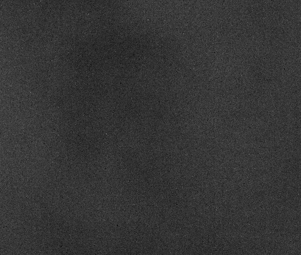
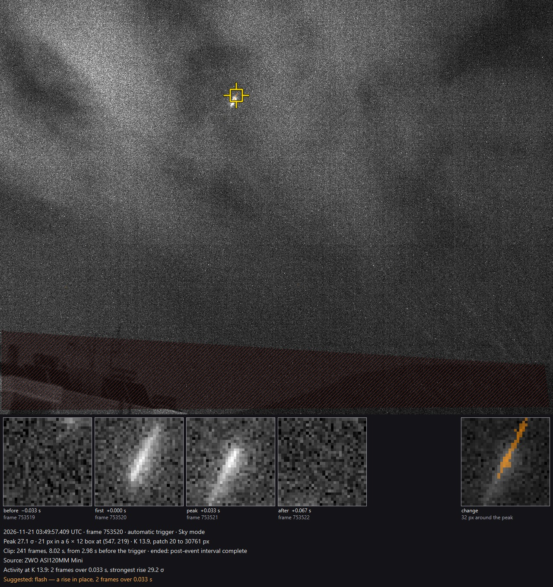
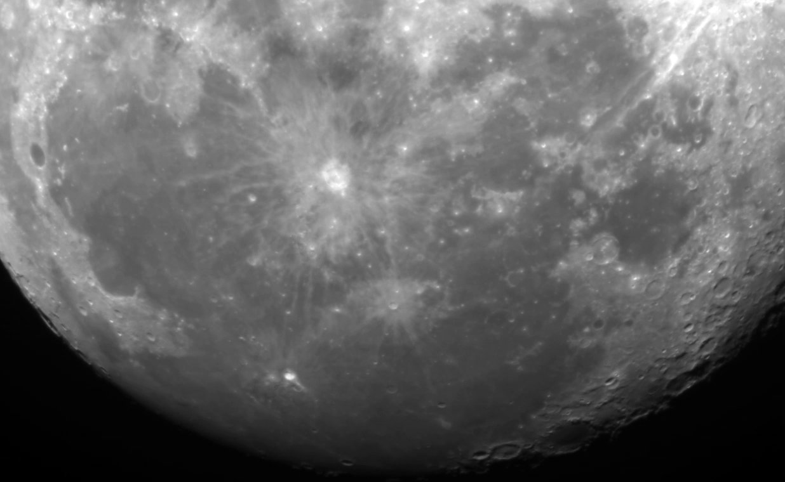
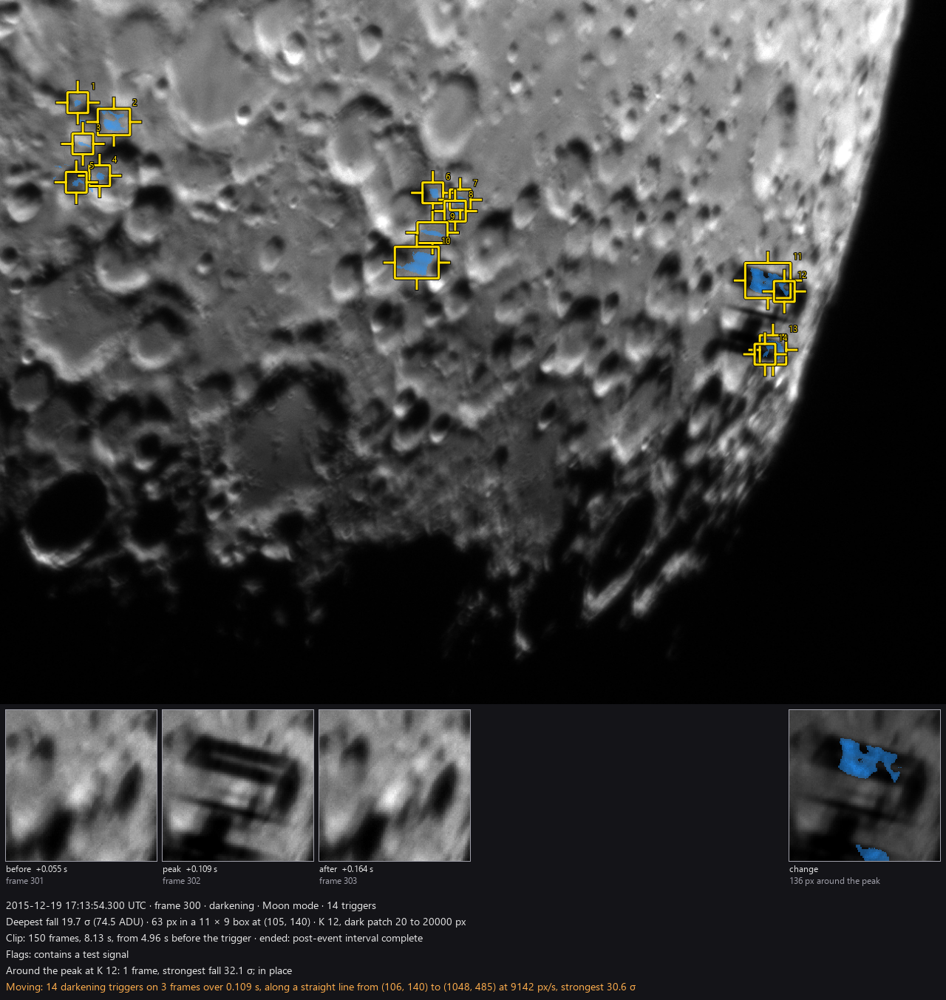
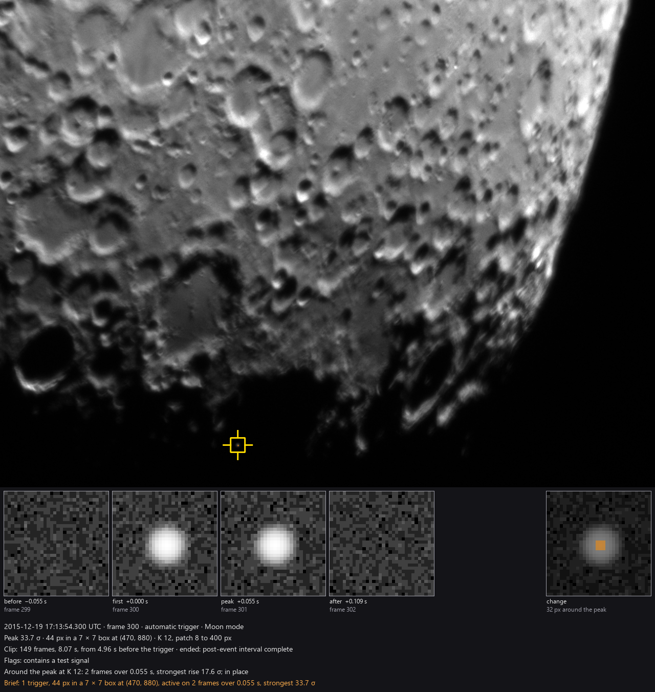

# SeleneWatch

SeleneWatch watches the stream of a camera, on a telescope or on a fixed lens pointed at the sky, and keeps the moments when something changes. It saves those moments as lossless video, with the frames from just before and after, the exact times, and a picture of what changed. It also makes time-lapses of the Moon and the planets.

It runs on Windows and works with ZWO, QHYCCD, Player One and ToupTek cameras, or with your own SER and AVI recordings.

> **What SeleneWatch saves are candidates, not discoveries.** A clip shows that something changed in the frame. What it was is for you to judge, and a lunar impact flash is normally confirmed only when another observer recorded it too.

---

## What you can do with it

### 1. Watch the sky through the night

Point a camera at the sky, start Monitoring, and go to bed. SeleneWatch compares every frame with what it has learned the sky looks like, and saves a clip whenever something appears: meteors, lightning, aircraft, satellites, or anything else that happened where the camera was pointing.

There are two ways to watch:
- **Fast events**, with exposures up to 40 ms: meteors, lightning and anything that moves, with its path frame by frame.
- **Slow and faint**, with exposures up to 2 seconds: faint light that lasts, such as aurora or airglow, with a time-lapse of the whole night beside it.

In the morning, a report lists the night's events. It groups them by what was measured, not by guesses: **brief** (everything in one place within a fifth of a second, such as a meteor), **moving** (along a straight line, such as an aircraft), **wide** (a large part of the sky at once, such as lightning) and **other**. A long aircraft crossing saved as several clips is shown as one event. Each event shows its frames, plays its animation, and opens the original video in your SER player.

  

*A meteor caught automatically by a fixed camera (ZWO ASI120MM Mini) on 21 November 2026 at 03:49:57 UTC, played at its real speed.*

*The overview SeleneWatch saved with it: where in the frame it happened, the frames before, during and after, and what changed. The hatched area is a mask over the rooftops, where nothing is tested.*

*The report of the same night: 55 clips became 25 events, 12 of them brief (the meteor is one). The pictures are crops around each event, so its shape shows: several of the brief events are streaks.*

### 2. Time-lapses of the Moon and the planets

Shadows lengthen across lunar craters, Jupiter turns, its moons move. A time-lapse shows changes too slow to see at the eyepiece.

At a fixed interval, for example every minute, SeleneWatch captures a short burst of frames, keeps the sharpest, aligns and stacks them, and sharpens the result. At the end of the session it builds the video. A **feature lock** follows a crater or the planet's disk, and can guide your mount to keep it in the field for hours. A Moon time-lapse is aligned on a steady area you choose (the lunar anchor) rather than on the whole frame, where a passing cloud could turn the image; a planet is kept centred on its disk.

Every stack is kept as a 32-bit FITS file. Afterwards you can sharpen it again, drop blurred or cloudy stacks (by their sharpness, compared with the stacks around them), check every dropped stack, and rebuild the video, without capturing again.

*One stack of a Moon time-lapse, sharpened, from a session of 57 stacks taken a minute apart.*

### 3. Shadows crossing the Moon

Aircraft, the International Space Station and satellites pass in front of the sunlit Moon as dark silhouettes. A watch for shadows looks only for parts of the Moon that suddenly get darker, so the shimmer of the bright surface does not set it off. Unpredicted crossings are saved as they happen; for a predicted one, SeleneWatch can record every frame over a time you set in advance.

The feature lock and mount guiding keep the Moon in place. **Auto-tune** measures the sunlit Moon and suggests the exposure, the gain and the sensitivity. The session can end by itself: at a time, after a duration, or when the Moon sinks too low.

*Test data: an ISS silhouette at its real size and speed for a 9.25-inch telescope (0.33″ per pixel), added to a real lunar recording and saved by SeleneWatch as a crossing. No real transit was recorded here.*

### 4. Impact flashes on the Moon's dark side

Small meteoroids hit the Moon all the time. On the part of the Moon lit only faintly by the Earth (earthshine), a large enough impact shows as a flash lasting a few hundredths of a second. Watching for these **lunar impact flashes** is one of the ways amateurs contribute to the study of lunar transient phenomena.

SeleneWatch tests each pixel against its own noise, so a faint flash on the dark side is noticed, while the bright sunlit side and the glare beside it are left out. Auto-tune sets the camera for the faint earthshine and measures the faintest flash that would be caught, by adding a marked test flash to the real frames. Guiding and the automatic end of the session work as for shadows.

*Test data: a marked test flash added to the unlit part of the Moon, beyond the terminator, in a real recording, and the clip SeleneWatch saved, grouped as brief (K 12). No real impact was recorded here.*

---

## Also in SeleneWatch

- **Cameras:** ZWO ASI, QHYCCD, Player One, and ToupTek (with the brands whose cameras it makes, such as Altair). Recordings in SER and uncompressed AVI, with FireCapture's log files. A synthetic Moon and sky for practice without hardware.
- **Preview before you capture:** see the camera's real pixels at any zoom, set the stretch and the histogram, and see what would trigger, without saving anything.
- **Auto-tune:** measures the scene and suggests the exposure, gain and sensitivity for what you are watching.
- **Unattended nights:** the session ends by itself at a time, after a duration, at dawn or when the Moon sets, and also when the camera, the guiding or the disk fails. You choose whether the mount then keeps tracking.
- **Check on it from your phone:** a read-only status page on your home network, found by scanning a QR code: what SeleneWatch is doing, whether the lock holds, and this session's events.
- **Continuous and scheduled recording:** record every frame on demand, or over a time set in advance for a predicted event.
- **Lossless evidence:** every saved frame is kept exactly as the camera delivered it, with its time and index, and test signals are marked on every frame they touch.

---

## Getting SeleneWatch

Download the latest release from the [releases page](https://github.com/ppissias/SeleneWatch/releases). It comes as a Windows installer (per user, no administrator rights needed) or as a zip to run from any folder. Windows 10 or 11, 64-bit.

Install your camera maker's driver first. ZWO's library comes with SeleneWatch; for the other cameras SeleneWatch finds the maker's library on your computer. To guide a mount, install the [ASCOM Platform](https://ascom-standards.org/) and your mount's driver. The [user manual](MANUAL.md#11-installing-and-connecting-a-camera) has the details.

---

## How far it has been tested

- **In use:** the sky watch, all night with a ZWO ASI120MM Mini, catching meteors, aircraft and satellites; Moon time-lapses at the telescope.
- **Tested in software:** every feature, with automated tests, recordings from 2010 to 2019, and test signals added to real lunar recordings.
- **Waiting for real tests:** QHY, Player One and ToupTek cameras on hardware; a whole night of mount guiding under the Moon; an impact flash or a shadow caught at the telescope; a predicted ISS transit recorded on schedule.

The [user manual](MANUAL.md#11-what-has-been-tested) lists what has been tested, feature by feature.

---

## Documentation

| Document | For | What it covers |
| --- | --- | --- |
| [User manual](MANUAL.md) | Observers | Setting up, the four ways of observing, the report and the files, troubleshooting |
| [Camera settings guide](CAMERA_SETTINGS_GUIDE.md) | Observers | Exposure, gain and histogram for each kind of observing |
| [Developer guide](DEVELOPER.md) | Contributors | Building from source, tests, packaging |
| [Project description](PROJECT_DESCRIPTION.md) | Reviewers | The design and the rules that keep saved data trustworthy |
| [Third-party licenses](THIRD_PARTY_LICENSES.md) | Everyone | The libraries SeleneWatch uses and their licenses |
| [Acknowledgements](ACKNOWLEDGEMENTS.md) | Everyone | References, libraries and tools |

SeleneWatch is free software under the BSD 2-Clause license. It is written in C++ with Qt 6 and is at an early stage: observing reports and suggestions are welcome.
