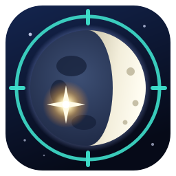

# SeleneWatch

**Continuous lunar monitoring and automatic capture of transient phenomena.**

SeleneWatch is a native Windows desktop application written in C++ and Qt 6 that monitors a live telescope camera stream—or recorded video—to detect brief, unexpected events and preserve lossless frames around them for later review.

Its primary purpose is helping observers capture **lunar transient phenomena**, especially brief meteoroid impact flashes on the Moon's night side (earthshine). It also handles lunar **transits** (satellites, the ISS, aircraft), **occultations**, and an optional **Sky** mode for wide-field meteors, fireballs, lightning, satellites, and aircraft.

> **Candidates, not discoveries.** Automatic detections are candidates for human review, not confirmed lunar events. Scientific confirmation of an impact flash normally requires an independent observation from another telescope or site. SeleneWatch preserves the frames, UTC timing, camera settings, and session records needed for that comparison.

**Using SeleneWatch:** See the [User Manual](MANUAL.md) for main screen orientation, camera and output setup, shared guiding, and step-by-step guides for the four observing workflows (lunar flashes, lunar transits/occultations, lunar and planetary time-lapses, and fixed-camera sky watching).


*Monitoring a lunar terminator recording (`Moon_181337.avi`): live preview, detection thresholds and 10-second sigma trace on the right, and native-ADU histogram below.*

---

## Quick start (60 seconds)

1. **Set your output folder & site once:** Open **Session → Output folder…** (choose a fast local SSD) and **Session → Site and instrument…** (save observer/site coordinates and telescope optics; keep several as named presets, for example home and a club field).
2. **Choose a source & start Preview:** Select your camera (**ZWO ASI**, **QHYCCD**, **Player One**, **ToupTek**), a **Recording file** (`.ser` or uncompressed `.avi`), or **Synthetic** (via **View → Testing tools**), then click **Start preview**.
3. **Frame, zoom & tune thresholds:** Use **Fit / 100% / 200%** or the mouse wheel (and right/middle-drag to pan) to inspect actual sensor pixels, adjust **Display and capture** stretch and **Histogram**, pick **Watching** (**The Moon** or **The sky**) in **Detection**, tune **Sensitivity K** above the 10-second seeing trace (or load a saved **Profile**), and optionally lock onto a crater in **Guiding**.
4. **Capture:**
   - Click **Start monitoring** for automatic flash, darkening/transit, or sky-event capture (plus on-demand **Save now**).
   - Click **Record** (unlimited or for a fixed frame count, or arm **Session → Schedule a recording…**) for continuous lossless SER video.
   - Or open **Time-lapse** and click **Start time-lapse** to stack the sharpest frames at a fixed cadence and build MP4/GIF animations of planetary rotation and changing lunar shadows.

---

## What SeleneWatch does

- **Monitor continuously across multiple sources** — acquire from **ZWO ASI**, **QHYCCD**, **Player One**, and **ToupTek** (and ToupTek-OEM) cameras, replay **SER** or uncompressed **AVI** recordings (in real time, fast, or looped), or rehearse indoors with built-in **synthetic** Moon and starry Sky scenes.
- **Tune and inspect at 1:1 pixel resolution before capturing** — run in **Preview** to focus, frame, zoom in smoothly with the mouse wheel or quick **Fit / 100% / 200%** controls (panning with right- or middle-drag), inspect the live native-ADU histogram, stretch the display for faint earthshine, and watch detector feedback (`Would trigger`) before arming **Monitoring**. Spin boxes, sliders, and closed dropdowns ignore stray mouse-wheel scrolls so parameters never drift accidentally while scrolling panels.
- **Auto-tune in Preview** — the **Auto-tune…** button opens a window that measures the earthshine (outlined on the preview from a box you draw), the sunlit Moon or the sky. **Tune camera** sets exposure and gain live, round by round, measuring after each change, until the brightness is in the target's aim; **Restore previous settings** undoes it. It then runs complete detectors at several K values on the same frames to suggest the lowest quiet K, which changes only when you apply it. Every change is logged.
- **Keep pre-event history in RAM** — maintain a time-sized ring buffer of shared, immutable frames under a configurable RAM ceiling so frames from *before* a trigger are saved alongside the event.
- **Detect flashes, transits, and sky events with named profiles** — analyse every frame per pixel against its own learned background and noise, with independent target modes and named **Detection profiles** for **The Moon** (impact flashes plus optional **darkening** triggers for silhouettes) and **The sky** (large brightenings, polygon horizon masks optionally saved with profiles, slow-drifter release, dusk-to-dawn scheduling, and sky-following exposure).
- **Preserve lossless evidence and fast review previews** — save native 8-, 12-, or 16-bit pixels untouched in **SER** clips (`event.ser`) with per-frame UTC timestamps, full sidecar metadata (`event.txt`), a session log (`candidates.txt`), annotated visual summaries (`00_overview.png`) with suggested classifications, and compact animated GIF previews (`04_event_preview.gif`, `≤ 10` frames, `≤ 512 KiB`) for both lunar and sky clips.
- **Capture manually or on schedule** — trigger an on-demand clip with **Save now**, record continuously to SER in **Preview** or **Monitoring** with **Record** (unlimited or for a chosen frame count), or schedule predicted events by UTC start and duration without silently dropping frames.
- **End an unattended night by itself** — **Ends**, above the preview, stops Monitoring or a time-lapse at a local time, after a duration, at dawn, or when the Moon sinks below an altitude, whichever comes first. Guiding that is lost, a camera that fails and a full disk end it too. With a mount connected, you choose whether it then keeps tracking or stops tracking.
- **Build lunar & planetary time-lapses** — watch planets turn and lunar shadows unfold in animations from your observing sessions. **Time-lapse** captures bursts at a fixed cadence (up to 100–200 best frames kept per period, processed in parallel with overload skip protection and disk-reserve stop-and-build safety), writes linear 32-bit float FITS stacks (`stacks/`, `sharpened/`), assembles `timelapse.mp4` / `timelapse.gif`, and offers non-destructive **Re-sharpen time-lapse…** with saved profiles and fast **Rebuild video only**.
- **Review a monitoring session** — each Moon or Sky watch has a `session-<UTC start>` folder with its clips, journal and continuous recordings. Choose **Open nightly report** after the writers finish, or later **Session → Open last nightly report**. The offline page shows monitored intervals, trigger outcomes and a chronological contact sheet linked to the original evidence.
- **Organise outputs safely** — keep `events/moon/`, `events/sky/`, `recordings/`, and `timelapses/` under one remembered output folder (**Session → Output folder…**) with missing-drive/cloud-sync safety checks and one-click in-place folder recreation if a directory was removed during Preview.
- **Measure sensitivity directly across event kinds** — inject calibrated **Test flash** signals (**Bright flash**, **Dark transit**, **Moving streak (meteor)**, **Blinking mover (aircraft)**, or **Lightning**) onto live or recorded streams to verify recovery limits; every affected frame and clip is explicitly marked as test data.
- **Hold the field gently** — lock onto a lunar feature to track drift, and optionally guide an **ASCOM** mount with small, bounded, logged guide pulses so monitoring stays on target without slewing or syncing the telescope.
- **Notice new releases** — once at startup, check GitHub for a newer stable release. A **New version … available** button appears at the top right; click it to open the [releases page](https://github.com/ppissias/SeleneWatch/releases). Offline and failed checks stay quiet.

---

## How it works

```text
Synthetic source / Recording (SER, AVI) / Cameras (ZWO, QHY, Player One, ToupTek)
                                  |
                           Frame acquisition
                     (a published frame is read-only
                      and shared, never copied)
                                  |
                  +---------------+---------------+
                  |                               |
           RAM ring buffer                 Event detection
           (recent raw frames)        (on every frame, always)
                  |                               |
                  +---------------+---------------+
                                  |
                           Event capture
                                  |
                  Pre- and post-event frames
                      + metadata + overview
                                  |
                     Writer (separate thread)
                                  |
   <output folder>/{events/, recordings/, timelapses/}

            Qt GUI: live preview with stretch, histogram,
                    controls, and status readouts

            Guide thread: feature lock, drift readout,
                    and bounded ASCOM guide pulses
```

Acquisition never waits on the disk, the GUI, or the mount. The preview and the guider may skip frames; detection and recording may not.

---

## Evidence principles

SeleneWatch follows strict evidence rules so saved clips remain reliable observational records:

- **Raw pixels stay untouched** between the source and the evidence file; display stretch, inversion, and debayering happen only on screen.
- **Native bit depths are preserved** lossless in SER files (8-bit or 16-bit words, with delivered sample layout recorded separately from advertised sensor ADC depth).
- **Every frame keeps its index and UTC time**, with dropped-frame gaps recorded.
- **Detection never goes blind** while clips collect or write; every candidate during Monitoring is logged even if disk reserve or writer backlog prevents saving its clip.
- **Test injections are explicitly marked** per frame and per clip, and finished clips are never rewritten.
- **Telescope motion is strictly bounded** to logged guide pulses; SeleneWatch never slews, syncs, parks, or alters mount tracking.

---

## Installing and running

Windows 64-bit releases are distributed in two forms:

- **`SeleneWatch-<version>-win64.msi`** — installs per user (no administrator rights needed) under `%LOCALAPPDATA%\SeleneWatch` with a Start-menu entry; saved data under your chosen output folder (`%USERPROFILE%\SeleneWatch` by default) is kept untouched on upgrades and uninstall.
- **`SeleneWatch-<version>-win64.zip`** — portable archive; unpack into a writable folder and run `SeleneWatch.exe`.

Install your camera vendor's Windows driver before connecting a camera. ZWO's SDK library ships with SeleneWatch; for QHYCCD, Player One, and ToupTek, SeleneWatch automatically discovers the vendor's x64 SDK DLL installed on your system (or lets you pick it in **Session → Camera support…**). See [User Manual §2](MANUAL.md#2-common-setup--connecting-a-source) for exact driver, DLL, and optional ASCOM Platform setup.

---

## Scope and current status

**In scope:** multi-vendor image acquisition, candidate detection, RAM buffering, lossless event and manual/scheduled continuous recording, lunar and planetary time-lapses (FITS stacking, linear sharpening, MP4/GIF assembly, and re-sharpening), visual clip overviews, sensitivity test injection, and keeping the Moon centred via feature lock and bounded ASCOM guide pulses.

**Not in scope:** pointing the telescope. SeleneWatch does not slew, sync, park, or turn mount tracking on; the observer centres the target, and guiding only holds it there. The one exception: when a session ends by itself, it stops the mount's tracking if you chose so.

**Current maturity:**

- **Working in software & automated checks:** the core pipeline, shared memory budget, SER/AVI playback, SER evidence and manual/scheduled continuous writers, Moon flash/darkening detection, Sky mode (masks, auto exposure), the end of a session (local time, duration, dawn, Moon altitude, lost guiding), single output folder management, lunar and planetary Time-lapse mode (CFITSIO 32-bit float FITS, OpenCV stacking/alignment, FFmpeg MP4/GIF, Re-sharpen dialog), `00_overview.png` summaries, `04_event_preview.gif` event previews, test-flash injection, feature lock, simulated/ASCOM guiding, and ZWO, QHY, Player One, and ToupTek adapters.
- **Verified on bench & all-night fixed-camera field use:** ZWO ASI120MM Mini (RAW8/RAW16 controls, byte integrity, two 30-minute unattended soak runs, and all-night fixed-camera **Sky** patrols capturing meteors/streaks, aircraft, cosmic rays, and flashes), plus ASCOM simulator guiding checks.
- **Pending live field & hardware checks:** physical QHY, Player One, and ToupTek camera validation; real mount guiding under the Moon; and real earthshine/transit calibration.
- **Planned next:** additional camera families, frame registration, transit tracking, and an in-app event browser/exporter.

Detailed test coverage and validation status are tracked in [User Manual §10](MANUAL.md#10-what-has-been-tested).

---

## Documentation map

SeleneWatch is written in **C++20** with **Qt 6 Widgets** (dynamically linked under LGPLv3), keeping its processing core independent of Qt UI classes. The architecture is a working design expected to evolve as field testing progresses; only the evidence rules require an explicit recorded decision to change.

| Document | Audience | Contents |
| --- | --- | --- |
| [MANUAL.md](MANUAL.md) | Observers | Installation, cameras, controls, detection, guiding, outputs, troubleshooting *(included in releases)* |
| [CAMERA_SETTINGS_GUIDE.md](CAMERA_SETTINGS_GUIDE.md) | Observers | Recommended exposure, gain, offset, and histogram levels for lunar earthshine flashes (3–10 % rule), sunlit transits, lunar and planetary time-lapses, and sky patrols *(included in releases)* |
| [DEVELOPER.md](DEVELOPER.md) | Contributors & maintainers | Building with Visual Studio/CMake/Qt 6, camera SDK options, CTest, probes, release packaging *(source repository)* |
| [PROJECT_DESCRIPTION.md](PROJECT_DESCRIPTION.md) | Architects & reviewers | Project vision, evidence rules, time model, threading/ownership, SER contract, development stages *(source repository)* |
| [THIRD_PARTY_LICENSES.md](THIRD_PARTY_LICENSES.md) | Users & packagers | Dependency versions, licenses, and binary redistribution obligations *(included in releases)* |
| [ACKNOWLEDGEMENTS.md](ACKNOWLEDGEMENTS.md) | Everyone | Scientific references, libraries, and tools *(also shown under **Help → Acknowledgements**)* |
| [features.md](features.md) & [implemented features.md](implemented%20features.md) | Contributors | Feature specifications, design rationales, validation records, and history *(source repository)* |

---

*SeleneWatch is an early-stage project. Feedback, observing tests, and design revisions are part of the development process.*
