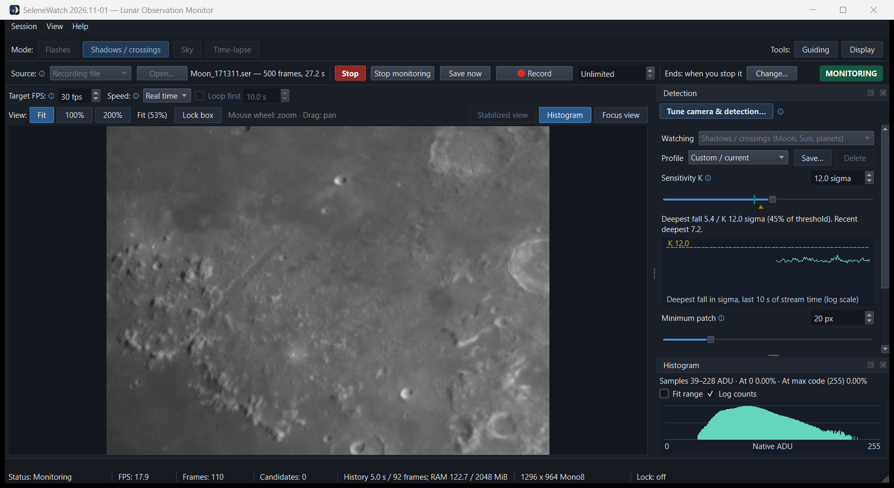
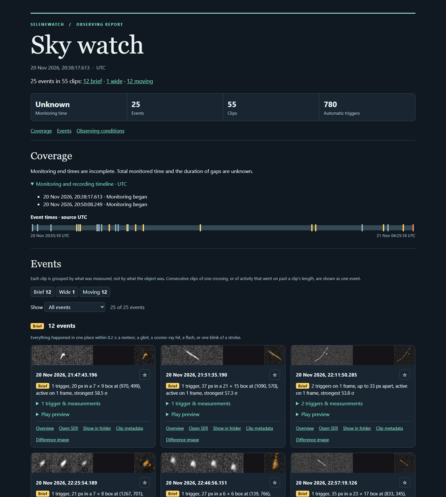
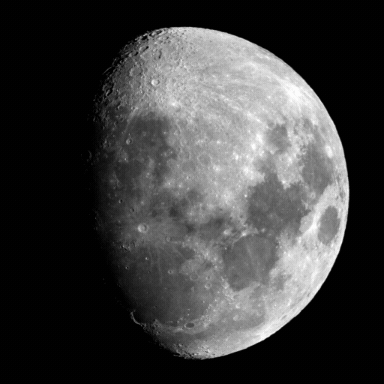
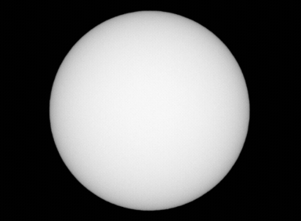
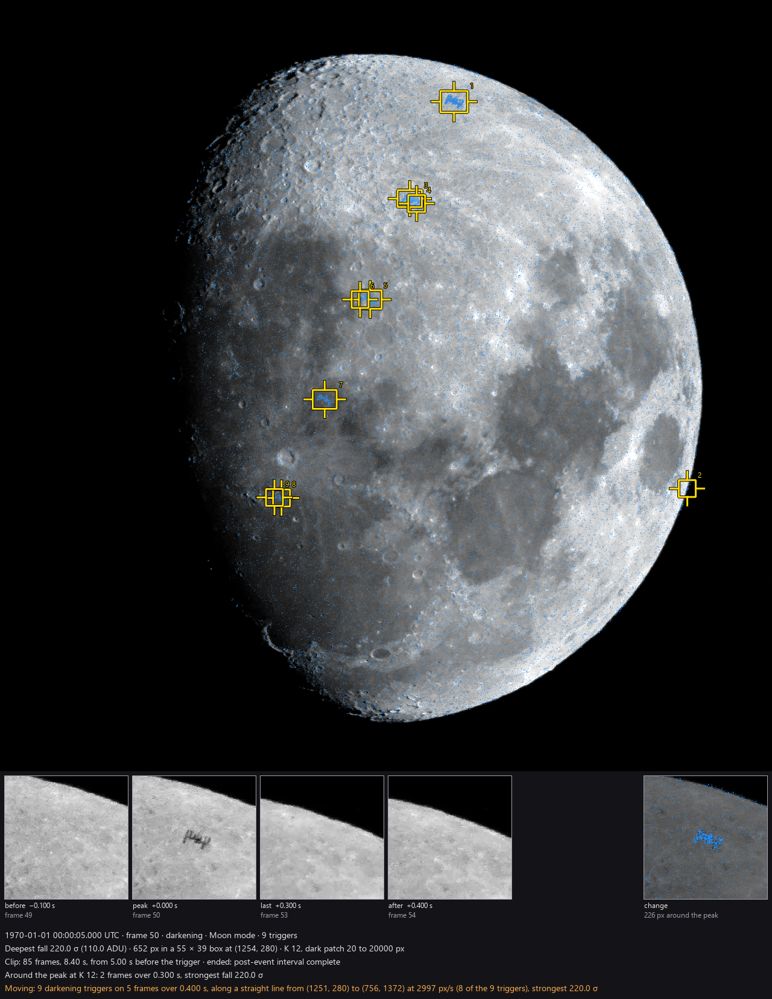
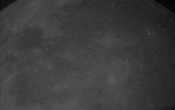
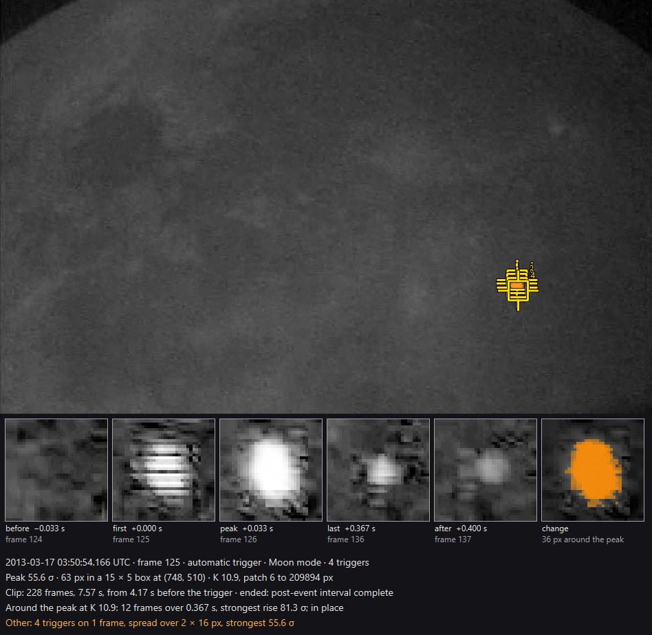
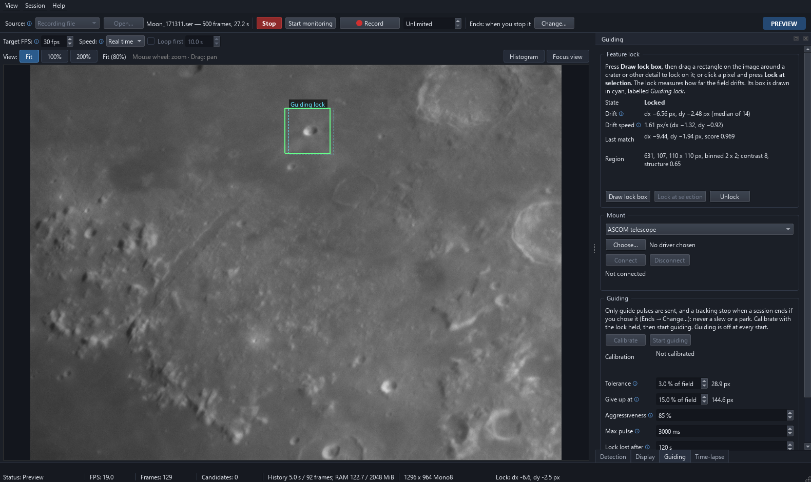

# SeleneWatch

### Watch the sky, Moon and planets. From split-second flashes to all-night time-lapses.
SeleneWatch watches the stream of a camera, on a telescope or on a fixed lens pointed at the sky, and keeps the moments when something changes. It saves those moments as lossless video, with the frames from just before and after, the exact times, and a picture of what changed. It also makes time-lapses of the Moon and the planets, and can lock directly onto a lunar crater or planetary disk to guide your ASCOM mount through the main camera—no guide scope or guide star required.

It runs on Windows and works with ZWO, QHYCCD, Player One and ToupTek cameras, or with your own SER and AVI recordings.

[Download releases](https://github.com/ppissias/SeleneWatch/releases) · [Website](https://startales.eu/SeleneWatch/) · [User manual](MANUAL.md) · [Camera settings guide](CAMERA_SETTINGS_GUIDE.md)

> **What SeleneWatch saves are candidates, not discoveries.** A clip shows that something changed in the frame. What it was is for you to judge, and a lunar impact flash is normally confirmed only when another observer recorded it too.

## Start here

- [What you can do with it](#what-you-can-do-with-it) ([Sky](#1-watch-the-sky-through-the-night) · [Time-lapses](#2-time-lapses-of-the-moon-and-the-planets) · [Lunar shadows](#3-shadows-crossing-the-moon) · [Impact flashes](#4-impact-flashes-on-the-moons-dark-side))
- [Surface-feature and planetary guiding](#surface-feature-and-planetary-guiding)
- [Status on your phone](#status-on-your-phone)
- [Also in SeleneWatch](#also-in-selenewatch)
- [Getting SeleneWatch](#getting-selenewatch)
- [How far it has been tested](#how-far-it-has-been-tested)
- [Documentation](#documentation)
- [Acknowledgements](#acknowledgements)

---

## What you can do with it

### 1. Watch the sky through the night

Point a camera at the sky, start Monitoring, and go to bed. SeleneWatch compares every frame with what it has learned the sky looks like, and saves a clip whenever something appears: meteors, lightning, aircraft, satellites, or anything else that happened where the camera was pointing.

There are two ways to watch:
- **Fast events**, with exposures up to 40 ms: meteors, lightning and anything that moves, with its path frame by frame.
- **Slow and faint**, with exposures up to 2 seconds: faint light that lasts, such as aurora or airglow, with a time-lapse of the whole night beside it.

In the morning, a report lists the night's events. It groups them by what was measured, not by guesses: **brief** (everything in one place within a fifth of a second, such as a meteor), **moving** (along a straight line, such as an aircraft), **wide** (a large part of the sky at once, such as lightning) and **other**. A long aircraft crossing saved as several clips is shown as one event. Each event shows its frames, plays its animation, and opens the original video in your SER player.

  

*A meteor caught automatically by a fixed camera (ZWO ASI120MM Mini) on 21 November 2026 at 03:49:57 UTC, played at its real speed.*

*The overview SeleneWatch saved with it: where in the frame it happened, the frames before, during and after, and what changed. The hatched area is a mask over the rooftops, where nothing is tested.*

*The report of the same night: 55 clips became 25 events, 12 of them brief (the meteor is one). The pictures are crops around each event, so its shape shows: several of the brief events are streaks.*

### 2. Time-lapses of the Moon and the planets

Shadows lengthen across lunar craters, Jupiter turns, its moons move. A time-lapse shows changes too slow to see at the eyepiece.

At a fixed interval, for example every minute, SeleneWatch captures a short burst of frames, keeps the sharpest, aligns and stacks them, and sharpens the result. At the end of the session it builds the video. A **feature lock** follows a crater or the planet's disk, and can guide your mount to keep it in the field for hours. A Moon time-lapse is aligned on a steady area you choose (the lunar anchor) rather than on the whole frame, where a passing cloud could turn the image; a planet is kept centred on its disk.

Every stack is kept as a 32-bit FITS file. Afterwards you can sharpen it again, drop blurred or cloudy stacks (by their sharpness, compared with the stacks around them), check every dropped stack, and rebuild the video, without capturing again.

*One stack of a Moon time-lapse, sharpened, from a session of 57 stacks taken a minute apart.*

### 3. Shadows crossing the Moon

Aircraft, the International Space Station and satellites pass in front of the sunlit Moon as dark silhouettes. A watch for shadows looks only for parts of the Moon that suddenly get darker, so the shimmer of the bright surface does not set it off. Unpredicted crossings are saved as they happen; for a predicted one, SeleneWatch can record every frame over a time you set in advance.

The feature lock and mount guiding keep the Moon in place. **Auto-tune** measures the sunlit Moon and suggests the exposure, the gain and the sensitivity. The session can end by itself: at a time, after a duration, or when the Moon sinks too low.

  
  &nbsp;&nbsp;
  

*Sample data: animated clip previews (`04_event_preview.gif`) saved automatically by SeleneWatch for public-domain NASA lunar (left, 16 March 2019, `NHQ201903160004`) and solar (right, 24 June 2020, `NHQ202006240004`) ISS transit sequences (credit: NASA / Joel Kowsky).*

*Sample data: the overview SeleneWatch saved for the same public-domain NASA lunar ISS transit sequence (credit: NASA / Joel Kowsky, `NHQ201903160004`), replayed through the shadows watch at its default K 12 with a one-frame trigger. SeleneWatch detected all five crossing frames in a straight line (grouped as **Moving**, 220 σ deepest fall) and centred the crop strip on the ISS silhouette. The [user manual](MANUAL.md#4-shadows-crossing-the-moon) also shows the solar ISS transit overview and a test-signal run.*

### 4. Impact flashes on the Moon's dark side

Small meteoroids hit the Moon all the time. On the part of the Moon lit only faintly by the Earth (earthshine), a large enough impact shows as a flash lasting a few hundredths of a second. Watching for these **lunar impact flashes** is one of the ways amateurs contribute to the study of lunar transient phenomena.

SeleneWatch tests each pixel against its own noise, so a faint flash on the dark side is noticed, while the bright sunlit side and the glare beside it are left out. Auto-tune sets the camera for the faint earthshine and measures the faintest flash that would be caught, by adding a marked test flash to the real frames. Guiding and the automatic end of the session work as for shadows.

  

*Sample data: animated clip preview (`04_event_preview.gif`) saved automatically by SeleneWatch for the 17 March 2013 Mare Imbrium lunar impact flash recorded by NASA's Marshall Space Flight Center (Meteoroid Environment Office) and published by NASA's Goddard Space Flight Center (`SVS 11806`, public domain).*

*Sample data: the overview SeleneWatch saved for the same 17 March 2013 Mare Imbrium lunar impact flash (credit: NASA MSFC / NASA GSFC, `SVS 11806`, public domain). SeleneWatch detected the onset, tracked the flash across 12 frames (0.37 s, strongest rise 81.3 σ) in place, and built the crop strip showing the rise and cooling decay. The [user manual](MANUAL.md#5-impact-flashes-on-the-moons-dark-side) also shows a marked test-flash run.*

---

## Surface-feature and planetary guiding

Keeping a lunar region or a planet centred for hours usually fails with standard star guiders—there are no guide stars on the Moon, and the Moon moves at its own rate against the stars. SeleneWatch guides directly on the main camera's live stream instead.

Draw a box around a crisp lunar crater, terminator detail, or a planet's disk, and SeleneWatch tracks its drift to sub-pixel precision in real time. Once calibrated against your [ASCOM](https://ascom-standards.org/) mount, it sends **guide pulses only** (never slews, parks, or unexpected tracking changes) to hold the feature steady through time-lapses, shadow-transit watches, impact-flash runs, or long continuous recordings. If clouds break the lock, guiding pauses and waits through a grace period before ending safely; you can also watch live drift speed along RA and Dec to refine polar alignment.

*Feature lock tracking a sunlit lunar crater on a real recording: the dashed cyan box marks the reference position, the solid green box follows the crater as the field drifts, and the Guiding panel reports sub-pixel drift, drift speed, match quality, and ASCOM pulse-guiding controls.*

---

## Status on your phone

Leaving the telescope running outside while you step indoors? Turn on **Session → Status on your phone…** and scan the QR code to open a read-only status page on your local home network—no cloud account, no port forwarding, protected by a session key, and off by default.

From your phone's browser you can check what SeleneWatch is doing (Monitoring, Preview, or Time-lapse), when the session is scheduled to end, whether the feature lock and guiding hold, live frame rate and free disk space, the latest saved clip's crops, and a live preview snapshot.

  

*The read-only status page on a phone (shown here with sample data): live session state, scheduled end time, event counts with the latest clip's crops, guiding lock, camera and disk health, and a live preview.*

---

## Also in SeleneWatch

- **Cameras:** ZWO ASI, QHYCCD, Player One, and ToupTek (with the brands whose cameras it makes, such as Altair). Recordings in SER and uncompressed AVI, with FireCapture's log files. A synthetic Moon and sky for practice without hardware.
- **Preview before you capture:** see the camera's real pixels at any zoom, set the stretch and the histogram, and see what would trigger, without saving anything.
- **Auto-tune:** measures the scene and suggests the exposure, gain and sensitivity for what you are watching.
- **Unattended nights:** the session ends by itself at a time, after a duration, at dawn or when the Moon sets, and also when the camera, the guiding or the disk fails. You choose whether the mount then keeps tracking.
- **Continuous and scheduled recording:** record every frame on demand, or over a time set in advance for a predicted event.
- **Lossless evidence:** every saved frame is kept exactly as the camera delivered it, with its time and index, and test signals are marked on every frame they touch.

---

## Getting SeleneWatch

Download the latest release from the [releases page](https://github.com/ppissias/SeleneWatch/releases). It comes as a Windows installer (per user, no administrator rights needed) or as a zip to run from any folder. Windows 10 or 11, 64-bit.

Install your camera maker's driver first. ZWO's library comes with SeleneWatch; for the other cameras SeleneWatch finds the maker's library on your computer. To guide a mount, install the [ASCOM Platform](https://ascom-standards.org/) and your mount's driver. The [user manual](MANUAL.md#11-installing-and-connecting-a-camera) has the details.

---

## How far it has been tested

- **In use:** the sky watch, all night with a ZWO ASI120MM Mini, catching meteors, aircraft and satellites; Moon time-lapses at the telescope.
- **Tested in software:** every feature, with automated tests, recordings from 2010 to 2019, public-domain NASA sequences (lunar and solar ISS transits at K 12, and NASA MSFC's 17 March 2013 lunar impact flash recording), and test signals added to real lunar recordings.
- **Waiting for real tests:** QHY, Player One and ToupTek cameras on hardware; a whole night of mount guiding under the Moon; an impact flash or a shadow caught at the telescope; a predicted ISS transit recorded on schedule.

The [user manual](MANUAL.md#11-what-has-been-tested) lists what has been tested, feature by feature.

---

## Documentation

| Document | For | What it covers |
| --- | --- | --- |
| [User manual](MANUAL.md) | Observers | Setting up, the four ways of observing, the report and the files, troubleshooting |
| [Camera settings guide](CAMERA_SETTINGS_GUIDE.md) | Observers | Exposure, gain and histogram for each kind of observing |
| [Developer guide](DEVELOPER.md) | Contributors | Building from source, tests, packaging |
| [Project description](PROJECT_DESCRIPTION.md) | Reviewers | The design and the rules that keep saved data trustworthy |
| [Third-party licenses](THIRD_PARTY_LICENSES.md) | Everyone | The libraries SeleneWatch uses and their licenses |

---

## Acknowledgements

### Software & Utilities

#### Open Source Software & Libraries

SeleneWatch is built with the following open-source libraries and components (license details in [THIRD_PARTY_LICENSES.md](THIRD_PARTY_LICENSES.md)):

- **Qt 6** by The Qt Company and contributors ([qt.io](https://www.qt.io)) — desktop interface, images, networking and threads, dynamically linked under the GNU LGPL v3.
- **OpenCV** by the OpenCV team ([opencv.org](https://opencv.org)) — edge-aware debayering, phase-correlation burst alignment, rigid Euclidean/ECC lunar alignment, Lanczos resampling, bilateral pre-denoise and linear unsharp masking, under the Apache License 2.0.
- **CFITSIO** by NASA/GSFC HEASARC ([heasarc.gsfc.nasa.gov/fitsio](https://heasarc.gsfc.nasa.gov/fitsio/)) — reading and writing linear 32-bit floating-point FITS stacks with astronomy metadata headers.
- **FFmpeg** by the FFmpeg developers ([ffmpeg.org](https://ffmpeg.org)) — external LGPLv3 shared build (`win64-lgpl-shared`, with `libopenh264`) for encoding MP4, palette-optimized GIF time-lapses and compact event clip previews.
- **QR Code generator library** by Project Nayuki ([nayuki.io](https://www.nayuki.io/page/qr-code-generator-library)) — generates the QR code for **Session → Status on your phone**, under the MIT License.

#### Camera & Mount Software

- Camera SDKs for **ZWO**, **QHYCCD**, **Player One** and **ToupTek** cameras, and the **[ASCOM Platform](https://ascom-standards.org/)** for mount guiding. SeleneWatch ships ZWO's library; the others are installed separately by the observer.

#### Development & Packaging

[CMake](https://cmake.org/) and [Ninja](https://ninja-build.org/) build the application; **Qt Test** and **CTest** run the automated suites; CPack and [WiX Toolset 3](https://wixtoolset.org/) create the Windows `.msi` installer and `.zip` archive.

#### AI Coding Assistants

The development of SeleneWatch has been supported by these AI coding assistants:

-  **Claude** by Anthropic ([Claude](https://www.anthropic.com/claude))
-  **Codex** by OpenAI ([Codex](https://openai.com/codex/))
-  **Gemini** by Google ([Gemini](https://gemini.google.com/))
-  **Grok** by xAI ([Grok](https://x.ai/grok))

Logos are trademarks of their respective owners.

### Scientific References & Algorithms

References for established methods, standards and interfaces implemented directly in SeleneWatch's own code (algorithms and formats supplied by libraries such as OpenCV and CFITSIO are credited through those libraries above). Each entry identifies its contribution; related literature is omitted unless it supplies an additional method used here. The same credits are available inside the application via **Help → Acknowledgements**.

#### Detecting changes in the image

- **Wren, Azarbayejani, Darrell & Pentland (1997)** — *Pfinder: Real-Time Tracking of the Human Body*, [IEEE TPAMI 19(7), 780–785](https://doi.org/10.1109/34.598236). Per-pixel running Gaussian background model in `FlashDetector` and `clip_overview`, with an exponential time constant in seconds and firing-pixel hold-out.
- **Hampel (1974)** — *The Influence Curve and Its Role in Robust Estimation*, [JASA 69(346), 383–393](https://doi.org/10.1080/01621459.1974.10482962). Robust MAD × 1.4826 scale estimator for the noise floor in `FlashDetector`, structured-scene pixel noise in `FeatureLock`, and residual scale in time-lapse brightness levelling (`stack_processor`).
- **Welford (1962)** — *Note on a Method for Calculating Corrected Sums of Squares and Products*, [Technometrics 4(3), 419–420](https://doi.org/10.1080/00401706.1962.10490022). One-pass running mean and variance in `FrameTimingMeter` and `auto_tune`.

#### Keeping the field (feature lock & guiding)

- **Lewis (1995)** — *Fast Normalized Cross-Correlation*, Vision Interface 1995 ([author's expanded version](https://www.scribblethink.org/Work/nvisionInterface/nip.html)). Direct zero-mean normalised cross-correlation with parabolic sub-pixel peak fitting in `FeatureLock`.
- **Immerkær (1996)** — *Fast Noise Variance Estimation*, [CVIU 64(2), 300–302](https://doi.org/10.1006/cviu.1996.0060). The 3×3 second-difference operator (factor 6), paired with Hampel's MAD × 1.4826 scale, in `FeatureLock::pixelNoise`.

#### Time-lapse brightness levelling

- **Huber (1964)** — *Robust Estimation of a Location Parameter*, [Ann. Math. Statist. 35(1), 73–101](https://doi.org/10.1214/aoms/1177703732). Huber-reweighted iteratively reweighted least squares (IRLS) implemented in `stack_processor` to fit affine brightness levelling between aligned time-lapse stacks without cloud-edge bias.

#### Sun and Moon positions

- **Meeus (1998)** — [*Astronomical Algorithms*, 2nd ed.](https://shopatsky.com/products/astronomical-algorithms-2nd-edition), Willmann-Bell. Through NOAA's Solar Calculator ([calculation details](https://gml.noaa.gov/grad/solcalc/calcdetails.html)) for `sunAltitudeDegrees`, and the Greenwich Mean Sidereal Time expression in `moonAltitudeDegrees`.
- **The Astronomical Almanac** (USNO / HMNAO), *Low-Precision Formulae for Geocentric Coordinates of the Moon* — adapted from **Van Flandern & Pulkkinen (1979)**, [ApJS 41, 391–411](https://doi.org/10.1086/190623). Geocentric lunar series with topocentric parallax correction in `moonAltitudeDegrees`.
- **Reda & Andreas (2004)** — [Solar Energy 76(5), 577–589](https://doi.org/10.1016/j.solener.2003.12.003), and **NASA JPL Horizons** ([ssd.jpl.nasa.gov/horizons](https://ssd.jpl.nasa.gov/horizons/)). Published reference values used only in the automated altitude tests (neither algorithm/service is invoked at run time).

#### Formats, protocols & interfaces

- **SER v3** — Heiko Wilkens & Grischa Hahn ([specification](https://www.grischa-hahn.homepage.t-online.de/astro/ser/SER%20Doc%20V3b.pdf)) (`SerReader` / `SerWriter`).
- **NTPv4** — Mills et al. (2010), [RFC 5905](https://datatracker.ietf.org/doc/html/rfc5905) (`clock_check`).
- **ASCOM Telescope interface** ([ascom-standards.org](https://ascom-standards.org/)) (`ascom_mount`) and **FireCapture** `.txt` capture logs by Torsten Edelmann ([firecapture.de](https://www.firecapture.de/)) (`firecapture_log`).

#### Sample Astronomical Imagery & Data

- **NASA / Joel Kowsky** (NASA Headquarters) — public-domain International Space Station lunar transit sequence (16 March 2019, `NHQ201903160004`, [Wikimedia Commons](https://commons.wikimedia.org/wiki/File:ISS_Lunar_Transit_(NHQ201903160004).webm)) and solar transit sequence (24 June 2020, `NHQ202006240004`, [Wikimedia Commons](https://commons.wikimedia.org/wiki/File:ISS_Solar_Transit_(NHQ202006240004).webm)), replayed as sample data to verify and illustrate SeleneWatch's shadows watch.
- **NASA's Marshall Space Flight Center (Meteoroid Environment Office) & NASA's Goddard Space Flight Center (Scientific Visualization Studio)** — public-domain 17 March 2013 Mare Imbrium lunar impact flash telescope recording (`SVS 11806`, [svs.gsfc.nasa.gov/11806](https://svs.gsfc.nasa.gov/11806)), replayed as sample data to verify and illustrate SeleneWatch's lunar impact flashes watch.

Use of NASA imagery does not imply endorsement by NASA.

---

SeleneWatch is free software under the BSD 2-Clause license. It is written in C++ with Qt 6 and is at an early stage: observing reports and suggestions are welcome.
